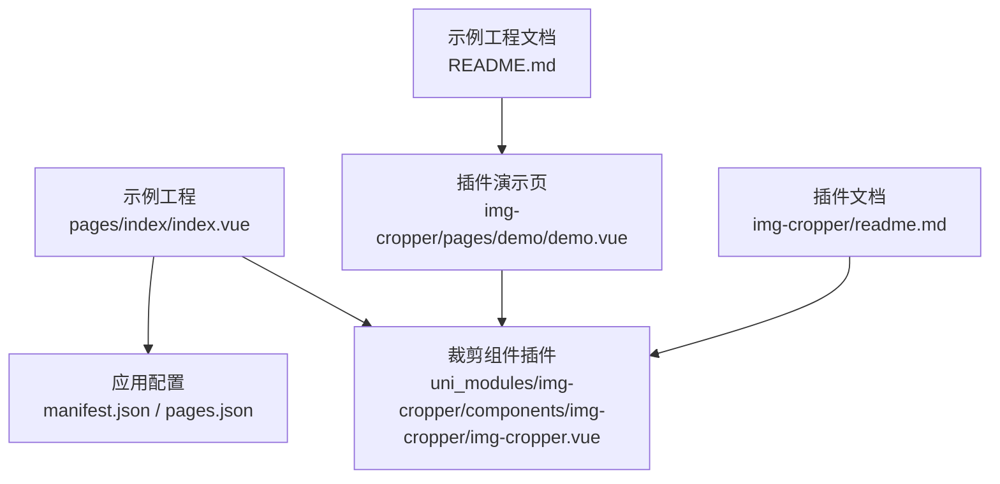
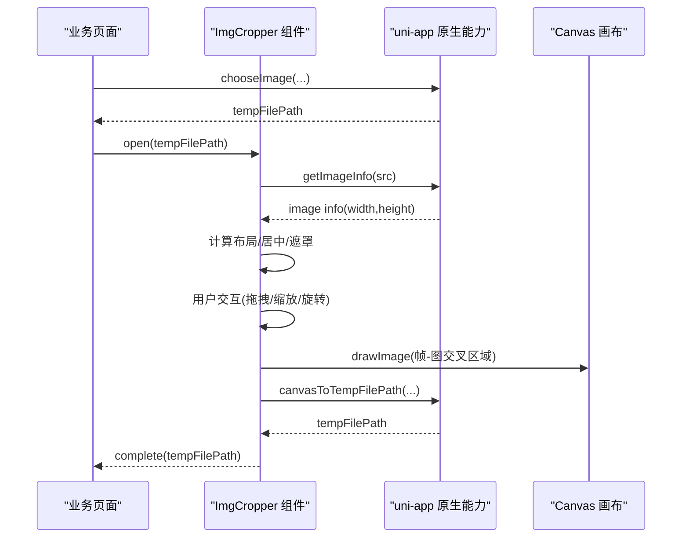
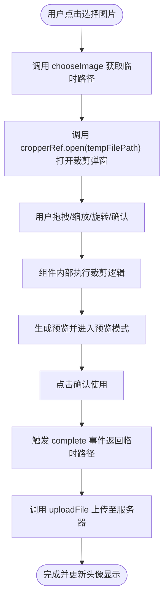
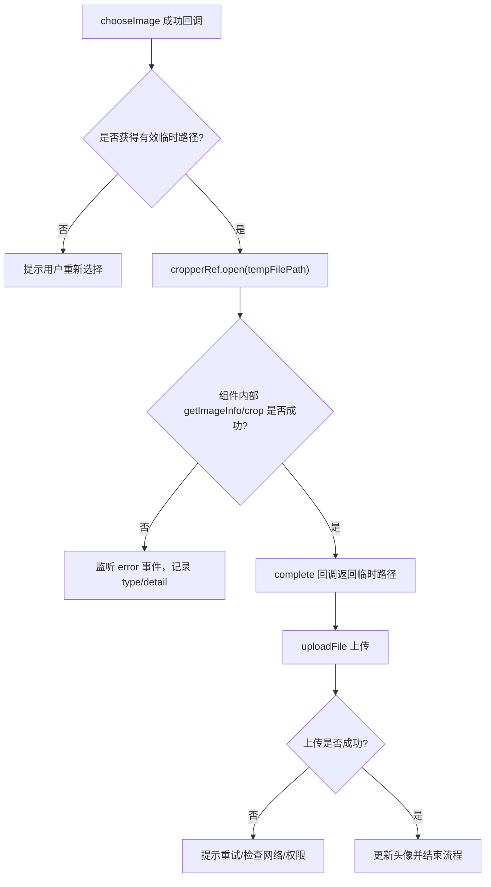
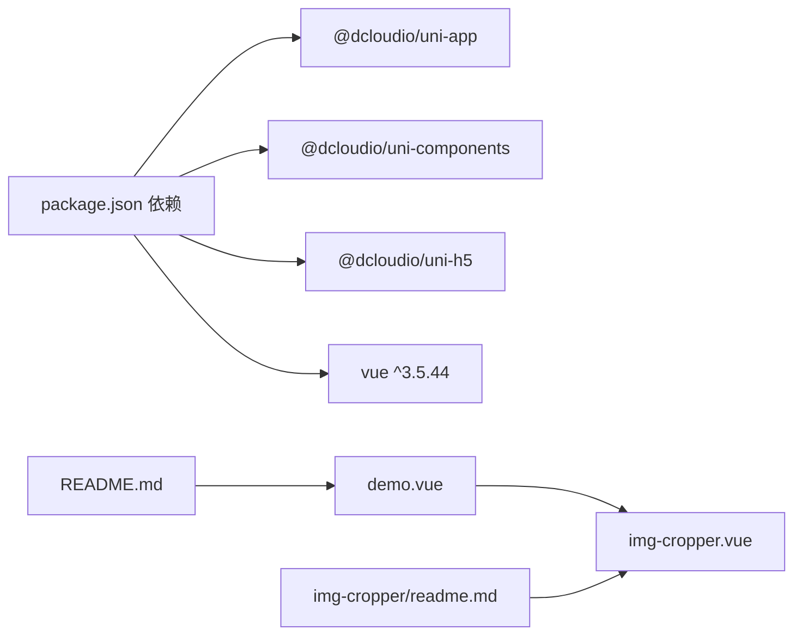

# 使用示例与最佳实践

<cite>
**本文引用的文件**   
- [README.md](file://README.md)
- [img-cropper/readme.md](file://img-cropper/readme.md)
- [uni_modules/img-cropper/components/img-cropper/img-cropper.vue](file://uni_modules/img-cropper/components/img-cropper/img-cropper.vue)
- [img-cropper/pages/demo/demo.vue](file://img-cropper/pages/demo/demo.vue)
- [package.json](file://package.json)
</cite>

## 目录
1. [简介](#简介)
2. [项目结构](#项目结构)
3. [核心组件与能力](#核心组件与能力)
4. [架构总览](#架构总览)
5. [完整头像上传与裁剪流程示例](#完整头像上传与裁剪流程示例)
6. [不同场景的组件配置方案](#不同场景的组件配置方案)
7. [错误处理最佳实践](#错误处理最佳实践)
8. [性能优化技巧](#性能优化技巧)
9. [自定义样式与主题配置](#自定义样式与主题配置)
10. [依赖关系分析](#依赖关系分析)
11. [常见问题排查](#常见问题排查)
12. [结论](#结论)

## 简介
本仓库是基于 uni-app 的头像裁剪插件示例工程，演示如何在 H5 和 APP（含 Android 10）端快速集成和使用图片裁剪组件。组件支持圆形/方形头像、单指拖拽、双指缩放、图片旋转、裁剪预览、零依赖开箱即用等特性。本文围绕“使用示例与最佳实践”展开，提供从图片选择到最终保存的完整流程、多场景配置、错误处理、性能优化以及主题定制指导。

## 项目结构
- 根目录为 uni-app 示例工程，包含页面入口、应用配置、构建脚本等。
- `uni_modules/img-cropper` 为通过 easycom 自动注册的裁剪组件插件目录。
- `img-cropper/pages/demo` 为插件自带的演示页面，展示基础用法。
- `img-cropper/readme.md` 为插件文档，说明 API、平台支持与实现细节。
- 根 `README.md` 为示例工程文档，包含快速开始、API 概览与常见问题。

图表来源
- [README.md:50-77](file://README.md#L50-L77)
- [img-cropper/readme.md:15-30](file://img-cropper/readme.md#L15-L30)

章节来源
- [README.md:50-77](file://README.md#L50-L77)
- [img-cropper/readme.md:15-30](file://img-cropper/readme.md#L15-L30)

## 核心组件与能力
- 组件名称：ImgCropper
- 关键能力
  - 输出尺寸可配：outputWidth、outputHeight
  - 裁剪框尺寸与形状：frameSize、outputShape（square/circle）
  - 输出质量与格式：quality、fileType
  - 主题与文案：themeColor、frameColor、title、cancelText、resetText、reEditText、cropText、confirmText
  - 事件回调：complete、cancel、error
  - 方法调用：open(src)、close()
- 交互能力
  - 单指拖拽移动图片
  - 双指缩放调整大小
  - 图片旋转（每次顺时针旋转 90°）
  - 裁剪预览与确认使用

章节来源
- [uni_modules/img-cropper/components/img-cropper/img-cropper.vue:116-143](file://uni_modules/img-cropper/components/img-cropper/img-cropper.vue#L116-L143)
- [uni_modules/img-cropper/components/img-cropper/img-cropper.vue:144-145](file://uni_modules/img-cropper/components/img-cropper/img-cropper.vue#L144-L145)
- [uni_modules/img-cropper/components/img-cropper/img-cropper.vue:440-451](file://uni_modules/img-cropper/components/img-cropper/img-cropper.vue#L440-L451)

## 架构总览
组件内部采用“帧-图交叉区域算法”，确保预览与生成图片完全一致；通过 Canvas 进行裁剪导出，并在 APP 端做多项兼容处理（避免 transform:scale、inset、margin:auto 等）。

图表来源
- [uni_modules/img-cropper/components/img-cropper/img-cropper.vue:202-229](file://uni_modules/img-cropper/components/img-cropper/img-cropper.vue#L202-L229)
- [uni_modules/img-cropper/components/img-cropper/img-cropper.vue:313-326](file://uni_modules/img-cropper/components/img-cropper/img-cropper.vue#L313-L326)
- [uni_modules/img-cropper/components/img-cropper/img-cropper.vue:328-350](file://uni_modules/img-cropper/components/img-cropper/img-cropper.vue#L328-L350)
- [uni_modules/img-cropper/components/img-cropper/img-cropper.vue:363-437](file://uni_modules/img-cropper/components/img-cropper/img-cropper.vue#L363-L437)

## 完整头像上传与裁剪流程示例
以下示例以“选择图片并裁剪”为主线，展示从用户点击按钮到最终显示头像的完整流程。你可以参考演示页面的结构与事件绑定方式，将裁剪结果用于后续上传或本地存储。

章节来源
- [img-cropper/pages/demo/demo.vue:45-56](file://img-cropper/pages/demo/demo.vue#L45-L56)
- [img-cropper/pages/demo/demo.vue:58-71](file://img-cropper/pages/demo/demo.vue#L58-L71)
- [README.md:124-150](file://README.md#L124-L150)

## 不同场景的组件配置方案
- 圆形头像
  - 设置 outputShape 为 circle
  - 建议输出宽高相等，如 800x800
  - 预览区可通过 CSS 圆角呈现圆形效果
- 方形头像
  - 设置 outputShape 为 square
  - 根据业务需求设置输出宽高，如 800x800 或 1000x1000
- 不同输出尺寸
  - 小头像：outputWidth=400, outputHeight=400
  - 高清头像：outputWidth=1200, outputHeight=1200
  - 非正方形：根据比例设置宽高，如 1200x800
- 输出质量与格式
  - quality 在 0~1 之间，越小体积越小，画质越低
  - fileType 可选 jpg/png，jpg 适合照片，png 适合透明背景

章节来源
- [uni_modules/img-cropper/components/img-cropper/img-cropper.vue:118-143](file://uni_modules/img-cropper/components/img-cropper/img-cropper.vue#L118-L143)
- [img-cropper/readme.md:75-92](file://img-cropper/readme.md#L75-L92)

## 错误处理最佳实践
- 网络异常
  - 在上传阶段捕获网络错误，提示用户重试或检查网络状态
  - 对失败请求进行指数退避重试，避免频繁请求
- 权限拒绝
  - 在调用 chooseImage 前判断系统相册/相机权限，必要时引导用户开启
  - 捕获权限拒绝错误，给出友好提示
- 内存不足
  - 控制输出尺寸与质量，避免超大图片导致内存溢出
  - 及时释放临时文件引用，避免长时间持有大对象
- 组件内部错误
  - 监听 error 事件，区分 getImageInfo 与 crop 两类错误
  - 记录错误类型与详情，便于定位问题

章节来源
- [uni_modules/img-cropper/components/img-cropper/img-cropper.vue:213-227](file://uni_modules/img-cropper/components/img-cropper/img-cropper.vue#L213-L227)
- [uni_modules/img-cropper/components/img-cropper/img-cropper.vue:313-326](file://uni_modules/img-cropper/components/img-cropper/img-cropper.vue#L313-L326)
- [img-cropper/readme.md:94-101](file://img-cropper/readme.md#L94-L101)

## 性能优化技巧
- 图片压缩
  - 合理设置 quality（如 0.7~0.9），平衡画质与体积
  - 根据头像用途选择合适的 fileType（jpg 通常更小）
- 缓存策略
  - 对已裁剪头像进行本地缓存（如 storage 或文件系统），减少重复裁剪
  - 对上传成功的头像 URL 进行缓存，避免重复上传
- 内存管理
  - 避免同时处理过多大图，限制并发裁剪任务数量
  - 及时关闭弹窗与释放引用，防止内存泄漏
- 渲染优化
  - 组件内部统一使用 Math.floor 取整，避免浮点像素导致的偏移
  - 在 APP 端避免使用 transform:scale、inset、margin:auto 等不稳定的布局方式

章节来源
- [uni_modules/img-cropper/components/img-cropper/img-cropper.vue:102-113](file://uni_modules/img-cropper/components/img-cropper/img-cropper.vue#L102-L113)
- [img-cropper/readme.md:142-151](file://img-cropper/readme.md#L142-L151)

## 自定义样式与主题配置
- 主题色
  - themeColor：确认按钮背景色
  - frameColor：裁剪框边框颜色
- 文案定制
  - title、cancelText、resetText、reEditText、cropText、confirmText
- 预览形状
  - outputShape：circle/square，影响裁剪框与预览显示
- 尺寸与比例
  - frameSize：裁剪框尺寸（rpx）
  - outputWidth/outputHeight：输出图片尺寸（px）

章节来源
- [uni_modules/img-cropper/components/img-cropper/img-cropper.vue:118-143](file://uni_modules/img-cropper/components/img-cropper/img-cropper.vue#L118-L143)
- [img-cropper/readme.md:75-92](file://img-cropper/readme.md#L75-L92)

## 依赖关系分析
- 示例工程依赖 uni-app 生态包与 Vue 3
- 组件通过 easycom 自动注册，无需手动引入
- 演示页面直接调用组件方法与事件回调

图表来源
- [package.json:9-19](file://package.json#L9-L19)
- [img-cropper/pages/demo/demo.vue:24-35](file://img-cropper/pages/demo/demo.vue#L24-L35)
- [README.md:153-173](file://README.md#L153-L173)

章节来源
- [package.json:9-19](file://package.json#L9-L19)
- [README.md:153-173](file://README.md#L153-L173)

## 常见问题排查
- 图片不显示
  - 原因：cropAreaHeight 在异步回调中赋值，导致 computed 计算出负数偏移
  - 解决：已在 open() 中立即设置初始值
- TypeScript 报错
  - 原因：未配置类型声明
  - 解决：不影响运行，可忽略；如需类型支持安装 @dcloudio/types
- 裁剪结果与预览不一致
  - 组件使用帧-图交叉区域算法，确保一致；若仍不一致，检查图片路径与输出尺寸

章节来源
- [README.md:222-245](file://README.md#L222-L245)
- [img-cropper/readme.md:152-171](file://img-cropper/readme.md#L152-L171)

## 结论
该头像裁剪组件提供了完整的裁剪能力与良好的跨端兼容性。通过合理的配置与错误处理，可以在 H5 与 APP 端稳定实现头像上传与裁剪流程。结合性能优化与主题定制，开发者可以快速满足多样化的业务需求。建议在项目中优先使用圆形/方形头像配置，并根据实际场景调整输出尺寸与质量，以获得更好的用户体验与性能表现。