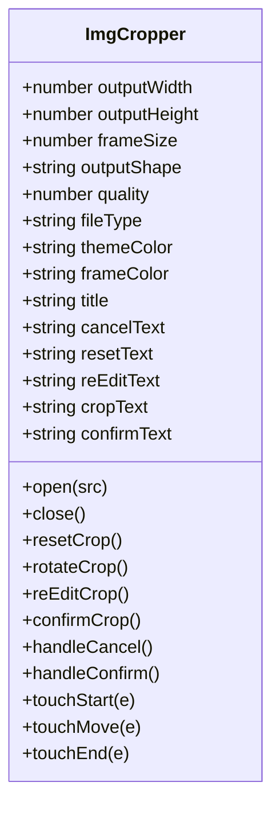
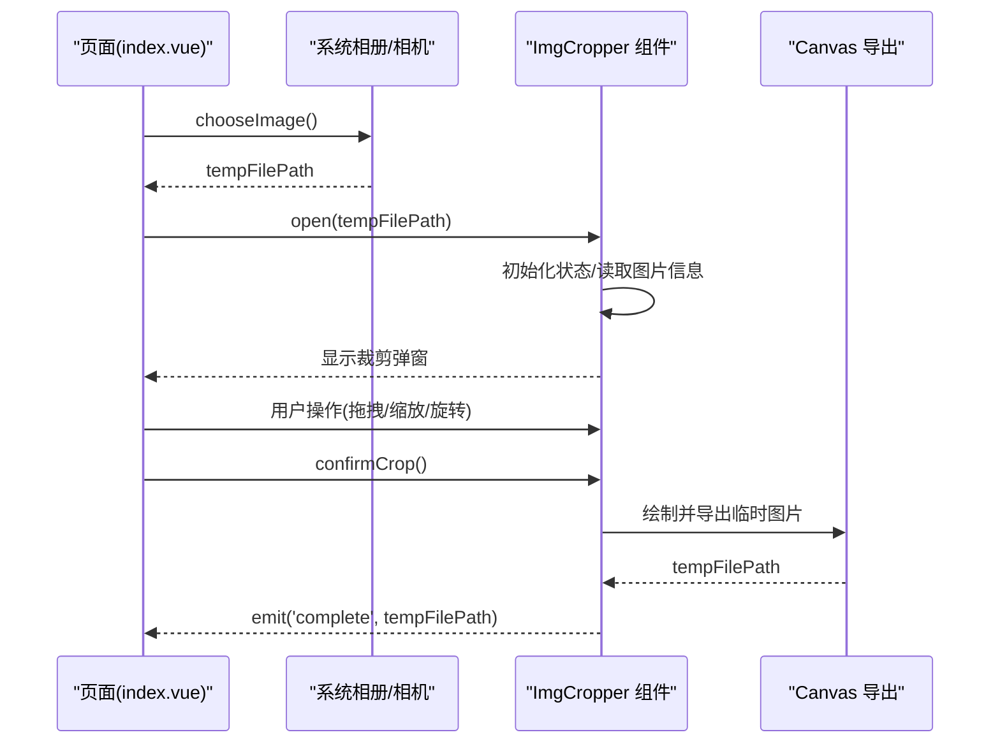
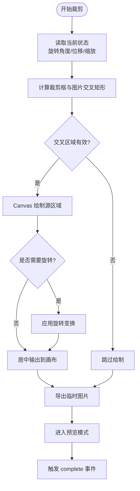

# 快速开始

<cite>
**本文引用的文件**   
- [README.md](file://README.md)
- [package.json](file://package.json)
- [img-cropper.vue（组件）](file://uni_modules/img-cropper/components/img-cropper/img-cropper.vue)
- [index.vue（示例页面）](file://pages/index/index.vue)
- [demo.vue（插件演示页）](file://img-cropper/pages/demo/demo.vue)
</cite>

## 目录
1. [简介](#简介)
2. [环境要求与准备](#环境要求与准备)
3. [项目克隆与运行](#项目克隆与运行)
4. [从零集成头像裁剪功能](#从零集成头像裁剪功能)
5. [事件处理与结果获取](#事件处理与结果获取)
6. [常见问题排查](#常见问题排查)
7. [架构与流程图概览](#架构与流程图概览)
8. [结论](#结论)

## 简介
本指南面向初学者，帮助你在 5 分钟内完成头像裁剪功能的集成。你将学会：
- 安装并引入头像裁剪组件
- 配置 easycom 自动注册
- 在页面中使用组件、选择图片、打开裁剪弹窗
- 处理裁剪完成、取消和错误事件，拿到裁剪后的临时图片路径

该示例工程基于 uni-app（Vue 3），组件支持 H5 与 APP（含 Android 10）。

**章节来源**
- [README.md:9-23](file://README.md#L9-L23)

## 环境要求与准备
- 开发工具：HBuilderX 3.0+
- Node.js：由 HBuilderX 内置，无需额外安装
- 框架：uni-app（Vue 3）

如果你已有 uni-app 项目，可直接将组件放入 `uni_modules` 目录；若从零开始，可克隆本示例工程并在 HBuilderX 中直接运行。

**章节来源**
- [README.md:27-30](file://README.md#L27-L30)
- [package.json:9-13](file://package.json#L9-L13)

## 项目克隆与运行
1. 克隆仓库
   - 使用 Git 克隆示例工程到本地
2. 打开项目
   - 用 HBuilderX 打开项目根目录
3. 运行项目
   - 菜单栏 → 运行 → 运行到浏览器 → 选择浏览器
   - 或运行到手机/模拟器

预期结果：
- 浏览器或设备中打开示例页面，显示“头像裁剪示例”
- 点击“选择图片并裁剪”，可调用系统相册或相机选择图片

**章节来源**
- [README.md:32-48](file://README.md#L32-L48)

## 从零集成头像裁剪功能
本节以“在你的项目中从零开始集成”为主线，给出最小可用步骤。

### 第一步：安装并引入组件
- 将组件目录放到你的项目的 `uni_modules/img-cropper/components/img-cropper/` 下
- 组件文件名为 `img-cropper.vue`

说明：
- 组件通过 uni_modules 机制被自动发现
- 配合 easycom 可实现无感引入，无需手动 import

**章节来源**
- [README.md:66-70](file://README.md#L66-L70)
- [img-cropper.vue:116-143](file://uni_modules/img-cropper/components/img-cropper/img-cropper.vue#L116-L143)

### 第二步：配置 easycom 自动注册
在 `pages.json` 中开启 easycom 自动扫描：
- 确保存在 `easycom.autoscan` 为 true
- 如果已有 custom 规则，保持为空对象即可

预期结果：
- 在任意页面直接使用 `` 标签，无需手动引入组件

**章节来源**
- [README.md:153-173](file://README.md#L153-L173)

### 第三步：在页面中使用组件
在你的页面模板中：
- 放置一个头像展示区域
- 提供一个按钮用于选择图片
- 在页面底部挂载 `` 组件，绑定必要属性与事件

关键要点：
- 使用 ref 获取组件实例
- 通过 `cropperRef.value.open(图片路径)` 打开裁剪弹窗
- 设置输出尺寸、裁剪框大小、预览形状、主题色等属性

参考示例页面：
- [index.vue](file://pages/index/index.vue)
- [demo.vue](file://img-cropper/pages/demo/demo.vue)

**章节来源**
- [index.vue:1-36](file://pages/index/index.vue#L1-L36)
- [demo.vue:1-36](file://img-cropper/pages/demo/demo.vue#L1-L36)

### 第四步：选择图片并打开裁剪弹窗
在脚本逻辑中：
- 调用 `uni.chooseImage` 选择图片
- 在 success 回调中取出临时路径
- 调用 `cropperRef.value.open(tempFilePath)` 打开裁剪弹窗

预期结果：
- 弹出裁剪弹窗，显示所选图片
- 支持单指拖拽移动、双指缩放、旋转等操作

**章节来源**
- [index.vue:45-55](file://pages/index/index.vue#L45-L55)
- [demo.vue:45-56](file://img-cropper/pages/demo/demo.vue#L45-L56)

## 事件处理与结果获取
组件对外暴露三个主要事件：
- complete：裁剪完成，返回临时图片路径
- cancel：用户取消裁剪
- error：裁剪出错，包含错误类型与详情

在页面中：
- 监听 complete 事件，将返回的临时路径赋值给头像展示变量
- 可选：在此处调用上传接口，将临时图片上传至服务器
- 监听 cancel 与 error 事件，进行日志记录或提示

参考实现：
- [index.vue:57-70](file://pages/index/index.vue#L57-L70)
- [demo.vue:58-71](file://img-cropper/pages/demo/demo.vue#L58-L71)

组件内部流程概览：
- 用户点击确认裁剪后，组件计算裁剪区域并生成图片
- 成功后进入预览模式，再次点击确认则触发 complete 事件
- 失败时触发 error 事件，并提示裁剪失败

**章节来源**
- [img-cropper.vue:313-326](file://uni_modules/img-cropper/components/img-cropper/img-cropper.vue#L313-L326)
- [img-cropper.vue:328-349](file://uni_modules/img-cropper/components/img-cropper/img-cropper.vue#L328-L349)
- [img-cropper.vue:352-438](file://uni_modules/img-cropper/components/img-cropper/img-cropper.vue#L352-L438)

## 常见问题排查
- 图片不显示
  - 可能原因：异步赋值导致布局计算异常
  - 解决：组件已在 open 方法中立即设置初始高度，避免 computed 依赖为 0 时出错
- TypeScript 报错找不到 uni 或 vue
  - 影响：不影响运行
  - 可选：如需类型支持，安装 @dcloudio/types
- 裁剪结果与预览不一致
  - 检查：图片路径是否正确、输出尺寸是否合理
  - 组件采用帧-图交叉区域算法，确保预览与生成一致

**章节来源**
- [README.md:222-245](file://README.md#L222-L245)

## 架构与流程图概览

### 组件类结构（代码级）

**图表来源**
- [img-cropper.vue:116-143](file://uni_modules/img-cropper/components/img-cropper/img-cropper.vue#L116-L143)
- [img-cropper.vue:202-262](file://uni_modules/img-cropper/components/img-cropper/img-cropper.vue#L202-L262)
- [img-cropper.vue:264-310](file://uni_modules/img-cropper/components/img-cropper/img-cropper.vue#L264-L310)
- [img-cropper.vue:313-326](file://uni_modules/img-cropper/components/img-cropper/img-cropper.vue#L313-L326)

### 页面到组件的调用时序

**图表来源**
- [index.vue:45-55](file://pages/index/index.vue#L45-L55)
- [img-cropper.vue:202-229](file://uni_modules/img-cropper/components/img-cropper/img-cropper.vue#L202-L229)
- [img-cropper.vue:313-326](file://uni_modules/img-cropper/components/img-cropper/img-cropper.vue#L313-L326)
- [img-cropper.vue:328-349](file://uni_modules/img-cropper/components/img-cropper/img-cropper.vue#L328-L349)

### 裁剪核心算法流程图

**图表来源**
- [img-cropper.vue:352-438](file://uni_modules/img-cropper/components/img-cropper/img-cropper.vue#L352-L438)

## 结论
通过以上步骤，你可以在 5 分钟内完成头像裁剪功能的集成：
- 安装组件到 `uni_modules`
- 配置 easycom 自动注册
- 在页面中选择图片并打开裁剪弹窗
- 处理 complete/cancel/error 事件，拿到裁剪后的临时图片路径

组件提供丰富的属性与事件，支持圆形/方形裁剪、拖拽、缩放、旋转等功能，适用于 H5 与 APP 端。遇到问题时可参考常见问题排查部分定位与解决。