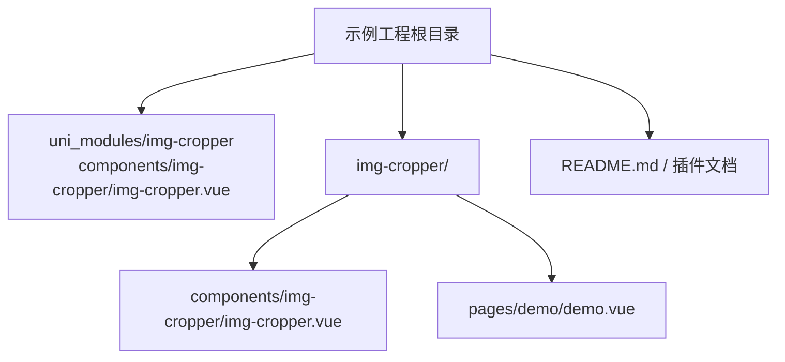
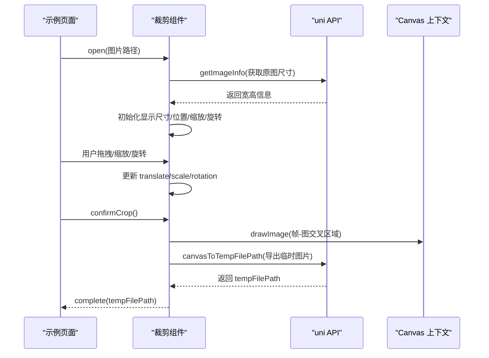
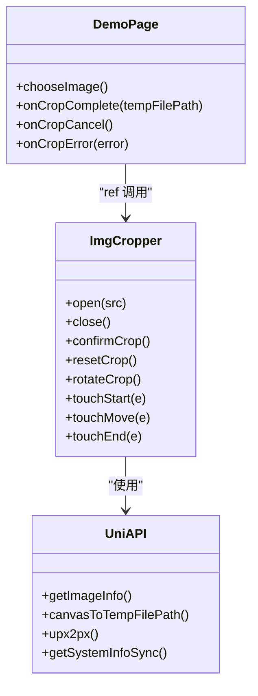

# 故障排除与FAQ

<cite>
**本文引用的文件**   
- [README.md](file://README.md)
- [img-cropper/readme.md](file://img-cropper/readme.md)
- [uni_modules/img-cropper/components/img-cropper/img-cropper.vue](file://uni_modules/img-cropper/components/img-cropper/img-cropper.vue)
- [img-cropper/components/img-cropper/img-cropper.vue](file://img-cropper/components/img-cropper/img-cropper.vue)
- [img-cropper/pages/demo/demo.vue](file://img-cropper/pages/demo/demo.vue)
</cite>

## 目录
1. [简介](#简介)
2. [项目结构](#项目结构)
3. [核心组件与能力](#核心组件与能力)
4. [架构总览](#架构总览)
5. [常见问题与解决方案](#常见问题与解决方案)
6. [调试技巧与工具](#调试技巧与工具)
7. [性能诊断与优化建议](#性能诊断与优化建议)
8. [平台兼容性与适配方案](#平台兼容性与适配方案)
9. [依赖关系分析](#依赖关系分析)
10. [结论](#结论)

## 简介
本指南面向使用头像裁剪插件的开发者，聚焦典型问题定位、原因分析与解决方案，并提供调试方法、性能排查思路以及多平台兼容性处理建议。内容基于仓库中的示例工程与裁剪组件源码整理而成，帮助你在 H5 与 APP（含 Android 10）环境下快速定位并解决问题。

## 项目结构
该仓库包含：
- 示例工程根目录：用于演示如何在 uni-app 项目中集成并使用裁剪组件
- img-cropper 插件目录：可独立发布到插件市场的组件包
- uni_modules 下的组件：通过 easycom 自动注册，供示例页面直接使用
- 演示页面：展示选择图片、打开裁剪弹窗、预览与确认使用的完整流程

**图表来源**
- [README.md:50-77](file://README.md#L50-L77)
- [img-cropper/readme.md:15-30](file://img-cropper/readme.md#L15-L30)

**章节来源**
- [README.md:50-77](file://README.md#L50-L77)
- [img-cropper/readme.md:15-30](file://img-cropper/readme.md#L15-L30)

## 核心组件与能力
- 支持圆形/方形裁剪框
- 单指拖拽移动图片、双指缩放调整大小
- 图片旋转（每次顺时针旋转 90°），导出时通过 Canvas 变换保证输出与预览一致
- 裁剪预览与确认使用
- 零依赖，自带弹窗，无需外部 UI 库
- 帧-图交叉区域算法确保“所见即所得”

关键实现要点：
- 使用 CSS 宽高直接设为缩放后像素值，避免在 APP 端使用 transform: scale() 导致布局盒不一致
- 所有尺寸统一 Math.floor 取整，减少浮点像素取整方向不一致导致的偏移
- 遮罩采用四块半透明区域围住裁剪框，提升兼容性
- Canvas 导出时使用真正居中公式，保证输出图像与裁剪框视觉内容一致

**章节来源**
- [uni_modules/img-cropper/components/img-cropper/img-cropper.vue:96-113](file://uni_modules/img-cropper/components/img-cropper/img-cropper.vue#L96-L113)
- [img-cropper/readme.md:120-151](file://img-cropper/readme.md#L120-L151)

## 架构总览
裁剪组件整体由“视图层 + 交互逻辑 + 裁剪导出”三部分构成：
- 视图层：全屏遮罩弹窗、标题栏、裁剪区、预览区、工具栏、操作按钮、隐藏 Canvas
- 交互逻辑：触摸事件处理（单指拖拽、双指缩放）、旋转控制、状态管理
- 裁剪导出：计算帧-图交叉区域，Canvas 绘制并导出临时图片路径

**图表来源**
- [uni_modules/img-cropper/components/img-cropper/img-cropper.vue:202-229](file://uni_modules/img-cropper/components/img-cropper/img-cropper.vue#L202-L229)
- [uni_modules/img-cropper/components/img-cropper/img-cropper.vue:313-337](file://uni_modules/img-cropper/components/img-cropper/img-cropper.vue#L313-L337)
- [uni_modules/img-cropper/components/img-cropper/img-cropper.vue:363-437](file://uni_modules/img-cropper/components/img-cropper/img-cropper.vue#L363-L437)

## 常见问题与解决方案

### 1. 图片不显示
- 现象：打开裁剪弹窗后图片不可见
- 原因：cropAreaHeight 在异步回调中赋值，导致 computed 计算出负数偏移
- 解决：已在 open() 中立即设置初始值，避免 computed 依赖为 0 时计算出错

排查建议：
- 检查 open() 是否被调用且传入正确的图片路径
- 检查 cropAreaHeight 是否在渲染前已赋初值
- 若仍异常，可在控制台打印 framePx、centerOffsetX/Y、displayedH 等中间变量

**章节来源**
- [README.md:222-231](file://README.md#L222-L231)
- [img-cropper/readme.md:152-159](file://img-cropper/readme.md#L152-L159)
- [uni_modules/img-cropper/components/img-cropper/img-cropper.vue:202-229](file://uni_modules/img-cropper/components/img-cropper/img-cropper.vue#L202-L229)

### 2. TypeScript 报错
- 现象：提示找不到 uni 或 vue 模块
- 原因：项目未配置 TypeScript 类型声明
- 解决：不影响运行，可忽略；如需类型支持，安装 @dcloudio/types

排查建议：
- 若希望获得更好的类型提示，建议在项目中引入官方类型声明包
- 组件内部使用 lang="ts"，但类型缺失不会阻断运行

**章节来源**
- [README.md:232-239](file://README.md#L232-L239)
- [img-cropper/readme.md:160-165](file://img-cropper/readme.md#L160-L165)

### 3. 裁剪结果与预览不一致
- 现象：预览与最终导出的图片内容不一致
- 原因：通常与图片路径错误或输出尺寸不合理有关
- 解决：确保传入的图片路径有效；合理设置 outputWidth/outputHeight；检查旋转角度是否正确

排查建议：
- 校验图片路径是否为本地或临时路径
- 检查 outputWidth/outputHeight 是否与 frameSize 匹配
- 若涉及旋转，确认旋转角度与 Canvas 变换逻辑一致

**章节来源**
- [README.md:240-245](file://README.md#L240-L245)
- [img-cropper/readme.md:166-171](file://img-cropper/readme.md#L166-L171)
- [uni_modules/img-cropper/components/img-cropper/img-cropper.vue:363-437](file://uni_modules/img-cropper/components/img-cropper/img-cropper.vue#L363-L437)

### 4. 裁剪失败或结果为空
- 现象：点击确认后提示裁剪失败，或 complete 未触发
- 可能原因：canvasToTempFilePath 导出失败、图片路径无效、Canvas 绘制内容为空
- 解决：捕获 error 事件，查看 detail；确保图片路径有效；必要时增加重试或降级策略

排查建议：
- 监听 error 事件，记录 type 与 detail
- 检查 exportCanvas 的 Promise 是否 resolve/reject
- 在低端设备上适当降低 quality 或输出尺寸

**章节来源**
- [uni_modules/img-cropper/components/img-cropper/img-cropper.vue:313-337](file://uni_modules/img-cropper/components/img-cropper/img-cropper.vue#L313-L337)
- [uni_modules/img-cropper/components/img-cropper/img-cropper.vue:329-348](file://uni_modules/img-cropper/components/img-cropper/img-cropper.vue#L329-L348)

### 5. 旋转后裁剪输出与预览不一致
- 现象：旋转后导出的图片方向或内容与预览不符
- 原因：Canvas 旋转变换未正确应用或未重置坐标系
- 解决：组件已通过 ctx.save()/ctx.restore() 与 translate/rotate 组合实现 90°/180°/270° 旋转导出，确保与预览一致

排查建议：
- 检查 rotation 状态是否正确递增并模 360
- 确认 Canvas 变换顺序与角度分支一致
- 若自定义扩展旋转逻辑，需同步更新导出分支

**章节来源**
- [uni_modules/img-cropper/components/img-cropper/img-cropper.vue:249-251](file://uni_modules/img-cropper/components/img-cropper/img-cropper.vue#L249-L251)
- [uni_modules/img-cropper/components/img-cropper/img-cropper.vue:400-430](file://uni_modules/img-cropper/components/img-cropper/img-cropper.vue#L400-L430)

### 6. 预览形状与输出形状不一致
- 现象：预览为圆形，但输出不是圆形；或反之
- 原因：预览样式仅影响显示，实际输出由 Canvas 绘制决定
- 解决：确保 outputShape 与 Canvas 绘制逻辑一致；当前组件以“所见即所得”的帧-图交叉区域算法保证一致性

排查建议：
- 检查 outputShape 传参是否正确
- 若自定义裁剪形状，需同时更新预览样式与 Canvas 绘制逻辑

**章节来源**
- [uni_modules/img-cropper/components/img-cropper/img-cropper.vue:125-126](file://uni_modules/img-cropper/components/img-cropper/img-cropper.vue#L125-L126)
- [uni_modules/img-cropper/components/img-cropper/img-cropper.vue:363-437](file://uni_modules/img-cropper/components/img-cropper/img-cropper.vue#L363-L437)

## 调试技巧与工具

### 常用调试步骤
- 监听组件事件：complete/cancel/error，打印参数与错误详情
- 打印中间变量：framePx、centerOffsetX/Y、displayedH、translateX/Y、scale、rotation
- 检查图片路径：确保传入的是本地或临时路径，且在当前环境可访问
- 分步验证：先验证 open() 是否正常加载图片，再验证 confirmCrop() 是否能导出临时路径

### 推荐工具
- HBuilderX 内置调试器：用于查看 uni-app 运行日志与网络请求
- 浏览器开发者工具：适用于 H5 端，便于观察 DOM/CSS 与 Canvas 绘制
- 真机调试：APP 端建议使用真机或模拟器进行手势与性能测试

**章节来源**
- [img-cropper/pages/demo/demo.vue:39-72](file://img-cropper/pages/demo/demo.vue#L39-L72)
- [uni_modules/img-cropper/components/img-cropper/img-cropper.vue:313-337](file://uni_modules/img-cropper/components/img-cropper/img-cropper.vue#L313-L337)

## 性能诊断与优化建议

### 内存泄漏排查
- 现象：长时间使用后内存持续增长，界面卡顿
- 可能原因：频繁创建 Canvas 实例、未及时释放资源、大量图片对象未清理
- 建议：
  - 复用 Canvas ID，避免重复创建
  - 在 close() 时清理预览与状态
  - 避免在循环中频繁调用 getImageInfo 或 canvasToTempFilePath

### 渲染卡顿优化
- 现象：拖拽/缩放过程中掉帧
- 可能原因：频繁重绘、复杂样式、大图绘制
- 建议：
  - 限制缩放范围（组件已限制 1~3）
  - 降低 quality 或输出尺寸
  - 避免在 touchMove 中进行昂贵计算

### 导出性能优化
- 现象：点击确认后耗时较长
- 可能原因：大图绘制、低质量设备、Canvas 导出开销
- 建议：
  - 根据设备性能动态调整 outputWidth/outputHeight
  - 在低端设备上降低 quality
  - 使用 showLoading 提供反馈，避免用户重复点击

**章节来源**
- [uni_modules/img-cropper/components/img-cropper/img-cropper.vue:281-297](file://uni_modules/img-cropper/components/img-cropper/img-cropper.vue#L281-L297)
- [uni_modules/img-cropper/components/img-cropper/img-cropper.vue:329-348](file://uni_modules/img-cropper/components/img-cropper/img-cropper.vue#L329-L348)

## 平台兼容性与适配方案

### 已验证平台
- H5：支持
- APP（Android）：支持（含 Android 10）
- APP（iOS）：支持
- 微信小程序：待验证
- 支付宝小程序：待验证
- uni-app x：不支持（需改用 Canvas 2D API）

### APP 端特殊处理
- 禁用 transform: scale()：Android 10 APP 端不可靠，组件直接设置 CSS 宽高
- 禁用 CSS inset:0：APP 端不支持，显式写 top/right/bottom/left
- 禁用 margin:auto 居中：APP 端 absolute 元素无效，使用 JS 计算居中偏移
- setup 阶段捕获 instance：事件处理器中 getCurrentInstance() 可能返回 null，需在 setup 阶段提前捕获

### 常见适配建议
- 使用 uni.upx2px 将 rpx 转换为 px，确保在不同屏幕密度下尺寸一致
- 所有尺寸统一 Math.floor 取整，避免浮点像素取整方向不一致
- 遮罩采用四块半透明区域代替挖空，提升兼容性

**章节来源**
- [README.md:211-221](file://README.md#L211-L221)
- [img-cropper/readme.md:109-119](file://img-cropper/readme.md#L109-L119)
- [img-cropper/readme.md:142-151](file://img-cropper/readme.md#L142-L151)
- [uni_modules/img-cropper/components/img-cropper/img-cropper.vue:96-113](file://uni_modules/img-cropper/components/img-cropper/img-cropper.vue#L96-L113)

## 依赖关系分析
- 示例页面依赖裁剪组件：通过 ref 调用 open/close 方法
- 裁剪组件依赖 uni API：getImageInfo、canvasToTempFilePath、upx2px、getSystemInfoSync
- 组件内部状态：visible、imageSrc、previewSrc、isPreview、originWidth/Height、imageWidth/Height、translateX/Y、scale、rotation

**图表来源**
- [img-cropper/pages/demo/demo.vue:39-72](file://img-cropper/pages/demo/demo.vue#L39-L72)
- [uni_modules/img-cropper/components/img-cropper/img-cropper.vue:202-229](file://uni_modules/img-cropper/components/img-cropper/img-cropper.vue#L202-L229)
- [uni_modules/img-cropper/components/img-cropper/img-cropper.vue:313-337](file://uni_modules/img-cropper/components/img-cropper/img-cropper.vue#L313-L337)

**章节来源**
- [img-cropper/pages/demo/demo.vue:39-72](file://img-cropper/pages/demo/demo.vue#L39-L72)
- [uni_modules/img-cropper/components/img-cropper/img-cropper.vue:145-178](file://uni_modules/img-cropper/components/img-cropper/img-cropper.vue#L145-L178)

## 结论
本指南围绕头像裁剪插件的典型问题展开，提供了从现象到原因的完整分析，并给出可操作的解决方案与调试方法。结合帧-图交叉区域算法与 APP 端兼容性处理，组件在 H5 与 APP（含 Android 10）环境下具备较好的稳定性与一致性。对于性能与平台适配问题，建议按本文提供的排查思路逐步定位，并结合设备特性进行优化。