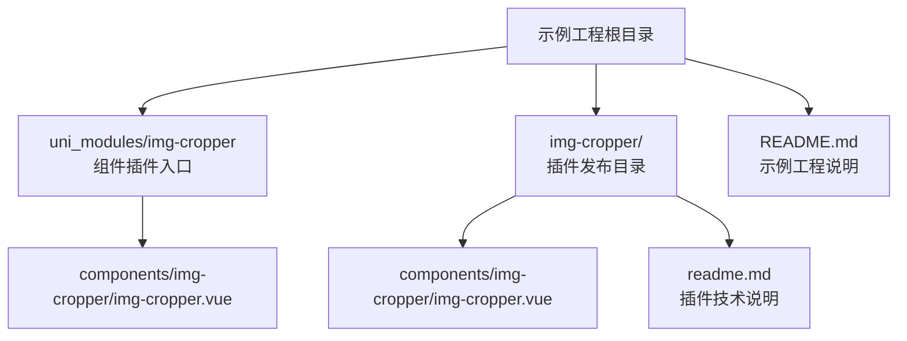
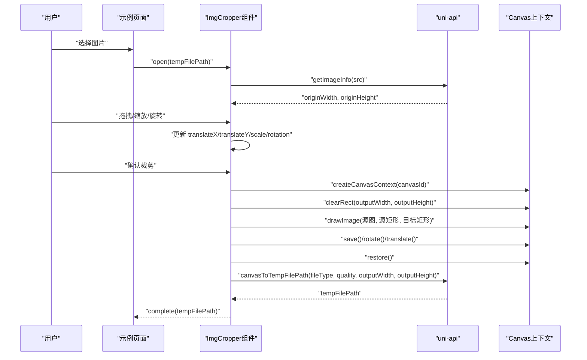
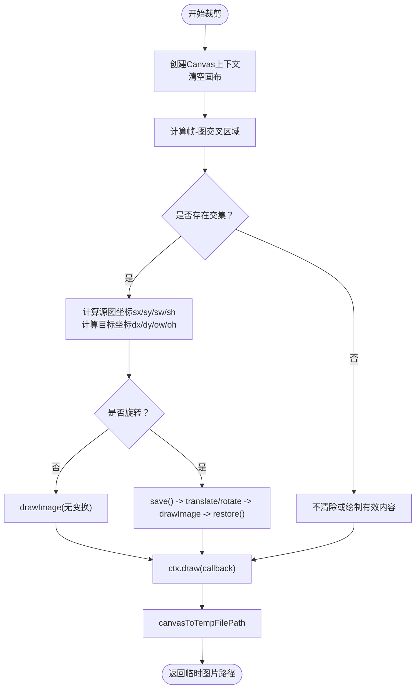
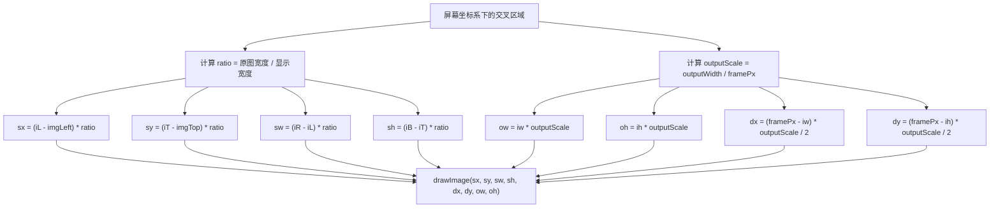
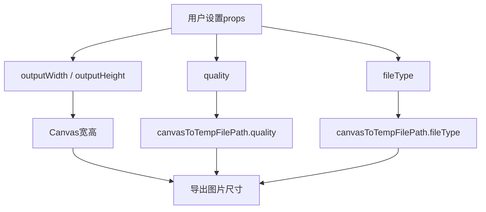
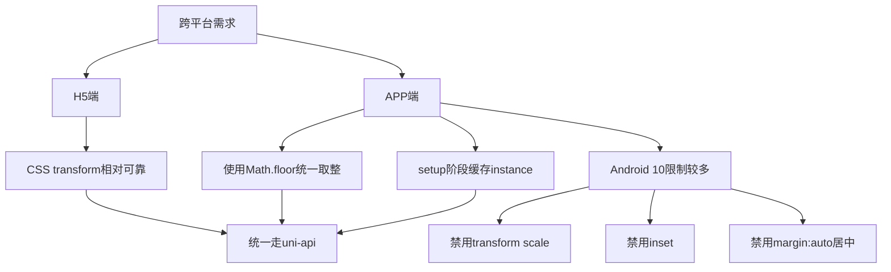
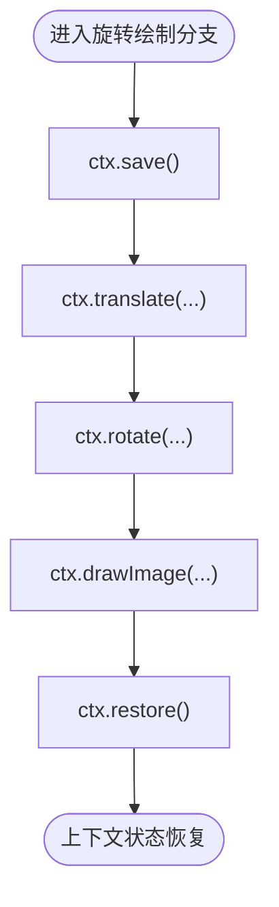
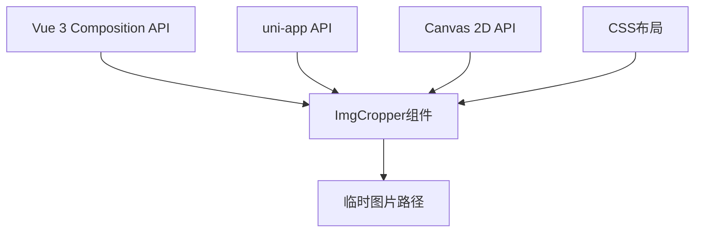

# Canvas渲染引擎

<cite>
**本文引用的文件**   
- [img-cropper.vue（uni_modules 版本）](file://uni_modules/img-cropper/components/img-cropper/img-cropper.vue)
- [img-cropper.vue（插件发布目录版本）](file://img-cropper/components/img-cropper/img-cropper.vue)
- [README.md（示例工程说明）](file://README.md)
- [readme.md（插件技术说明）](file://img-cropper/readme.md)
</cite>

## 目录

1. [引言](#引言)
2. [项目结构](#项目结构)
3. [核心组件与职责](#核心组件与职责)
4. [架构总览](#架构总览)
5. [Canvas渲染流程详解](#canvas渲染流程详解)
6. [图像变换处理：drawImage参数、坐标映射与尺寸计算](#图像变换处理drawimage参数坐标映射与尺寸计算)
7. [质量优化机制：quality、格式转换与输出尺寸控制](#质量优化机制quality格式转换与输出尺寸控制)
8. [跨平台兼容性处理：APP端与H5端差异适配](#跨平台兼容性处理app端与h5端差异适配)
9. [Canvas上下文生命周期管理：ctx.save与ctx.restore的使用场景](#canvas上下文生命周期管理ctxsave与ctxrestore的使用场景)
10. [依赖关系分析](#依赖关系分析)
11. [性能优化技巧](#性能优化技巧)
12. [常见问题与解决方案](#常见问题与解决方案)
13. [结论](#结论)

## 引言

本仓库是一个基于 uni-app 的头像裁剪插件示例工程，核心能力是通过 Canvas 将用户交互得到的裁剪区域转换为高质量图片。其渲染引擎围绕以下关键点展开：

- **图像变换处理**：通过 `drawImage` 完成源图到目标画布的坐标映射与尺寸缩放，并支持 90°/180°/270° 旋转。
- **质量优化机制**：通过 `quality` 参数和 `fileType` 控制输出质量与格式，同时由 `outputWidth` / `outputHeight` 控制最终输出尺寸。
- **跨平台兼容性**：针对 H5 与 APP（含 Android 10）做差异化适配，避免 CSS transform、inset、margin 居中在 APP 端的兼容问题。
- **Canvas 上下文生命周期**：使用 `ctx.save()` 与 `ctx.restore()` 隔离旋转变换，保证多次绘制不会互相污染。
- **帧-图交叉区域算法**：确保预览内容与最终生成的裁剪结果完全一致。

该文档从代码实现出发，逐步拆解渲染管线、坐标系统、质量策略与平台差异，帮助读者理解一个可复用的 Canvas 渲染引擎设计。

## 项目结构

项目采用 uni-app + Vue 3 的工程结构，核心裁剪逻辑集中在 `img-cropper` 组件中。组件同时存在于两个位置：

- `uni_modules/img-cropper/components/img-cropper/img-cropper.vue`：作为 easycom 自动注册插件被示例工程引用。
- `img-cropper/components/img-cropper/img-cropper.vue`：插件发布目录中的组件源码。

**图表来源**   
- [README.md:50-77](file://README.md#L50-L77)
- [img-cropper.vue（uni_modules 版本）:1-94](file://uni_modules/img-cropper/components/img-cropper/img-cropper.vue#L1-L94)
- [img-cropper.vue（插件发布目录版本）:1-94](file://img-cropper/components/img-cropper/img-cropper.vue#L1-L94)

**章节来源**   
- [README.md:50-77](file://README.md#L50-L77)
- [img-cropper.vue（uni_modules 版本）:1-94](file://uni_modules/img-cropper/components/img-cropper/img-cropper.vue#L1-L94)
- [img-cropper.vue（插件发布目录版本）:1-94](file://img-cropper/components/img-cropper/img-cropper.vue#L1-L94)

## 核心组件与职责

`img-cropper` 组件承担以下职责：

| 模块 | 职责 | 关键行为 |
|---|---|---|
| 弹窗与布局 | 显示裁剪遮罩、标题栏、操作按钮、预览区 | 控制 `visible`、`isPreview`、主题色、文案等 |
| 图片展示层 | 显示原图、裁剪框、遮罩、预览图 | 使用 CSS 定位、缩放、旋转控制视觉呈现 |
| 触摸交互层 | 单指拖拽、双指缩放、旋转按钮 | 更新 `translateX`、`translateY`、`scale`、`rotation` |
| 裁剪计算层 | 计算帧-图交叉区域、映射源图坐标、计算目标画布坐标 | 调用 `uni.createCanvasContext`、`ctx.drawImage` |
| Canvas导出层 | 将 Canvas 内容导出为临时图片路径 | 调用 `uni.canvasToTempFilePath`，传入 `quality`、`fileType`、输出尺寸 |
| 事件与API层 | 暴露 `open`、`close`，抛出 `complete`、`cancel`、`error` | 供父页面调用与监听 |

组件对外暴露的核心 API 包括：

- **Props**：`outputWidth`、`outputHeight`、`frameSize`、`outputShape`、`quality`、`fileType`、主题与文案相关属性。
- **Events**：`complete`、`cancel`、`error`。
- **Methods**：`open(src)`、`close()`。

**章节来源**   
- [img-cropper.vue（uni_modules 版本）:116-144](file://uni_modules/img-cropper/components/img-cropper/img-cropper.vue#L116-L144)
- [img-cropper.vue（插件发布目录版本）:116-144](file://img-cropper/components/img-cropper/img-cropper.vue#L116-L144)
- [README.md:175-210](file://README.md#L175-L210)

## 架构总览

从用户操作到图片输出的整体流程如下：

**图表来源**   
- [img-cropper.vue（uni_modules 版本）:202-229](file://uni_modules/img-cropper/components/img-cropper/img-cropper.vue#L202-L229)
- [img-cropper.vue（uni_modules 版本）:313-326](file://uni_modules/img-cropper/components/img-cropper/img-cropper.vue#L313-L326)
- [img-cropper.vue（uni_modules 版本）:363-436](file://uni_modules/img-cropper/components/img-cropper/img-cropper.vue#L363-L436)
- [img-cropper.vue（uni_modules 版本）:329-349](file://uni_modules/img-cropper/components/img-cropper/img-cropper.vue#L329-L349)

**章节来源**   
- [img-cropper.vue（uni_modules 版本）:202-229](file://uni_modules/img-cropper/components/img-cropper/img-cropper.vue#L202-L229)
- [img-cropper.vue（uni_modules 版本）:313-326](file://uni_modules/img-cropper/components/img-cropper/img-cropper.vue#L313-L326)
- [img-cropper.vue（uni_modules 版本）:363-436](file://uni_modules/img-cropper/components/img-cropper/img-cropper.vue#L363-L436)
- [img-cropper.vue（uni_modules 版本）:329-349](file://uni_modules/img-cropper/components/img-cropper/img-cropper.vue#L329-L349)

## Canvas渲染流程详解

Canvas 渲染流程可以拆分为四个阶段：**初始化画布**、**计算交叉区域**、**绘制图像**、**导出图片**。

### 1. 初始化画布

组件在模板中声明一个隐藏 Canvas，并通过 `canvas-id` 绑定唯一标识。渲染时通过 `uni.createCanvasContext` 获取上下文，并使用 `clearRect` 清空画布，避免上一次绘制残留。

关键点：

- Canvas 宽高由 `outputWidth` 与 `outputHeight` 决定。
- 每次裁剪前都会清空画布。
- 使用 `instance` 作为 `createCanvasContext` 的第二个参数，避免在事件处理器中 `getCurrentInstance()` 返回 null。

### 2. 计算交叉区域

组件使用“帧-图交叉区域算法”：

- 计算裁剪框在屏幕坐标系下的边界。
- 计算图片在屏幕坐标系下的边界。
- 求两者的交集矩形。
- 如果存在交集，则继续绘制；否则不绘制任何内容。

这一步保证了只有真正可见且位于裁剪框内的像素才会被输出。

### 3. 绘制图像

根据是否旋转，渲染分支不同：

- **无旋转**：直接计算源图区域和目标画布区域，调用 `drawImage`。
- **有旋转**：先保存上下文状态，再执行平移和旋转，然后绘制，最后恢复上下文状态。

### 4. 导出图片

绘制完成后调用 `ctx.draw(false, callback)`，回调中调用 `uni.canvasToTempFilePath`，传入：

- `canvasId`
- `x`、`y`
- `width`、`height`
- `destWidth`、`destHeight`
- `fileType`
- `quality`

最终返回临时图片路径，组件通过 `complete` 事件交给父页面。

**图表来源**   
- [img-cropper.vue（uni_modules 版本）:363-436](file://uni_modules/img-cropper/components/img-cropper/img-cropper.vue#L363-L436)
- [img-cropper.vue（uni_modules 版本）:329-349](file://uni_modules/img-cropper/components/img-cropper/img-cropper.vue#L329-L349)

**章节来源**   
- [img-cropper.vue（uni_modules 版本）:363-436](file://uni_modules/img-cropper/components/img-cropper/img-cropper.vue#L363-L436)
- [img-cropper.vue（uni_modules 版本）:329-349](file://uni_modules/img-cropper/components/img-cropper/img-cropper.vue#L329-L349)

## 图像变换处理：drawImage参数、坐标映射与尺寸计算

### drawImage 的参数语义

在当前实现中，`drawImage` 用于将原图的一部分绘制到目标画布上。其参数含义可理解为：

| 参数类别 | 含义 | 在本组件中的作用 |
|---|---|---|
| 源图地址 | 要绘制的图片路径 | 来自用户选择的图片临时路径 |
| 源图起始横坐标 sx | 原图中截取区域的左上角 x | 将屏幕坐标映射回原图坐标 |
| 源图起始纵坐标 sy | 原图中截取区域的左上角 y | 将屏幕坐标映射回原图坐标 |
| 源图宽度 sw | 原图中截取区域的宽度 | 由交叉区域宽度乘以原图与显示图的缩放比例得到 |
| 源图高度 sh | 原图中截取区域的高度 | 由交叉区域高度乘以原图与显示图的缩放比例得到 |
| 目标画布起始横坐标 dx | 目标画布上的绘制起点 x | 使截取内容在输出画布中居中 |
| 目标画布起始纵坐标 dy | 目标画布上的绘制起点 y | 使截取内容在输出画布中居中 |
| 目标画布宽度 ow | 输出画布上显示的宽度 | 交叉区域宽度乘以输出缩放比例 |
| 目标画布高度 oh | 输出画布上显示的高度 | 交叉区域高度乘以输出缩放比例 |

### 坐标映射过程

组件维护了三个关键坐标系：

1. **原图坐标系**：以原图真实像素为单位。
2. **屏幕显示坐标系**：以当前显示的图片位置和尺寸为基准。
3. **输出画布坐标系**：以 `outputWidth` × `outputHeight` 为基准。

映射步骤如下：

- 通过 `originWidth` 与 `dW`（显示宽度）计算 `ratio = originWidth / dW`。
- 用 `ratio` 将屏幕坐标差值映射回原图坐标。
- 用 `outputScale = outputWidth / framePx` 将交叉区域映射到输出画布尺寸。
- 用 `(framePx - intersectW) * outputScale / 2` 计算居中偏移。

### 尺寸计算

- `framePx`：裁剪框的实际像素尺寸。
- `dW`、`displayedH`：图片在屏幕上显示的宽度和高度。
- `iw`、`ih`：交叉区域的宽度和高度。
- `ow`、`oh`：输出画布上对应内容的宽度和高度。
- `outputScale`：输出画布相对于裁剪框的缩放倍数。

这种设计确保了：**无论图片如何移动、缩放、旋转，只要视觉上落在裁剪框内的部分，都会被精确映射到输出图片中。**

**图表来源**   
- [img-cropper.vue（uni_modules 版本）:383-399](file://uni_modules/img-cropper/components/img-cropper/img-cropper.vue#L383-L399)
- [img-cropper.vue（插件发布目录版本）:381-397](file://img-cropper/components/img-cropper/img-cropper.vue#L381-L397)

**章节来源**   
- [img-cropper.vue（uni_modules 版本）:383-399](file://uni_modules/img-cropper/components/img-cropper/img-cropper.vue#L383-L399)
- [img-cropper.vue（插件发布目录版本）:381-397](file://img-cropper/components/img-cropper/img-cropper.vue#L381-L397)

## 质量优化机制：quality、格式转换与输出尺寸控制

### quality 参数

`quality` 是 `canvasToTempFilePath` 的质量参数，取值范围通常为 0 到 1。数值越高，图片质量越好，但文件体积通常也越大。

组件默认值为 `0.9`，适合大多数头像裁剪场景。若需要更小体积，可降低该值；若追求更高清晰度，可适当提高。

### fileType 参数

`fileType` 控制输出格式，支持：

- `jpg`：有损压缩，体积小，适合照片类头像。
- `png`：无损或低压缩，体积较大，适合需要透明背景或高保真场景。

组件默认输出 `jpg`，可通过 props 改为 `png`。

### 输出尺寸控制

输出尺寸由 `outputWidth` 和 `outputHeight` 共同决定：

- Canvas 实际宽高设置为 `outputWidth` × `outputHeight`。
- `canvasToTempFilePath` 同时传入 `width`、`height`、`destWidth`、`destHeight`，确保导出尺寸与 Canvas 一致。
- 组件内部还通过 `outputScale = outputWidth / framePx` 计算输出缩放比例，保证裁剪框内的内容按比例放大到目标尺寸。

这意味着：**输出图片不是简单截图，而是根据裁剪框与实际像素关系进行精确缩放后的结果。**

**图表来源**   
- [img-cropper.vue（uni_modules 版本）:119-130](file://uni_modules/img-cropper/components/img-cropper/img-cropper.vue#L119-L130)
- [img-cropper.vue（uni_modules 版本）:329-349](file://uni_modules/img-cropper/components/img-cropper/img-cropper.vue#L329-L349)
- [img-cropper.vue（uni_modules 版本）:384-388](file://uni_modules/img-cropper/components/img-cropper/img-cropper.vue#L384-L388)

**章节来源**   
- [img-cropper.vue（uni_modules 版本）:119-130](file://uni_modules/img-cropper/components/img-cropper/img-cropper.vue#L119-L130)
- [img-cropper.vue（uni_modules 版本）:329-349](file://uni_modules/img-cropper/components/img-cropper/img-cropper.vue#L329-L349)
- [img-cropper.vue（uni_modules 版本）:384-388](file://uni_modules/img-cropper/components/img-cropper/img-cropper.vue#L384-L388)

## 跨平台兼容性处理：APP端与H5端差异适配

组件明确标注支持 H5 与 APP（含 Android 10），并在注释中总结了 APP 端的关键兼容要点：

| 兼容点 | 处理方式 | 原因 |
|---|---|---|
| 禁用 `transform: scale()` | 使用 CSS 直接设置宽高像素值 | Android 10 APP 端对 transform scale 不可靠 |
| 禁用 CSS `inset:0` | 不使用 inset 布局 | APP 端不支持 |
| 禁用 `margin:auto` 居中 | 使用绝对定位 + 手动计算偏移 | APP 端 absolute 元素下 margin 居中无效 |
| getCurrentInstance 可能为 null | 在 setup 阶段捕获 instance 并传给 Canvas API | 事件处理器中无法稳定获取实例 |
| 浮点像素取整不一致 | 所有尺寸使用 `Math.floor` | 避免 APP 端浮点像素取整方向不一致导致偏移 |

此外，组件还通过以下方式提升兼容性：

- 使用 `uni.upx2px` 将 rpx 转为 px，保证不同设备下布局一致。
- 使用 `uni.getImageInfo` 获取原图宽高，避免依赖 DOM 或浏览器特性。
- 使用 `uni.canvasToTempFilePath` 统一导出接口，屏蔽底层 Canvas 差异。

**图表来源**   
- [img-cropper.vue（uni_modules 版本）:97-113](file://uni_modules/img-cropper/components/img-cropper/img-cropper.vue#L97-L113)
- [img-cropper.vue（uni_modules 版本）:173-189](file://uni_modules/img-cropper/components/img-cropper/img-cropper.vue#L173-L189)
- [img-cropper.vue（uni_modules 版本）:146-147](file://uni_modules/img-cropper/components/img-cropper/img-cropper.vue#L146-L147)

**章节来源**   
- [img-cropper.vue（uni_modules 版本）:97-113](file://uni_modules/img-cropper/components/img-cropper/img-cropper.vue#L97-L113)
- [img-cropper.vue（uni_modules 版本）:173-189](file://uni_modules/img-cropper/components/img-cropper/img-cropper.vue#L173-L189)
- [img-cropper.vue（uni_modules 版本）:146-147](file://uni_modules/img-cropper/components/img-cropper/img-cropper.vue#L146-L147)

## Canvas上下文生命周期管理：ctx.save与ctx.restore的使用场景

在旋转裁剪场景中，Canvas 上下文的状态管理非常关键。组件在旋转分支中使用：

1. `ctx.save()`：保存当前上下文状态。
2. `ctx.translate(...)`：平移画布原点。
3. `ctx.rotate(...)`：旋转画布坐标系。
4. `ctx.drawImage(...)`：在变换后的坐标系中绘制图像。
5. `ctx.restore()`：恢复到保存前的上下文状态。

这样做的好处是：

- 旋转只影响当前绘制操作，不会影响后续绘制。
- 不同旋转角度之间互不干扰。
- 即使多次旋转，上下文状态也能正确恢复。

**图表来源**   
- [img-cropper.vue（uni_modules 版本）:405-430](file://uni_modules/img-cropper/components/img-cropper/img-cropper.vue#L405-L430)
- [img-cropper.vue（插件发布目录版本）:405-428](file://img-cropper/components/img-cropper/img-cropper.vue#L405-L428)

**章节来源**   
- [img-cropper.vue（uni_modules 版本）:405-430](file://uni_modules/img-cropper/components/img-cropper/img-cropper.vue#L405-L430)
- [img-cropper.vue（插件发布目录版本）:405-428](file://img-cropper/components/img-cropper/img-cropper.vue#L405-L428)

## 依赖关系分析

组件依赖的主要外部能力包括：

| 依赖 | 用途 | 说明 |
|---|---|---|
| Vue 3 Composition API | 组件状态管理 | 使用 `ref`、`computed`、`defineComponent`、`nextTick` |
| uni-app API | 跨平台能力 | `uni.getImageInfo`、`uni.createCanvasContext`、`uni.canvasToTempFilePath` |
| Canvas 2D API | 图像绘制 | `clearRect`、`drawImage`、`save`、`restore`、`translate`、`rotate` |
| CSS 布局 | 用户界面 | 遮罩、裁剪框、预览区、工具栏、按钮 |

组件内部没有引入第三方图像处理库，所有图像变换都通过原生 Canvas API 实现，属于轻量级、零依赖的实现方式。

**图表来源**   
- [img-cropper.vue（uni_modules 版本）:114-144](file://uni_modules/img-cropper/components/img-cropper/img-cropper.vue#L114-L144)
- [img-cropper.vue（uni_modules 版本）:378-436](file://uni_modules/img-cropper/components/img-cropper/img-cropper.vue#L378-L436)

**章节来源**   
- [img-cropper.vue（uni_modules 版本）:114-144](file://uni_modules/img-cropper/components/img-cropper/img-cropper.vue#L114-L144)
- [img-cropper.vue（uni_modules 版本）:378-436](file://uni_modules/img-cropper/components/img-cropper/img-cropper.vue#L378-L436)

## 性能优化技巧

结合组件实现，可总结以下 Canvas 渲染性能优化建议：

1. **避免不必要的重绘**  
   只在确认裁剪时创建 Canvas 上下文并绘制，而不是在每次触摸事件中绘制。

2. **合理设置输出尺寸**  
   `outputWidth` 与 `outputHeight` 不宜过大，否则会增加内存占用和导出时间。头像场景通常 800×800 已足够。

3. **合理使用 quality**  
   头像类图片不需要极高画质，适当降低 `quality` 可显著减小文件体积。

4. **优先使用 jpg**  
   除非需要透明背景，否则优先使用 `jpg`，减少存储和传输成本。

5. **避免频繁创建 Canvas**  
   组件为每个实例生成唯一 `canvasId`，避免多实例冲突，同时复用同一 Canvas 上下文进行绘制。

6. **使用 Math.floor 统一取整**  
   避免浮点像素导致的布局偏移，尤其在 APP 端表现更稳定。

7. **延迟导出**  
   组件在导出前使用 `setTimeout` 延迟 200ms，有助于确保 Canvas 绘制完成后再导出。

[本节为通用性能建议，不直接分析具体代码片段]

## 常见问题与解决方案

### 1. 图片不显示

**现象**：打开裁剪弹窗后图片不可见。  
**原因**：`cropAreaHeight` 在异步回调中赋值，可能导致 computed 计算出负数偏移。  
**解决**：组件已在 `open()` 中立即设置初始值，避免 computed 依赖为 0 时计算出错。

**章节来源**   
- [README.md:222-231](file://README.md#L222-L231)
- [img-cropper.vue（uni_modules 版本）:202-229](file://uni_modules/img-cropper/components/img-cropper/img-cropper.vue#L202-L229)

### 2. TypeScript 报错

**现象**：提示找不到 `uni` 或 `vue` 模块。  
**原因**：项目未配置 TypeScript 类型声明。  
**解决**：不影响运行，可忽略；如需类型支持，安装 `@dcloudio/types`。

**章节来源**   
- [README.md:232-239](file://README.md#L232-L239)

### 3. 裁剪结果与预览不一致

**现象**：预览图和最终生成的图片内容不一致。  
**原因**：可能是图片路径不正确，或输出尺寸不合理。  
**解决**：检查图片路径、输出尺寸，并确保使用帧-图交叉区域算法。

**章节来源**   
- [README.md:240-245](file://README.md#L240-L245)
- [img-cropper.vue（uni_modules 版本）:352-360](file://uni_modules/img-cropper/components/img-cropper/img-cropper.vue#L352-L360)

### 4. 旋转后裁剪异常

**现象**：旋转后裁剪结果错位或变形。  
**原因**：未正确使用 `ctx.save()` 与 `ctx.restore()`，或旋转角度与平移量不匹配。  
**解决**：确保旋转分支中先保存上下文，再执行 translate 和 rotate，最后恢复上下文。

**章节来源**   
- [img-cropper.vue（uni_modules 版本）:405-430](file://uni_modules/img-cropper/components/img-cropper/img-cropper.vue#L405-L430)

### 5. APP 端布局偏移

**现象**：APP 端图片位置与预期不符。  
**原因**：使用了 APP 端不支持的 CSS 特性，如 `transform: scale()`、`inset`、`margin:auto`。  
**解决**：改用绝对定位 + 手动计算偏移，并使用 `Math.floor` 统一取整。

**章节来源**   
- [img-cropper.vue（uni_modules 版本）:97-113](file://uni_modules/img-cropper/components/img-cropper/img-cropper.vue#L97-L113)

## 结论

该 Canvas 渲染引擎以 `img-cropper` 组件为核心，围绕“帧-图交叉区域算法”实现了高精度、跨平台的图片裁剪能力。其关键技术包括：

- 通过 `drawImage` 完成源图到目标画布的坐标映射与尺寸缩放。
- 通过 `quality`、`fileType`、`outputWidth`、`outputHeight` 控制输出质量与尺寸。
- 通过 `ctx.save()` 与 `ctx.restore()` 管理 Canvas 上下文状态，支持旋转绘制。
- 通过 uni-app API 屏蔽 H5 与 APP 端差异，提供一致的裁剪体验。
- 通过 `Math.floor`、rpx 转 px、避免 APP 端不支持的 CSS 特性，提升兼容性。

对于需要高质量头像裁剪的场景，该实现提供了清晰、可扩展、可复用的 Canvas 渲染方案。若未来需要支持更复杂的图形变换，可在现有基础上扩展变换矩阵、插值算法与批量导出能力。