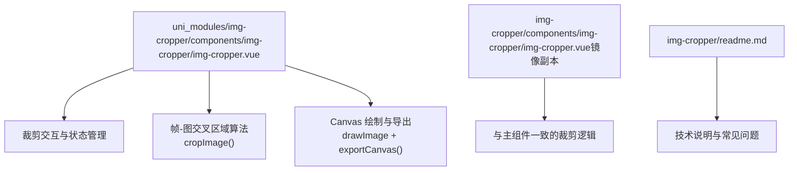
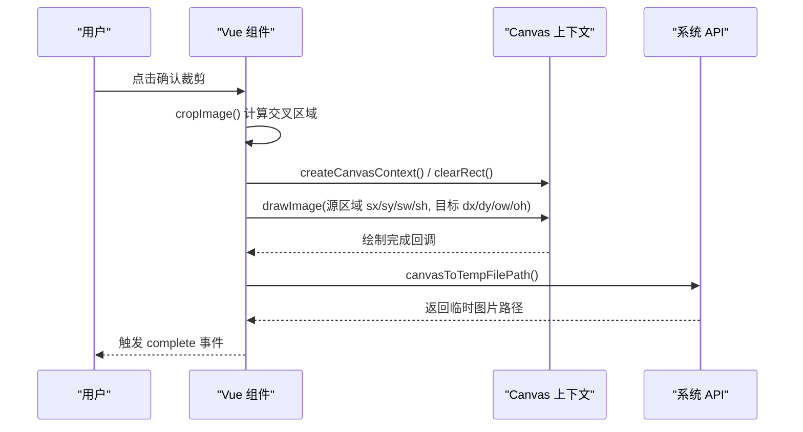
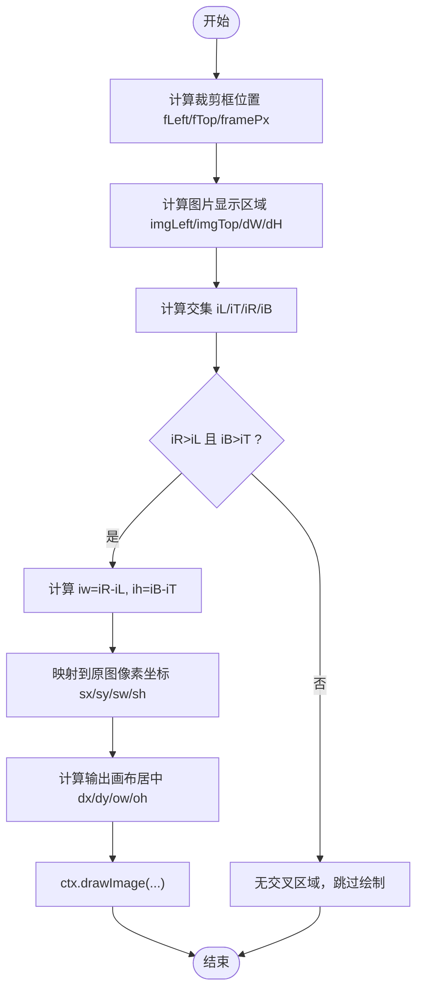
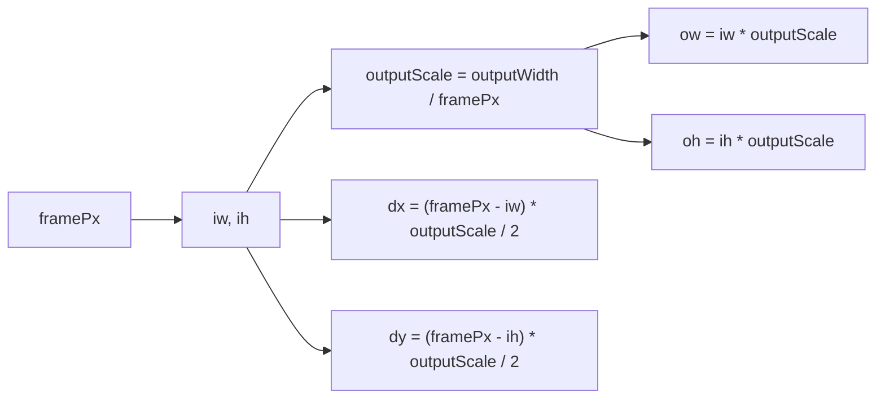
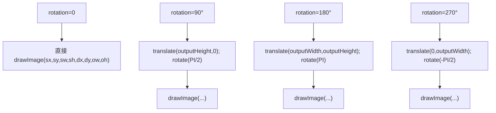
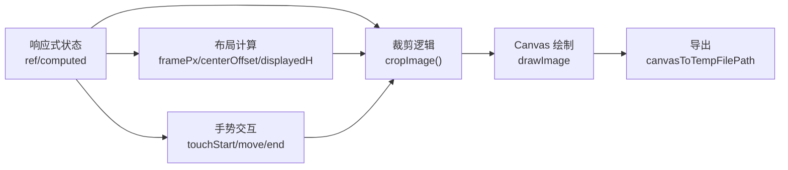

# 帧-图交叉区域算法

<cite>
**本文引用的文件**   
- [img-cropper.vue](file://uni_modules/img-cropper/components/img-cropper/img-cropper.vue)
- [img-cropper.vue（镜像副本）](file://img-cropper/components/img-cropper/img-cropper.vue)
- [img-cropper 插件说明](file://img-cropper/readme.md)
</cite>

## 目录
1. [引言](#引言)
2. [项目结构](#项目结构)
3. [核心组件](#核心组件)
4. [架构总览](#架构总览)
5. [详细组件分析](#详细组件分析)
6. [依赖关系分析](#依赖关系分析)
7. [性能考量](#性能考量)
8. [故障排查指南](#故障排查指南)
9. [结论](#结论)
10. [附录：数学推导与代码示例路径](#附录数学推导与代码示例路径)

## 引言
本文聚焦于图片裁剪组件中的“帧-图交叉区域算法”，系统解析其坐标转换、交叉矩形计算、像素级精度保证机制，以及输出画布居中的数学公式与实现细节。目标是帮助开发者理解该算法为何能确保“预览/生成图片与裁剪框视觉内容完全一致”，并掌握在 H5 与 APP（含 Android 10）上的关键兼容点与优化技巧。

## 项目结构
本仓库是一个 uni-app 工程，核心裁剪逻辑位于 uni_modules 下的 img-cropper 组件中；同时存在一份镜像副本用于演示或独立使用。

**图表来源**
- [img-cropper.vue:96-453](file://uni_modules/img-cropper/components/img-cropper/img-cropper.vue#L96-L453)
- [img-cropper.vue（镜像副本）:96-451](file://img-cropper/components/img-cropper/img-cropper.vue#L96-L451)
- [img-cropper 插件说明:120-150](file://img-cropper/readme.md#L120-L150)

**章节来源**
- [img-cropper.vue:96-453](file://uni_modules/img-cropper/components/img-cropper/img-cropper.vue#L96-L453)
- [img-cropper.vue（镜像副本）:96-451](file://img-cropper/components/img-cropper/img-cropper.vue#L96-L451)
- [img-cropper 插件说明:120-150](file://img-cropper/readme.md#L120-L150)

## 核心组件
- 组件职责
  - 提供全屏弹窗式裁剪界面，支持拖拽、缩放、旋转。
  - 通过 Canvas 将“帧-图交叉区域”映射到原图，再居中绘制到输出画布。
  - 将 Canvas 内容导出为临时图片路径，供预览或提交。
- 关键数据流
  - 输入：图片源路径、输出尺寸、裁剪框尺寸、旋转角度。
  - 中间：屏幕坐标系下计算交叉矩形，映射回原图像素坐标。
  - 输出：目标画布上居中的裁剪结果。

**章节来源**
- [img-cropper.vue:96-143](file://uni_modules/img-cropper/components/img-cropper/img-cropper.vue#L96-L143)
- [img-cropper.vue:312-438](file://uni_modules/img-cropper/components/img-cropper/img-cropper.vue#L312-L438)

## 架构总览
下图展示从用户操作到最终导出图片的完整流程，重点标注了“帧-图交叉区域算法”的位置。

**图表来源**
- [img-cropper.vue:312-438](file://uni_modules/img-cropper/components/img-cropper/img-cropper.vue#L312-L438)
- [img-cropper.vue:328-350](file://uni_modules/img-cropper/components/img-cropper/img-cropper.vue#L328-L350)

## 详细组件分析

### 1. 坐标系统与变量定义
- 屏幕坐标系
  - 裁剪框左上角：fLeft = centerOffsetX，fTop = frameTopPx
  - 图片显示区域左上角：imgLeft = centerOffsetX + translateX，imgTop = centerOffsetY + translateY
  - 图片显示宽高：dW = floor(imageWidth * scale)，dH = displayedH
- 裁剪框尺寸
  - framePx：由 rpx 转为 px 后取整，保证布局盒与视觉尺寸一致
- 输出画布
  - outputWidth/outputHeight：最终导出图片尺寸
  - outputScale = outputWidth / framePx：将“帧内像素”映射到“输出画布像素”

这些变量在裁剪前统一用 Math.floor 取整，避免 APP 端浮点像素取整方向不一致导致的偏移。

**章节来源**
- [img-cropper.vue:172-189](file://uni_modules/img-cropper/components/img-cropper/img-cropper.vue#L172-L189)
- [img-cropper.vue:363-371](file://uni_modules/img-cropper/components/img-cropper/img-cropper.vue#L363-L371)

### 2. 交叉矩形计算
在屏幕坐标系下，计算裁剪框与图片显示区域的交集：
- iL = max(fLeft, imgLeft)
- iT = max(fTop, imgTop)
- iR = min(fLeft + framePx, imgLeft + dW)
- iB = min(fTop + framePx, imgTop + dH)
- 有效条件：iR > iL 且 iB > iT

若满足条件，则得到交叉区域宽度 iw = iR - iL，高度 ih = iB - iT。

**图表来源**
- [img-cropper.vue:363-399](file://uni_modules/img-cropper/components/img-cropper/img-cropper.vue#L363-L399)

**章节来源**
- [img-cropper.vue:363-399](file://uni_modules/img-cropper/components/img-cropper/img-cropper.vue#L363-L399)

### 3. 像素级精度保证机制
- 所有尺寸统一使用 Math.floor 取整，包括：
  - framePx：rpx→px 后取整
  - displayedH：imageHeight*scale 后取整
  - centerOffsetX/Y：居中偏移取整
  - dW：imageWidth*scale 后取整
- 目的：避免 APP 端对浮点像素的不同取整策略导致视觉偏移，确保“所见即所得”。

**章节来源**
- [img-cropper.vue:172-189](file://uni_modules/img-cropper/components/img-cropper/img-cropper.vue#L172-L189)
- [img-cropper.vue:363-371](file://uni_modules/img-cropper/components/img-cropper/img-cropper.vue#L363-L371)

### 4. 源区域映射：屏幕坐标 → 原图像素
- ratio = originWidth / dW：屏幕显示宽度与原图宽度的比例
- 源区域：
  - sx = (iL - imgLeft) * ratio
  - sy = (iT - imgTop) * ratio
  - sw = (iR - iL) * ratio
  - sh = (iB - iT) * ratio

该映射保证从“屏幕可见的交叉区域”精确反推到“原图的对应像素块”。

**章节来源**
- [img-cropper.vue:381-396](file://uni_modules/img-cropper/components/img-cropper/img-cropper.vue#L381-L396)

### 5. 目标区域与居中公式
- outputScale = outputWidth / framePx
- ow = iw * outputScale
- oh = ih * outputScale
- 居中公式：
  - dx = (framePx - iw) * outputScale / 2
  - dy = (framePx - ih) * outputScale / 2

该公式确保：当交叉区域小于裁剪框时，剩余空间在输出画布上均匀分配，从而与预览视觉一致。

**图表来源**
- [img-cropper.vue:383-398](file://uni_modules/img-cropper/components/img-cropper/img-cropper.vue#L383-L398)

**章节来源**
- [img-cropper.vue:383-398](file://uni_modules/img-cropper/components/img-cropper/img-cropper.vue#L383-L398)

### 6. 旋转处理
- 预览阶段：CSS transform: rotate() 实时旋转显示。
- 导出阶段：根据 rotation 值（0/90/180/270），使用 ctx.translate() 与 ctx.rotate() 进行变换，确保导出图片与预览一致。
- 无论旋转角度如何，源区域仍按“无旋转”时的交叉区域计算，再通过 Canvas 变换实现旋转。

**图表来源**
- [img-cropper.vue:390-431](file://uni_modules/img-cropper/components/img-cropper/img-cropper.vue#L390-L431)

**章节来源**
- [img-cropper.vue:390-431](file://uni_modules/img-cropper/components/img-cropper/img-cropper.vue#L390-L431)

### 7. 导出流程
- 清空画布：clearRect(0, 0, outputWidth, outputHeight)
- 绘制：ctx.drawImage(...)
- 导出：canvasToTempFilePath({ canvasId, x/y/width/height, destWidth/destHeight, fileType, quality })
- 延迟导出：setTimeout 200ms 确保绘制完成后再导出

**章节来源**
- [img-cropper.vue:328-350](file://uni_modules/img-cropper/components/img-cropper/img-cropper.vue#L328-L350)
- [img-cropper.vue:378-436](file://uni_modules/img-cropper/components/img-cropper/img-cropper.vue#L378-L436)

## 依赖关系分析
- 运行时依赖
  - Vue 3 响应式状态：ref/computed
  - uni-app 平台 API：uni.upx2px、uni.getSystemInfoSync、uni.getImageInfo、uni.createCanvasContext、uni.canvasToTempFilePath
- 组件内部依赖
  - 布局计算依赖 framePx、centerOffsetX/Y、displayedH
  - 裁剪逻辑依赖 rotation、scale、translateX/Y、originWidth/Height

**图表来源**
- [img-cropper.vue:145-189](file://uni_modules/img-cropper/components/img-cropper/img-cropper.vue#L145-L189)
- [img-cropper.vue:264-310](file://uni_modules/img-cropper/components/img-cropper/img-cropper.vue#L264-L310)
- [img-cropper.vue:312-438](file://uni_modules/img-cropper/components/img-cropper/img-cropper.vue#L312-L438)

**章节来源**
- [img-cropper.vue:145-189](file://uni_modules/img-cropper/components/img-cropper/img-cropper.vue#L145-L189)
- [img-cropper.vue:264-310](file://uni_modules/img-cropper/components/img-cropper/img-cropper.vue#L264-L310)
- [img-cropper.vue:312-438](file://uni_modules/img-cropper/components/img-cropper/img-cropper.vue#L312-L438)

## 性能考量
- 避免不必要的重绘：仅在确认裁剪时执行 Canvas 绘制与导出。
- 使用 Math.floor 统一取整，减少因浮点像素差异导致的额外校正开销。
- 导出前 setTimeout 200ms，确保绘制完成，避免重复导出失败。
- 限制缩放范围（1~3），防止极端缩放带来的计算与渲染压力。

[本节为通用指导，不直接分析具体文件]

## 故障排查指南
- 图片不显示
  - 原因：cropAreaHeight 在异步回调中赋值，导致 computed 计算出负数偏移
  - 解决：已在 open() 中立即设置初始值
- TypeScript 报错
  - 问题：提示找不到 uni 或 vue 模块
  - 解决：不影响运行，可忽略；如需类型支持，安装 @dcloudio/types
- 裁剪结果与预览不一致
  - 检查：图片路径是否正确、输出尺寸是否合理
  - 原理：组件使用帧-图交叉区域算法，确保预览与生成图片完全一致

**章节来源**
- [img-cropper 插件说明:152-171](file://img-cropper/readme.md#L152-L171)

## 结论
“帧-图交叉区域算法”通过严格的坐标转换与像素级精度控制，确保裁剪输出与裁剪框视觉内容完全一致。其关键点包括：
- 屏幕坐标系下计算交叉矩形
- 将交叉区域映射回原图像素坐标
- 以 outputScale 将交叉区域居中放置到输出画布
- 统一 Math.floor 取整策略保障跨端一致性
- 旋转场景下保持源区域计算不变，通过 Canvas 变换实现旋转导出

这套设计兼顾准确性与性能，适用于 H5 与 APP（含 Android 10）等多端环境。

[本节为总结性内容，不直接分析具体文件]

## 附录：数学推导与代码示例路径

### 数学推导
- 已知
  - 裁剪框：fLeft, fTop, framePx
  - 图片显示区域：imgLeft, imgTop, dW, dH
- 交叉矩形
  - iL = max(fLeft, imgLeft)
  - iT = max(fTop, imgTop)
  - iR = min(fLeft + framePx, imgLeft + dW)
  - iB = min(fTop + framePx, imgTop + dH)
  - 有效条件：iR > iL 且 iB > iT
- 源区域映射
  - ratio = originWidth / dW
  - sx = (iL - imgLeft) * ratio
  - sy = (iT - imgTop) * ratio
  - sw = (iR - iL) * ratio
  - sh = (iB - iT) * ratio
- 目标区域与居中
  - outputScale = outputWidth / framePx
  - ow = (iR - iL) * outputScale
  - oh = (iB - iT) * outputScale
  - dx = (framePx - (iR - iL)) * outputScale / 2
  - dy = (framePx - (iB - iT)) * outputScale / 2

### 代码示例路径
- 交叉区域计算与居中公式实现
  - [img-cropper.vue:363-399](file://uni_modules/img-cropper/components/img-cropper/img-cropper.vue#L363-L399)
- 旋转变换与 drawImage 调用
  - [img-cropper.vue:390-431](file://uni_modules/img-cropper/components/img-cropper/img-cropper.vue#L390-L431)
- 导出 Canvas 为临时图片
  - [img-cropper.vue:328-350](file://uni_modules/img-cropper/components/img-cropper/img-cropper.vue#L328-L350)

**章节来源**
- [img-cropper.vue:328-431](file://uni_modules/img-cropper/components/img-cropper/img-cropper.vue#L328-L431)