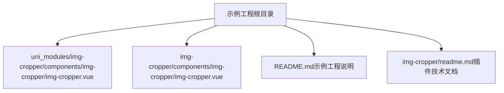
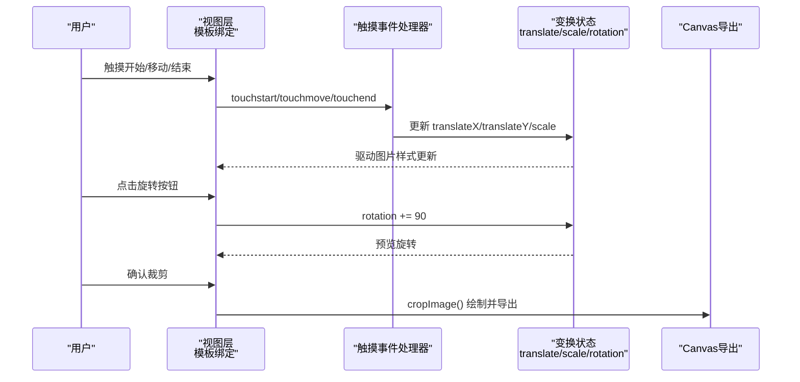
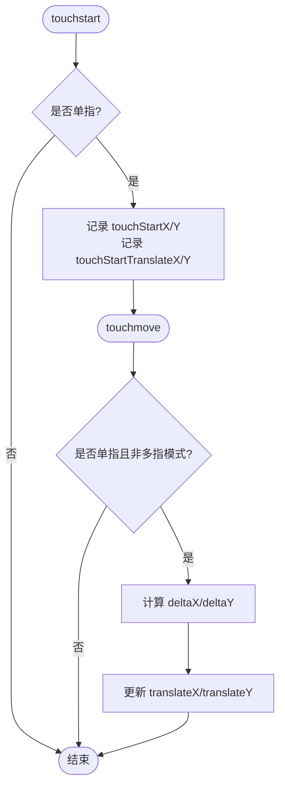
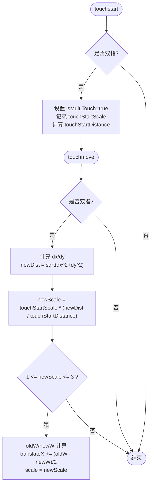
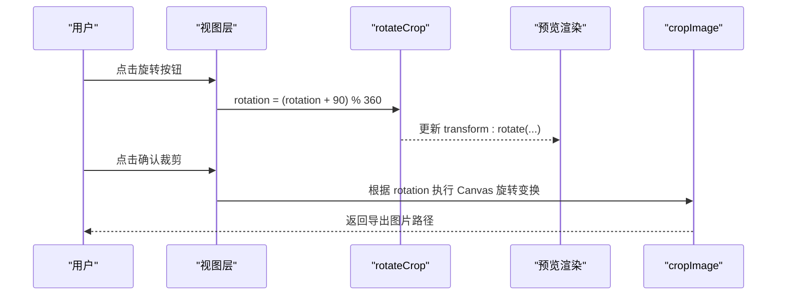
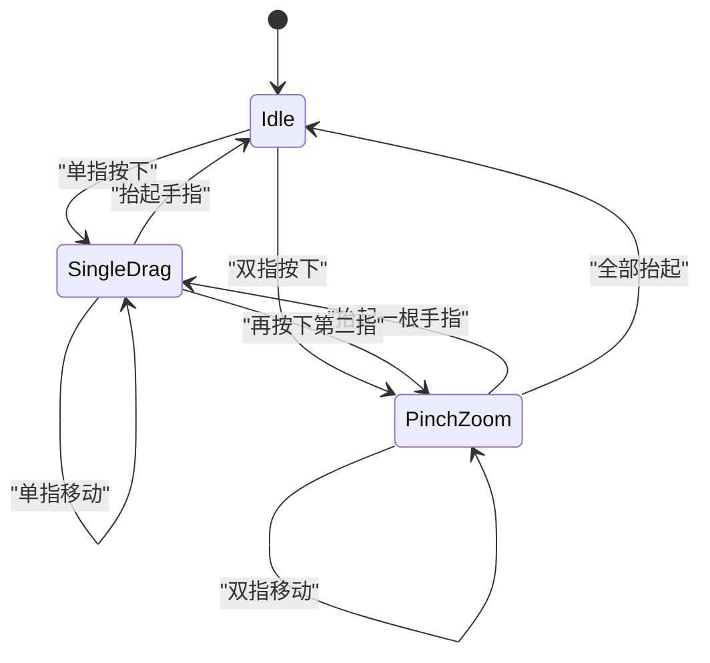
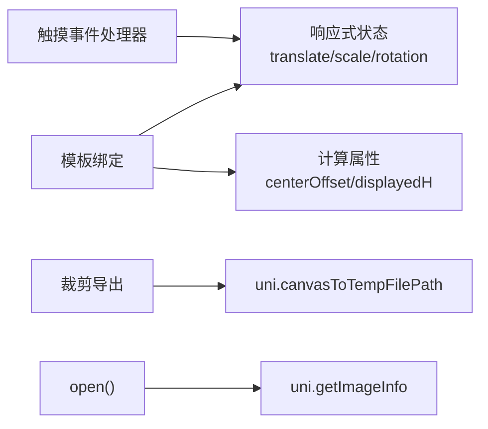

# 手势交互系统

<cite>
**本文引用的文件**   
- [img-cropper.vue](file://uni_modules/img-cropper/components/img-cropper/img-cropper.vue)
- [img-cropper.vue（插件发布目录）](file://img-cropper/components/img-cropper/img-cropper.vue)
- [README.md（示例工程说明）](file://README.md)
- [readme.md（插件技术文档）](file://img-cropper/readme.md)
</cite>

## 目录
1. [引言](#引言)
2. [项目结构](#项目结构)
3. [核心组件与状态](#核心组件与状态)
4. [架构总览](#架构总览)
5. [详细组件分析](#详细组件分析)
6. [依赖关系分析](#依赖关系分析)
7. [性能考虑](#性能考虑)
8. [故障排查指南](#故障排查指南)
9. [结论](#结论)

## 引言
本文件聚焦于图片裁剪组件中的手势交互系统，围绕以下目标展开：
- 单指拖拽移动：触摸起始位置记录、位移计算与边界限制逻辑。
- 双指缩放调整：多点触控检测、距离计算公式与缩放比例控制。
- 90度增量旋转：点击按钮实现顺时针旋转，并保证预览与导出一致。
- 触摸事件状态管理：isMultiTouch标志位使用、touchStartTranslateX/Y基准值重置机制。
- 手势冲突处理方案与性能优化建议，确保流畅的用户体验。

该组件基于 uni-app + Vue 3，同时支持 H5 与 APP（含 Android 10），通过 CSS transform: rotate 实现预览旋转，通过 Canvas 变换实现导出旋转，确保所见即所得。

**章节来源**
- [README.md（示例工程说明）:9-17](file://README.md#L9-L17)
- [readme.md（插件技术文档）:5-13](file://img-cropper/readme.md#L5-L13)

## 项目结构
本项目包含示例工程与可复用的裁剪组件：
- 示例工程根目录提供页面入口、配置与使用说明。
- 组件位于 uni_modules 与 img-cropper 两个目录中，内容基本一致，分别用于 easycom 自动注册与插件发布。

**图表来源**
- [README.md（示例工程说明）:50-77](file://README.md#L50-L77)
- [img-cropper.vue（插件发布目录）:1-94](file://img-cropper/components/img-cropper/img-cropper.vue#L1-L94)

**章节来源**
- [README.md（示例工程说明）:50-77](file://README.md#L50-L77)

## 核心组件与状态
组件在 setup 阶段集中声明了所有响应式状态，包括：
- 可见性与预览状态：visible、isPreview、previewSrc。
- 图片尺寸与显示尺寸：originWidth、originHeight、imageWidth、imageHeight、displayedH。
- 变换状态：translateX、translateY、scale、rotation。
- 触摸状态：touchStartX、touchStartY、touchStartTranslateX、touchStartTranslateY、touchStartScale、touchStartDistance、isMultiTouch。
- 布局计算：framePx、centerOffsetX、centerOffsetY、cropAreaHeight、frameTopPx。

这些状态共同驱动模板中的图片定位、缩放、旋转以及裁剪框遮罩与边框的渲染。

**章节来源**
- [img-cropper.vue:149-189](file://uni_modules/img-cropper/components/img-cropper/img-cropper.vue#L149-L189)
- [img-cropper.vue（插件发布目录）:149-189](file://img-cropper/components/img-cropper/img-cropper.vue#L149-L189)

## 架构总览
手势交互系统由“触摸事件处理器”和“图像变换状态”两部分组成：
- 触摸事件处理器负责解析单指/双指手势，更新位移、缩放等状态。
- 图像变换状态被模板绑定，驱动图片的 left/top/width/height/transform 属性变化。
- 旋转功能通过按钮触发 rotation 状态递增，并在 Canvas 导出时应用旋转变换。

**图表来源**
- [img-cropper.vue:265-310](file://uni_modules/img-cropper/components/img-cropper/img-cropper.vue#L265-L310)
- [img-cropper.vue:247-251](file://uni_modules/img-cropper/components/img-cropper/img-cropper.vue#L247-L251)
- [img-cropper.vue:361-436](file://uni_modules/img-cropper/components/img-cropper/img-cropper.vue#L361-L436)

**章节来源**
- [img-cropper.vue:265-310](file://uni_modules/img-cropper/components/img-cropper/img-cropper.vue#L265-L310)
- [img-cropper.vue:361-436](file://uni_modules/img-cropper/components/img-cropper/img-cropper.vue#L361-L436)

## 详细组件分析

### 单指拖拽移动
- 触摸起始位置记录：在 touchstart 中，当 e.touches.length === 1 时，记录 touchStartX、touchStartY 以及当前 translateX、translateY 作为基准。
- 位移计算：在 touchmove 中，当为单指且未处于多指模式时，根据当前手指坐标与起始坐标差值，直接更新 translateX、translateY。
- 边界限制逻辑：当前实现未对 translateX/translateY 做显式边界限制；图片可在裁剪区域内自由拖动。若需限制，可在 touchmove 中对 translateX/translateY 进行上下界钳制。

**图表来源**
- [img-cropper.vue:265-284](file://uni_modules/img-cropper/components/img-cropper/img-cropper.vue#L265-L284)
- [img-cropper.vue（插件发布目录）:263-282](file://img-cropper/components/img-cropper/img-cropper.vue#L263-L282)

**章节来源**
- [img-cropper.vue:265-284](file://uni_modules/img-cropper/components/img-cropper/img-cropper.vue#L265-L284)
- [img-cropper.vue（插件发布目录）:263-282](file://img-cropper/components/img-cropper/img-cropper.vue#L263-L282)

### 双指缩放调整
- 多点触控检测：在 touchstart 中，当 e.touches.length === 2 时，标记 isMultiTouch = true，记录 touchStartScale 与初始两点距离 touchStartDistance。
- 距离计算公式：在 touchmove 中，当检测到双指时，计算当前 dx、dy，并通过 Math.sqrt(dx*dx + dy*dy) 得到新距离，按新旧距离比值乘以初始缩放得到 newScale。
- 缩放比例控制：仅当 newScale 在 [1, 3] 范围内时生效；同时采用中心锚定缩放策略，将宽度变化量的一半折算进 translateX，使视觉中心保持不变。

**图表来源**
- [img-cropper.vue:272-297](file://uni_modules/img-cropper/components/img-cropper/img-cropper.vue#L272-L297)
- [img-cropper.vue（插件发布目录）:270-296](file://img-cropper/components/img-cropper/img-cropper.vue#L270-L296)

**章节来源**
- [img-cropper.vue:272-297](file://uni_modules/img-cropper/components/img-cropper/img-cropper.vue#L272-L297)
- [img-cropper.vue（插件发布目录）:270-296](file://img-cropper/components/img-cropper/img-cropper.vue#L270-L296)

### 90度增量旋转
- 旋转触发：点击工具栏中的旋转按钮，调用 rotateCrop，将 rotation 每次增加 90°，并对 360 取模。
- 预览旋转：模板中 image 元素通过 transform: rotate(rotation deg) 实时展示旋转效果。
- 导出旋转：cropImage 中根据 rotation 值选择不同 Canvas 变换路径（90°/180°/270°），确保导出图片与预览完全一致。

**图表来源**
- [img-cropper.vue:247-251](file://uni_modules/img-cropper/components/img-cropper/img-cropper.vue#L247-L251)
- [img-cropper.vue:361-436](file://uni_modules/img-cropper/components/img-cropper/img-cropper.vue#L361-L436)

**章节来源**
- [img-cropper.vue:247-251](file://uni_modules/img-cropper/components/img-cropper/img-cropper.vue#L247-L251)
- [img-cropper.vue:361-436](file://uni_modules/img-cropper/components/img-cropper/img-cropper.vue#L361-L436)

### 触摸事件的状态管理
- isMultiTouch 标志位：用于区分单指拖拽与双指缩放。在 touchstart 中根据 touches.length 设置；在 touchmove 中单指分支会检查 !isMultiTouch.value，避免与缩放冲突。
- touchStartTranslateX/Y 基准值重置：在 touchEnd 中，如果仍有一根手指（例如双指缩放后先抬起一根），则以剩余手指当前位置重新设置 touchStartX/Y 与 touchStartTranslateX/Y，避免后续单指拖拽出现跳变。

**图表来源**
- [img-cropper.vue:265-310](file://uni_modules/img-cropper/components/img-cropper/img-cropper.vue#L265-L310)
- [img-cropper.vue（插件发布目录）:263-308](file://img-cropper/components/img-cropper/img-cropper.vue#L263-L308)

**章节来源**
- [img-cropper.vue:265-310](file://uni_modules/img-cropper/components/img-cropper/img-cropper.vue#L265-L310)
- [img-cropper.vue（插件发布目录）:263-308](file://img-cropper/components/img-cropper/img-cropper.vue#L263-L308)

### 手势冲突处理方案
- 单指与双指互斥：通过 isMultiTouch 标志位确保单指拖拽不会与双指缩放同时生效。
- 双指到单指的平滑过渡：在 touchEnd 中，当只剩一根手指时，立即以该手指当前位置重设单指拖拽基准，避免从缩放切换到拖拽时的位置跳变。
- 缩放范围限制：将 newScale 限制在 [1, 3]，防止过度放大或缩小导致操作异常。

**章节来源**
- [img-cropper.vue:272-310](file://uni_modules/img-cropper/components/img-cropper/img-cropper.vue#L272-L310)
- [img-cropper.vue（插件发布目录）:270-308](file://img-cropper/components/img-cropper/img-cropper.vue#L270-L308)

## 依赖关系分析
- 组件内部依赖：
  - 模板绑定依赖 computed 属性（如 centerOffsetX、centerOffsetY、displayedH）与 ref 状态（translateX、translateY、scale、rotation）。
  - 触摸事件处理器依赖 uni 提供的 API（如 uni.getImageInfo、uni.canvasToTempFilePath）。
- 外部依赖：
  - Vue 3 组合式 API（ref、computed、defineComponent、getCurrentInstance、nextTick）。
  - uni-app 运行时环境（uni 全局对象）。

**图表来源**
- [img-cropper.vue:114-147](file://uni_modules/img-cropper/components/img-cropper/img-cropper.vue#L114-L147)
- [img-cropper.vue:202-229](file://uni_modules/img-cropper/components/img-cropper/img-cropper.vue#L202-L229)
- [img-cropper.vue:327-348](file://uni_modules/img-cropper/components/img-cropper/img-cropper.vue#L327-L348)

**章节来源**
- [img-cropper.vue:114-147](file://uni_modules/img-cropper/components/img-cropper/img-cropper.vue#L114-L147)
- [img-cropper.vue:202-229](file://uni_modules/img-cropper/components/img-cropper/img-cropper.vue#L202-L229)
- [img-cropper.vue:327-348](file://uni_modules/img-cropper/components/img-cropper/img-cropper.vue#L327-L348)

## 性能考虑
- 布局盒与视觉尺寸一致性：为避免 APP 端 transform: scale 导致的布局盒不跟随问题，组件直接使用 CSS 宽高设为缩放后的像素值，并使用 Math.floor 统一取整，减少浮点像素差异带来的偏移。
- 频繁更新的优化：
  - 在触摸事件中直接更新响应式状态，避免额外计算开销。
  - 使用 computed 缓存居中偏移与显示高度，减少重复计算。
- 导出性能：
  - cropImage 中使用 Canvas 变换绘制，仅在确认裁剪时执行，避免在拖拽过程中频繁绘制。
  - exportCanvas 使用 setTimeout 延迟导出，降低主线程压力。

[本节为通用性能建议，不直接分析具体代码行]

## 故障排查指南
- 图片不显示：
  - 原因：cropAreaHeight 在异步回调中赋值，可能导致 computed 计算出负数偏移。
  - 解决：已在 open() 中立即设置初始值，无需额外处理。
- TypeScript 报错：
  - 原因：未配置类型声明。
  - 解决：不影响运行，可忽略；如需类型支持，安装 @dcloudio/types。
- 裁剪结果与预览不一致：
  - 组件使用帧-图交叉区域算法确保一致；如遇问题，请检查图片路径与输出尺寸是否合理。

**章节来源**
- [README.md（示例工程说明）:222-245](file://README.md#L222-L245)
- [readme.md（插件技术文档）:152-171](file://img-cropper/readme.md#L152-L171)

## 结论
该手势交互系统通过清晰的状态管理与事件分流，实现了单指拖拽、双指缩放与 90 度增量旋转的核心能力。其关键设计要点包括：
- 使用 isMultiTouch 标志位隔离单指与双指手势，避免冲突。
- 在 touchEnd 中重置单指拖拽基准，确保缩放后切换拖拽的平滑性。
- 通过 CSS transform 与 Canvas 变换双重保障，实现预览与导出的旋转一致性。
- 针对 APP 端兼容性进行多项优化，确保在不同平台上的稳定表现。

在实际使用中，可根据业务需求扩展边界限制、缩放范围与旋转步进等参数，以获得更贴合产品体验的手势交互。