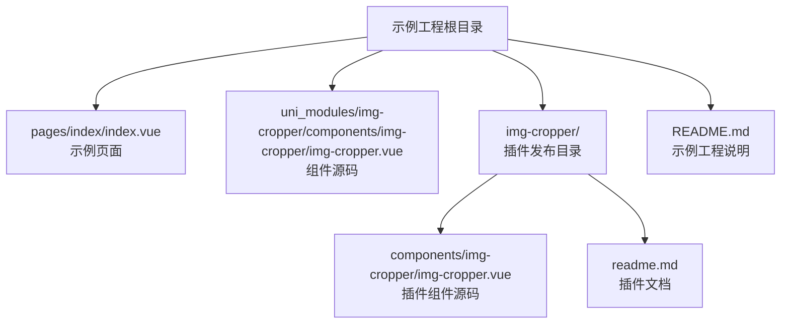
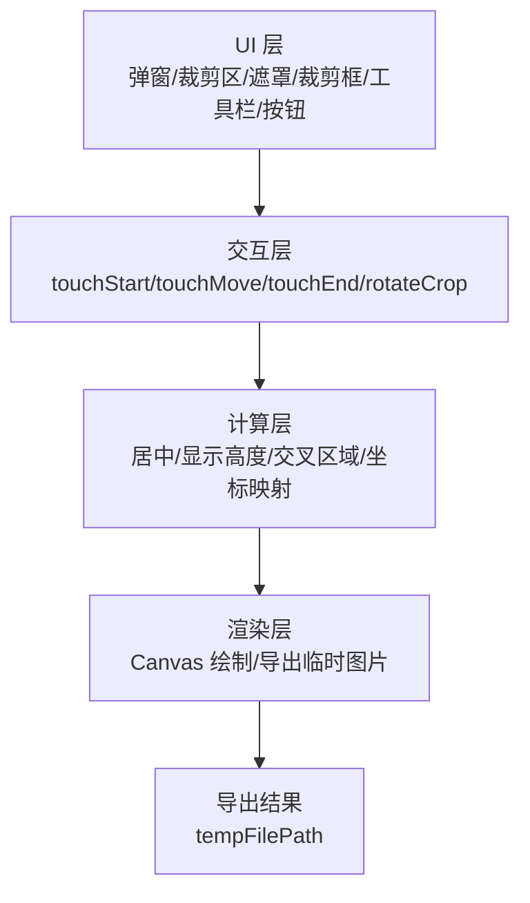
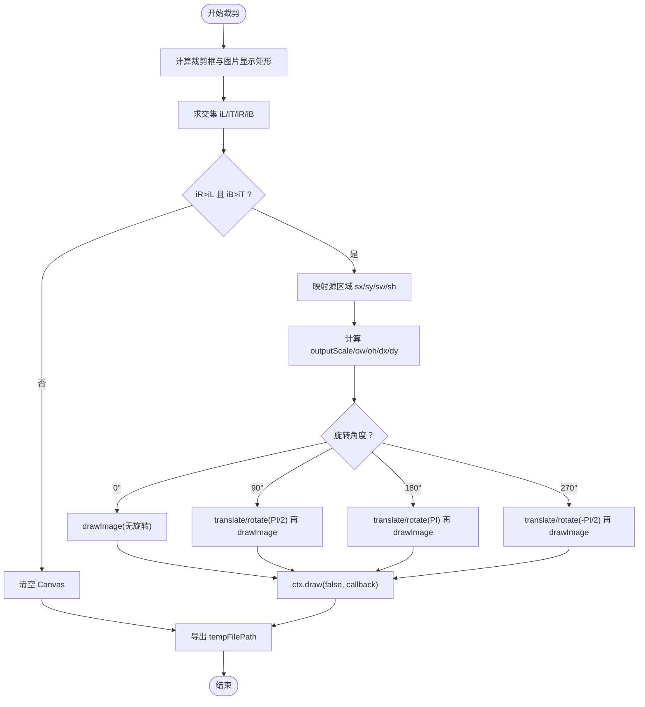
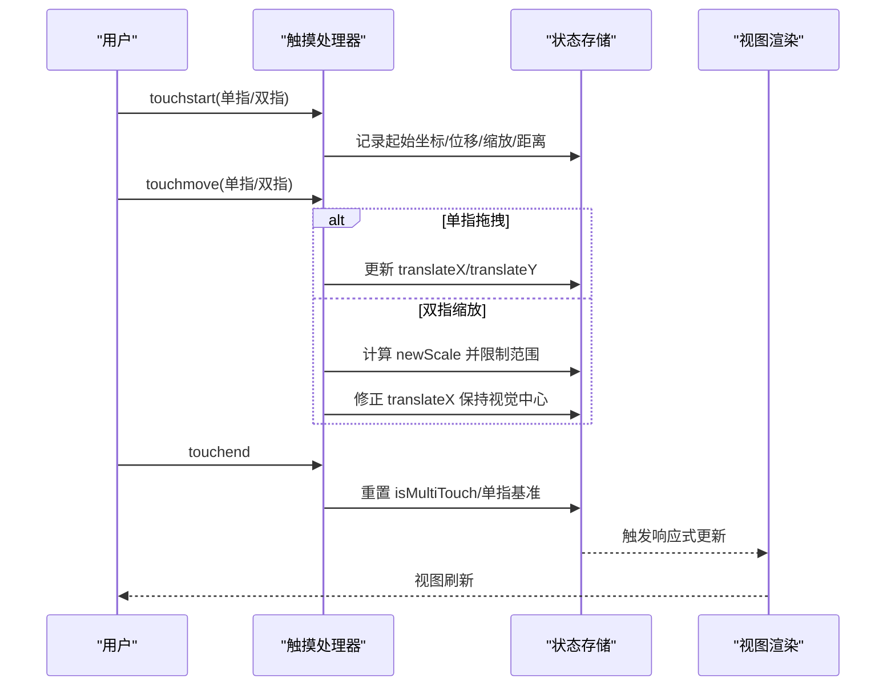
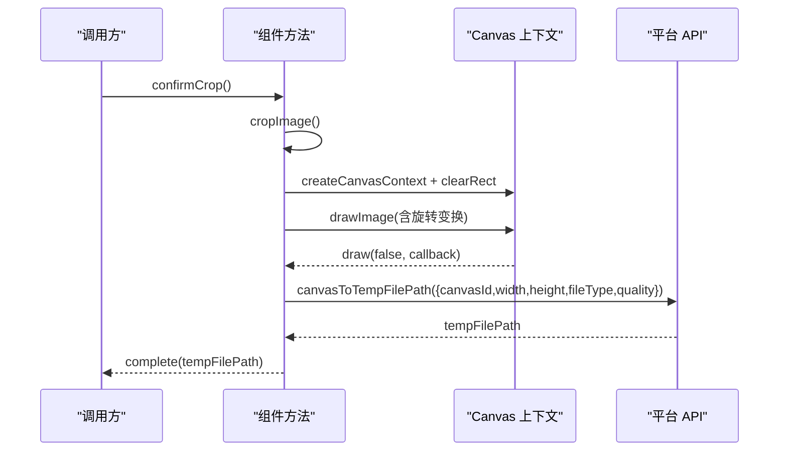
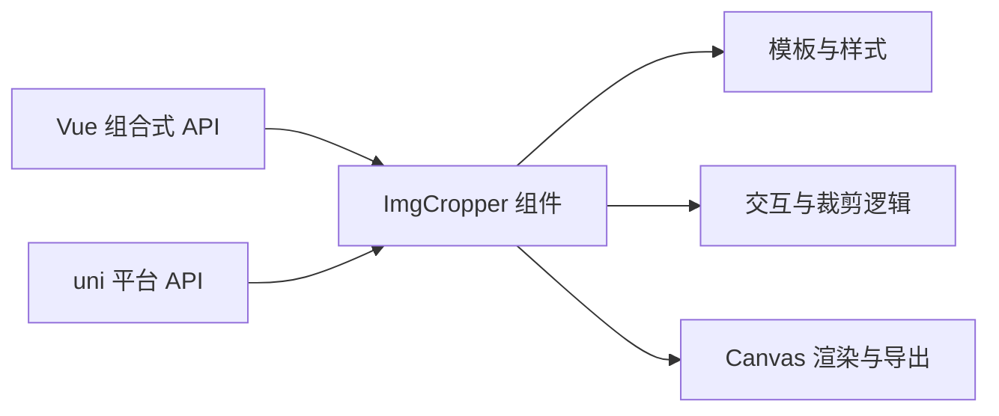

# 核心功能详解

<cite>
**本文引用的文件**   
- [img-cropper.vue](file://uni_modules/img-cropper/components/img-cropper/img-cropper.vue)
- [img-cropper.vue（插件发布目录）](file://img-cropper/components/img-cropper/img-cropper.vue)
- [README.md（示例工程说明）](file://README.md)
- [readme.md（插件文档）](file://img-cropper/readme.md)
</cite>

## 目录
1. [引言](#引言)
2. [项目结构](#项目结构)
3. [核心组件总览](#核心组件总览)
4. [架构总览](#架构总览)
5. [详细组件分析](#详细组件分析)
6. [依赖关系分析](#依赖关系分析)
7. [性能与质量优化](#性能与质量优化)
8. [故障排查指南](#故障排查指南)
9. [结论](#结论)
10. [附录：API 速查](#附录api-速查)

## 引言
本文件面向开发者，深入解析头像裁剪组件的核心实现，重点覆盖以下方面：
- 帧-图交叉区域算法的工作原理、坐标转换与像素级精度保证
- 手势交互系统：单指拖拽移动、双指缩放调整、90度增量旋转的触摸事件处理与状态管理
- Canvas 渲染引擎的工作流程：图像变换、质量优化、格式转换等关键技术点
- 性能优化建议与常见问题解决方案，帮助扩展与维护该组件

## 项目结构
仓库是一个基于 uni-app 的示例工程，包含：
- 示例页面与入口配置
- 可独立发布的 img-cropper 插件目录
- 已集成到 uni_modules 的组件源码

图表来源
- [README.md:50-77](file://README.md#L50-L77)
- [img-cropper.vue:1-94](file://uni_modules/img-cropper/components/img-cropper/img-cropper.vue#L1-L94)

章节来源
- [README.md:50-77](file://README.md#L50-L77)

## 核心组件总览
组件名为 ImgCropper，提供弹窗式图片裁剪能力，支持：
- 方形/圆形预览输出
- 单指拖拽移动图片
- 双指缩放调整大小
- 90度增量旋转
- 通过 Canvas 导出指定尺寸、格式与质量的图片

关键设计要点：
- 使用 CSS 宽高直接设为缩放后像素值，避免 APP 端 transform:scale 布局盒不一致问题
- 所有尺寸统一 Math.floor 取整，避免浮点像素取整方向不一致导致偏移
- 帧-图交叉区域算法确保预览与生成图片视觉一致
- Canvas 输出采用真正居中公式，保证裁剪框内内容在输出图中居中

章节来源
- [img-cropper.vue:97-113](file://uni_modules/img-cropper/components/img-cropper/img-cropper.vue#L97-L113)
- [img-cropper.vue:116-144](file://uni_modules/img-cropper/components/img-cropper/img-cropper.vue#L116-L144)

## 架构总览
组件内部由 UI 层、交互层、计算层与渲染层组成：
- UI 层：弹窗、裁剪区、遮罩、裁剪框、工具栏、按钮、隐藏 Canvas
- 交互层：触摸事件处理（单指拖拽、双指缩放）、旋转按钮
- 计算层：布局计算（居中、显示高度）、帧-图交叉区域计算、坐标映射
- 渲染层：Canvas 绘制、导出临时图片路径

图表来源
- [img-cropper.vue:1-94](file://uni_modules/img-cropper/components/img-cropper/img-cropper.vue#L1-L94)
- [img-cropper.vue:262-310](file://uni_modules/img-cropper/components/img-cropper/img-cropper.vue#L262-L310)
- [img-cropper.vue:311-438](file://uni_modules/img-cropper/components/img-cropper/img-cropper.vue#L311-L438)

## 详细组件分析

### 帧-图交叉区域算法与坐标转换
该算法是确保“所见即所得”的关键。其核心步骤如下：
1. 计算屏幕坐标系下裁剪框矩形与图片显示矩形的交集
   - 裁剪框：left=centerOffsetX, top=frameTopPx, width=height=framePx
   - 图片显示矩形：left=centerOffsetX+translateX, top=centerOffsetY+translateY, width=Math.floor(imageWidth*scale), height=displayedH
2. 计算交集矩形 (iL,iT,iR,iB)，若 iR>iL 且 iB>iT 则存在有效交集
3. 将交集从屏幕坐标映射回原图坐标：
   - ratio = originWidth / dW（dW 为图片显示宽度）
   - sx=(iL-imgLeft)*ratio, sy=(iT-imgTop)*ratio, sw=(iR-iL)*ratio, sh=(iB-iT)*ratio
4. 计算输出画布上的目标矩形并居中放置：
   - outputScale = outputWidth / framePx
   - ow=iw*outputScale, oh=ih*outputScale
   - dx=((fp-iw)*outputScale)/2, dy=((fp-ih)*outputScale)/2
5. 根据旋转角度应用 Canvas 变换：
   - 0°：直接 drawImage
   - 90°/180°/270°：ctx.translate + ctx.rotate 后再 drawImage

图表来源
- [img-cropper.vue:350-438](file://uni_modules/img-cropper/components/img-cropper/img-cropper.vue#L350-L438)

数学与精度要点：
- 所有尺寸计算统一使用 Math.floor，避免 APP 端浮点像素取整方向不一致导致的偏移
- 垂直居中使用 centerOffsetY = frameTopPx + (framePx - displayedH)/2，确保任意比例图片在裁剪框中始终居中
- 输出画布居中公式严格遵循 dx=(framePx-intersectW)*outputScale/2，dy=(framePx-intersectH)*outputScale/2

章节来源
- [img-cropper.vue:172-189](file://uni_modules/img-cropper/components/img-cropper/img-cropper.vue#L172-L189)
- [img-cropper.vue:350-438](file://uni_modules/img-cropper/components/img-cropper/img-cropper.vue#L350-L438)

### 手势交互系统与状态管理
组件维护两类状态：
- 图像状态：imageWidth/imageHeight（按 frameSize 与原始宽高比计算）、translateX/translateY（位移）、scale（缩放）、rotation（旋转）
- 触摸状态：touchStartX/Y、touchStartTranslateX/Y、touchStartScale、touchStartDistance、isMultiTouch

交互流程：
- 单指拖拽：记录起始坐标与当前 translate，move 时更新 translateX/translateY
- 双指缩放：记录初始两点距离与初始 scale，move 时根据新距离计算 newScale，限制范围 [1,3]；同时以中心锚定方式修正 translateX，使视觉中心不变
- 抬起手指：当双指缩放后先抬起一根手指时，用剩余手指位置重置单指拖拽基准，避免跳变
- 旋转：点击旋转按钮，rotation += 90 % 360

图表来源
- [img-cropper.vue:262-310](file://uni_modules/img-cropper/components/img-cropper/img-cropper.vue#L262-L310)

章节来源
- [img-cropper.vue:149-170](file://uni_modules/img-cropper/components/img-cropper/img-cropper.vue#L149-L170)
- [img-cropper.vue:262-310](file://uni_modules/img-cropper/components/img-cropper/img-cropper.vue#L262-L310)

### Canvas 渲染引擎工作流程
渲染流程包括：
1. 创建 Canvas Context：uni.createCanvasContext(canvasId, instance)
2. 清空画布：ctx.clearRect(0, 0, outputWidth, outputHeight)
3. 根据旋转角度执行 drawImage 变换
4. 完成绘制回调：ctx.draw(false, callback)
5. 导出临时图片：uni.canvasToTempFilePath(...)

关键点：
- 导出参数：width/height/destWidth/destHeight=outputWidth/outputHeight，fileType=jpg/png，quality=0~1
- 为保证跨端稳定，导出前延迟 setTimeout 200ms，避免某些平台异步时序问题
- 使用 getCurrentInstance() 在 setup 阶段捕获 instance，避免事件处理器中获取不到实例

图表来源
- [img-cropper.vue:311-348](file://uni_modules/img-cropper/components/img-cropper/img-cropper.vue#L311-L348)
- [img-cropper.vue:361-438](file://uni_modules/img-cropper/components/img-cropper/img-cropper.vue#L361-L438)

章节来源
- [img-cropper.vue:311-348](file://uni_modules/img-cropper/components/img-cropper/img-cropper.vue#L311-L348)
- [img-cropper.vue:361-438](file://uni_modules/img-cropper/components/img-cropper/img-cropper.vue#L361-L438)

### 预览与形状控制
- 预览模式：切换 isPreview=true 后显示 previewSrc，使用 image mode="aspectFit"
- 形状控制：outputShape='circle' 时为预览图添加圆形样式类
- 重新编辑：reEditCrop 切换回编辑模式并清空预览

章节来源
- [img-cropper.vue:47-59](file://uni_modules/img-cropper/components/img-cropper/img-cropper.vue#L47-L59)
- [img-cropper.vue:251-260](file://uni_modules/img-cropper/components/img-cropper/img-cropper.vue#L251-L260)

## 依赖关系分析
组件对外暴露：
- Props：输出尺寸、裁剪框尺寸、输出形状、质量、格式、主题色、边框颜色、文案等
- Events：complete/cancel/error
- Methods：open/close

内部依赖：
- Vue 组合式 API：computed/ref/defineComponent/getCurrentInstance/nextTick
- uni 平台 API：upx2px、getSystemInfoSync、getImageInfo、createCanvasContext、canvasToTempFilePath、showLoading/hideLoading/toast

图表来源
- [img-cropper.vue:114-144](file://uni_modules/img-cropper/components/img-cropper/img-cropper.vue#L114-L144)
- [img-cropper.vue:202-228](file://uni_modules/img-cropper/components/img-cropper/img-cropper.vue#L202-L228)
- [img-cropper.vue:329-348](file://uni_modules/img-cropper/components/img-cropper/img-cropper.vue#L329-L348)

章节来源
- [img-cropper.vue:114-144](file://uni_modules/img-cropper/components/img-cropper/img-cropper.vue#L114-L144)
- [img-cropper.vue:202-228](file://uni_modules/img-cropper/components/img-cropper/img-cropper.vue#L202-L228)
- [img-cropper.vue:329-348](file://uni_modules/img-cropper/components/img-cropper/img-cropper.vue#L329-L348)

## 性能与质量优化
- 输出尺寸与质量
  - 合理设置 outputWidth/outputHeight，避免过大导致内存与导出耗时增加
  - quality 控制在 0~1，兼顾清晰度与体积
- 格式选择
  - jpg 适合照片类，体积小；png 适合需要透明背景的场景
- 渲染优化
  - 使用 Math.floor 统一取整，减少跨端像素差异带来的重绘抖动
  - 避免不必要的 computed 重算，尽量复用中间变量
- 交互优化
  - 双指缩放范围限制 [1,3]，防止极端缩放导致性能下降或视觉异常
  - 单指拖拽与双指缩放手势分离，减少误触
- 导出优化
  - 导出前 setTimeout 延迟，提升跨端稳定性
  - 仅在确认裁剪时进行 Canvas 绘制与导出，避免频繁操作

[本节为通用指导，不直接分析具体代码文件]

## 故障排查指南
常见问题与定位思路：
- 图片不显示
  - 原因：cropAreaHeight 在异步回调中赋值，导致 computed 计算出负数偏移
  - 解决：已在 open() 中立即设置初始值，无需额外处理
- TypeScript 报错
  - 原因：未安装类型声明
  - 解决：不影响运行，可忽略；如需类型支持，安装 @dcloudio/types
- 裁剪结果与预览不一致
  - 检查图片路径是否正确
  - 检查输出尺寸是否合理
  - 确认旋转角度与 Canvas 变换逻辑一致

章节来源
- [README.md:222-245](file://README.md#L222-L245)
- [readme.md:152-171](file://img-cropper/readme.md#L152-L171)

## 结论
该头像裁剪组件通过严谨的帧-图交叉区域算法、稳定的手势交互机制与可靠的 Canvas 渲染流程，实现了跨端一致的裁剪体验。开发者可在现有基础上扩展更多手势（如捏合旋转）、自定义裁剪框形状与遮罩样式，或接入更复杂的图像处理管线。

[本节为总结性内容，不直接分析具体代码文件]

## 附录：API 速查
- Props
  - outputWidth/outputHeight：输出图片宽高（px）
  - frameSize：裁剪框尺寸（rpx）
  - outputShape：square/circle
  - quality：0~1
  - fileType：jpg/png
  - themeColor/frameColor/title/cancelText/resetText/reEditText/cropText/confirmText：UI 文案与配色
- Events
  - complete：返回 tempFilePath
  - cancel：用户取消
  - error：{ type, detail }
- Methods
  - open(src)：打开裁剪弹窗
  - close()：关闭裁剪弹窗

章节来源
- [img-cropper.vue:118-143](file://uni_modules/img-cropper/components/img-cropper/img-cropper.vue#L118-L143)
- [img-cropper.vue:144-145](file://uni_modules/img-cropper/components/img-cropper/img-cropper.vue#L144-L145)
- [img-cropper.vue:440-451](file://uni_modules/img-cropper/components/img-cropper/img-cropper.vue#L440-L451)