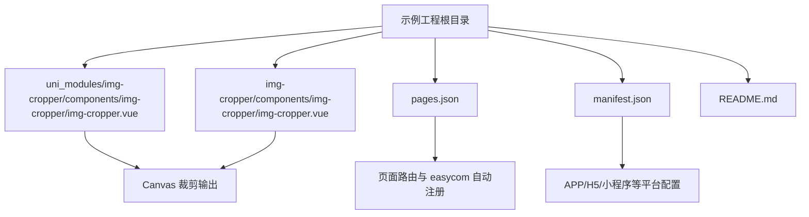
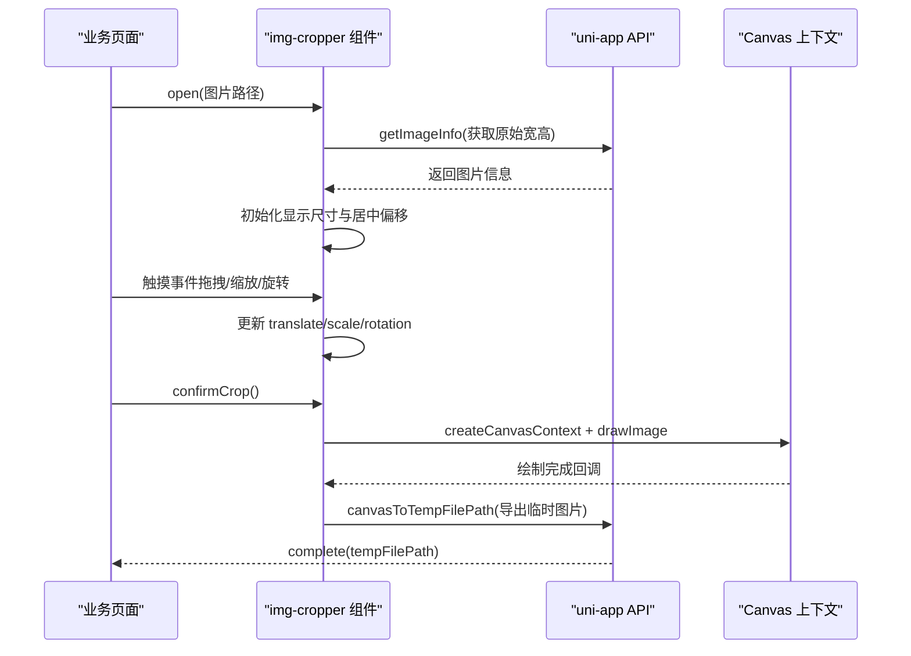
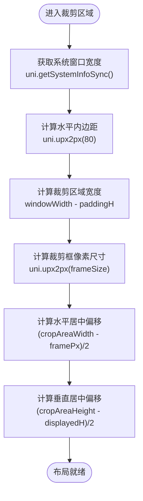
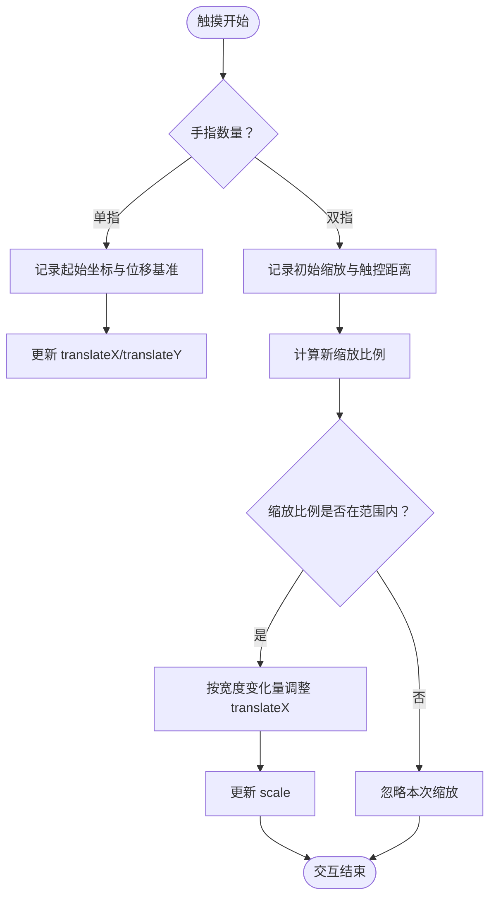
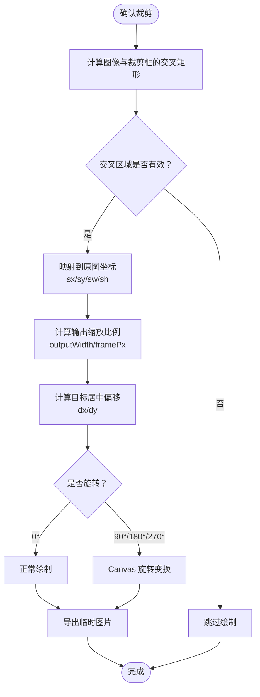
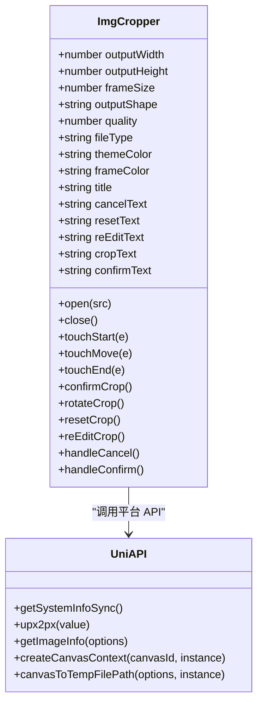
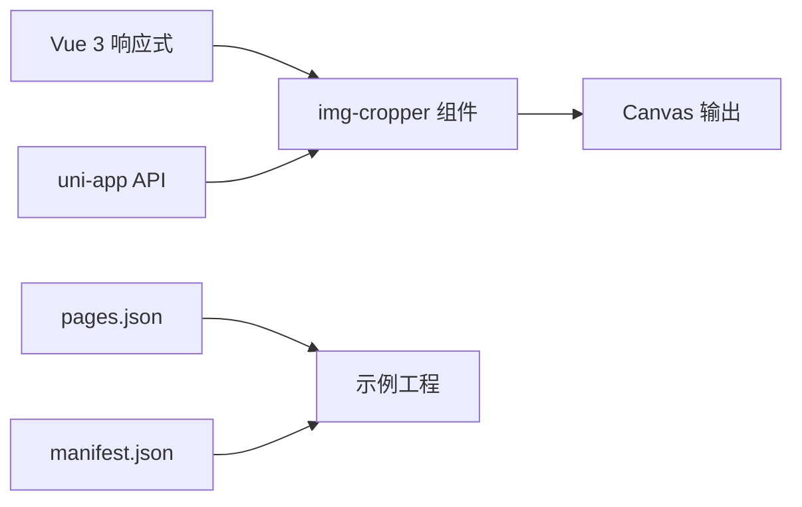

# 跨平台兼容性处理

<cite>
**本文引用的文件**   
- [img-cropper.vue（uni_modules 版本）](file://uni_modules\img-cropper\components\img-cropper\img-cropper.vue)
- [img-cropper.vue（插件发布目录版本）](file://img-cropper\components\img-cropper\img-cropper.vue)
- [README.md（示例工程文档）](file://README.md)
- [pages.json](file://pages.json)
- [manifest.json](file://manifest.json)
</cite>

## 目录
1. [引言](#引言)
2. [项目结构](#项目结构)
3. [核心组件与职责](#核心组件与职责)
4. [架构总览](#架构总览)
5. [详细组件分析](#详细组件分析)
6. [依赖关系分析](#依赖关系分析)
7. [性能与布局特性](#性能与布局特性)
8. [跨平台适配策略](#跨平台适配策略)
9. [测试与调试建议](#测试与调试建议)
10. [结论](#结论)

## 引言
本文件围绕图片裁剪组件的跨平台兼容性实现进行系统化解析，重点覆盖以下目标：
- APP 端（含 Android 10）的特殊适配方案，包括禁用 `transform: scale()`、避免使用 CSS `inset:0`、避免使用 `margin:auto` 居中。
- H5 端的标准支持方式与浏览器差异处理思路。
- uni-app 框架的平台差异 API 调用，如 `uni.upx2px` 单位转换、`uni.getSystemInfoSync` 系统信息获取等。
- 组件在不同平台的布局计算差异与样式适配方案。
- 跨平台测试建议和调试技巧，确保组件在多种环境下稳定运行。

该组件基于 uni-app 构建，同时面向 H5 和 APP（Android/iOS），并通过 Canvas 完成最终裁剪输出。其设计核心是“用真实像素尺寸驱动布局”，从而规避 APP 端渲染引擎对部分 CSS 特性的不一致行为。

## 项目结构
示例工程采用 uni-app 标准结构，核心裁剪逻辑集中在 `uni_modules/img-cropper/components/img-cropper/img-cropper.vue`，同时在 `img-cropper/` 目录下保留一份用于插件发布的副本。页面入口通过 `pages.json` 配置路由，应用级能力通过 `manifest.json` 声明。

**图表来源**
- [img-cropper.vue（uni_modules 版本）:1-94](file://uni_modules\img-cropper\components\img-cropper\img-cropper.vue#L1-L94)
- [img-cropper.vue（插件发布目录版本）:1-94](file://img-cropper\components\img-cropper\img-cropper.vue#L1-L94)
- [pages.json:1-22](file://pages.json#L1-L22)
- [manifest.json:1-73](file://manifest.json#L1-L73)

**章节来源**
- [README.md:50-77](file://README.md#L50-L77)
- [pages.json:1-22](file://pages.json#L1-L22)
- [manifest.json:1-73](file://manifest.json#L1-L73)

## 核心组件与职责
`img-cropper.vue` 是本次跨平台兼容性的核心载体，承担以下职责：
- 提供弹窗式裁剪界面，包含裁剪区域、遮罩、裁剪框、预览区、工具栏和操作按钮。
- 管理图片拖拽、双指缩放、旋转状态。
- 将屏幕坐标下的“帧-图交叉区域”映射到原图坐标，再通过 Canvas 绘制并导出临时图片路径。
- 通过 uni-app 提供的 API 获取系统信息和执行 Canvas 操作。
- 针对 APP 端限制，采用纯像素尺寸布局，避免不可靠的 CSS 特性。

组件对外暴露：
- Props：输出宽高、裁剪框尺寸、形状、质量、格式、主题色、边框色、标题与按钮文案等。
- Events：`complete`、`cancel`、`error`。
- Methods：`open`、`close`。

**章节来源**
- [img-cropper.vue（uni_modules 版本）:116-147](file://uni_modules\img-cropper\components\img-cropper\img-cropper.vue#L116-L147)
- [img-cropper.vue（插件发布目录版本）:116-147](file://img-cropper\components\img-cropper\img-cropper.vue#L116-L147)

## 架构总览
组件整体流程如下：用户触发选择图片后打开裁剪弹窗；组件加载图片信息并初始化显示尺寸；用户通过触摸交互调整位置、缩放和旋转；点击确认后，组件计算裁剪区域并在 Canvas 上绘制，最后导出为临时图片路径供上层使用。

**图表来源**
- [img-cropper.vue（uni_modules 版本）:202-228](file://uni_modules\img-cropper\components\img-cropper\img-cropper.vue#L202-L228)
- [img-cropper.vue（uni_modules 版本）:313-336](file://uni_modules\img-cropper\components\img-cropper\img-cropper.vue#L313-L336)
- [img-cropper.vue（uni_modules 版本）:363-436](file://uni_modules\img-cropper\components\img-cropper\img-cropper.vue#L363-L436)

## 详细组件分析

### 布局与尺寸计算
组件在布局阶段优先使用真实像素值，而不是依赖 CSS 变换或定位特性：
- 裁剪框尺寸通过 `uni.upx2px` 将 rpx 转换为 px，并使用 `Math.floor` 取整，避免浮点像素导致的偏移。
- 水平居中通过 `(cropAreaWidth - framePx) / 2` 计算 `centerOffsetX`。
- 垂直居中通过 `(cropAreaHeight - framePx) / 2` 计算 `frameTopPx`，再结合图片缩放后的显示高度 `displayedH` 计算 `centerOffsetY`。
- 所有关键尺寸统一使用 `Math.floor`，保证 APP 端布局盒与视觉尺寸一致。

**图表来源**
- [img-cropper.vue（uni_modules 版本）:172-189](file://uni_modules\img-cropper\components\img-cropper\img-cropper.vue#L172-L189)
- [img-cropper.vue（插件发布目录版本）:172-189](file://img-cropper\components\img-cropper\img-cropper.vue#L172-L189)

**章节来源**
- [img-cropper.vue（uni_modules 版本）:172-189](file://uni_modules\img-cropper\components\img-cropper\img-cropper.vue#L172-L189)
- [img-cropper.vue（插件发布目录版本）:172-189](file://img-cropper\components\img-cropper\img-cropper.vue#L172-L189)

### 触摸交互与中心锚定缩放
组件支持单指拖拽与双指缩放，并在缩放时保持视觉中心不变：
- 单指拖拽直接更新 `translateX` 与 `translateY`。
- 双指缩放根据触控距离变化计算新缩放比例，并限制在合理范围。
- 中心锚定缩放通过将宽度变化量对半折算进 `translateX`，使图片左边缘锚定的同时视觉中心保持不变；垂直方向由 `centerOffsetY` 自动补偿。

**图表来源**
- [img-cropper.vue（uni_modules 版本）:265-310](file://uni_modules\img-cropper\components\img-cropper\img-cropper.vue#L265-L310)
- [img-cropper.vue（插件发布目录版本）:263-308](file://img-cropper\components\img-cropper\img-cropper.vue#L263-L308)

**章节来源**
- [img-cropper.vue（uni_modules 版本）:265-310](file://uni_modules\img-cropper\components\img-cropper\img-cropper.vue#L265-L310)
- [img-cropper.vue（插件发布目录版本）:263-308](file://img-cropper\components\img-cropper\img-cropper.vue#L263-L308)

### 帧-图交叉区域裁剪算法
裁剪的核心是“帧-图交叉区域算法”：
- 计算裁剪框与图片在屏幕坐标系下的交叉矩形。
- 将交叉区域映射回原图坐标作为源矩形。
- 将交叉区域在输出画布中居中放置为目标矩形，使用真正居中公式：`dx = (framePx - intersectW) * outputScale / 2`，`dy = (framePx - intersectH) * outputScale / 2`。
- 支持 0°、90°、180°、270° 旋转，通过 Canvas 变换实现。

**图表来源**
- [img-cropper.vue（uni_modules 版本）:363-436](file://uni_modules\img-cropper\components\img-cropper\img-cropper.vue#L363-L436)
- [img-cropper.vue（插件发布目录版本）:361-436](file://img-cropper\components\img-cropper\img-cropper.vue#L361-L436)

**章节来源**
- [img-cropper.vue（uni_modules 版本）:363-436](file://uni_modules\img-cropper\components\img-cropper\img-cropper.vue#L363-L436)
- [img-cropper.vue（插件发布目录版本）:361-436](file://img-cropper\components\img-cropper\img-cropper.vue#L361-L436)

### 组件类结构与关系
从面向对象角度，组件可抽象为一个裁剪控制器，负责状态管理、交互处理和 Canvas 输出。

**图表来源**
- [img-cropper.vue（uni_modules 版本）:116-147](file://uni_modules\img-cropper\components\img-cropper\img-cropper.vue#L116-L147)
- [img-cropper.vue（uni_modules 版本）:202-228](file://uni_modules\img-cropper\components\img-cropper\img-cropper.vue#L202-L228)
- [img-cropper.vue（uni_modules 版本）:329-348](file://uni_modules\img-cropper\components\img-cropper\img-cropper.vue#L329-L348)

**章节来源**
- [img-cropper.vue（uni_modules 版本）:116-147](file://uni_modules\img-cropper\components\img-cropper\img-cropper.vue#L116-L147)

## 依赖关系分析
组件依赖 uni-app 提供的运行时 API 与 Vue 3 响应式能力：
- Vue 3：`computed`、`defineComponent`、`getCurrentInstance`、`nextTick`、`ref`。
- uni-app：`uni.upx2px`、`uni.getSystemInfoSync`、`uni.getImageInfo`、`uni.createCanvasContext`、`uni.canvasToTempFilePath`、`uni.showLoading`、`uni.hideLoading`、`uni.showToast`。
- 构建与配置：`pages.json` 控制页面路由与 easycom 自动注册；`manifest.json` 控制 APP/H5/小程序等平台配置。

**图表来源**
- [img-cropper.vue（uni_modules 版本）:114-114](file://uni_modules\img-cropper\components\img-cropper\img-cropper.vue#L114-L114)
- [pages.json:17-20](file://pages.json#L17-L20)
- [manifest.json:1-73](file://manifest.json#L1-L73)

**章节来源**
- [img-cropper.vue（uni_modules 版本）:114-114](file://uni_modules\img-cropper\components\img-cropper\img-cropper.vue#L114-L114)
- [pages.json:17-20](file://pages.json#L17-L20)
- [manifest.json:1-73](file://manifest.json#L1-L73)

## 性能与布局特性
- 使用真实像素尺寸驱动布局，避免 APP 端因 `transform:scale()` 导致的布局盒与视觉尺寸不一致问题。
- 所有关键尺寸使用 `Math.floor` 取整，减少浮点像素取整方向不一致带来的偏移。
- 遮罩层通过四块半透明区域围住裁剪框，替代可能兼容性较差的“挖空”效果。
- Canvas 隐藏于视口外，仅用于离线绘制与导出，不影响主线程 UI。

这些策略共同保证了在 APP 端（尤其是 Android 10）上的稳定性与一致性。

**章节来源**
- [img-cropper.vue（uni_modules 版本）:102-113](file://uni_modules\img-cropper\components\img-cropper\img-cropper.vue#L102-L113)
- [img-cropper.vue（uni_modules 版本）:172-189](file://uni_modules\img-cropper\components\img-cropper\img-cropper.vue#L172-L189)
- [img-cropper.vue（uni_modules 版本）:191-199](file://uni_modules\img-cropper\components\img-cropper\img-cropper.vue#L191-L199)

## 跨平台适配策略

### APP 端（含 Android 10）特殊适配
组件明确针对 APP 端的限制做了适配：
- 禁用 `transform: scale()`：在 Android 10 APP 端不可靠，因此采用直接设置图片宽高像素值的方式实现缩放。
- 禁用 CSS `inset:0`：APP 端不支持，改用 `top/right/bottom/left` 组合实现遮罩铺满。
- 禁用 `margin:auto` 居中：APP 端对 absolute 元素的 `margin:auto` 无效，改用显式计算 `centerOffsetX` 与 `centerOffsetY`。
- 在 `setup` 阶段捕获 `instance`：因为事件处理器中 `getCurrentInstance()` 可能返回 null，提前保存实例以确保 Canvas API 调用正确。

这些策略在组件注释中有明确说明，并在代码中通过像素尺寸与显式居中计算体现。

**章节来源**
- [img-cropper.vue（uni_modules 版本）:102-113](file://uni_modules\img-cropper\components\img-cropper\img-cropper.vue#L102-L113)
- [img-cropper.vue（uni_modules 版本）:145-147](file://uni_modules\img-cropper\components\img-cropper\img-cropper.vue#L145-L147)
- [img-cropper.vue（uni_modules 版本）:172-189](file://uni_modules\img-cropper\components\img-cropper\img-cropper.vue#L172-L189)
- [img-cropper.vue（uni_modules 版本）:191-199](file://uni_modules\img-cropper\components\img-cropper\img-cropper.vue#L191-L199)

### H5 端标准支持与浏览器差异处理
- H5 端遵循现代浏览器标准，CSS 与 Canvas API 支持良好。
- 组件仍沿用像素尺寸布局与显式居中计算，以保证与 APP 端行为一致，降低跨平台差异。
- 对于可能的浏览器差异（如 Canvas 导出、触摸事件细节），组件通过 uni-app 的统一 API 屏蔽底层差异，例如使用 `uni.canvasToTempFilePath` 而非直接调用原生 Canvas 导出方法。

虽然仓库未提供具体浏览器差异分支代码，但通过 uni-app API 的使用，可以认为组件在 H5 端以“标准兼容 + 统一封装”的方式处理差异。

**章节来源**
- [img-cropper.vue（uni_modules 版本）:329-348](file://uni_modules\img-cropper\components\img-cropper\img-cropper.vue#L329-L348)
- [README.md:211-220](file://README.md#L211-L220)

### uni-app 平台差异 API 调用
组件广泛使用 uni-app 提供的平台差异 API：
- `uni.upx2px`：将 rpx 转换为 px，用于裁剪框尺寸与内边距计算。
- `uni.getSystemInfoSync`：获取系统窗口宽度，用于计算裁剪区域宽度。
- `uni.getImageInfo`：获取图片原始宽高，用于按比例计算显示尺寸。
- `uni.createCanvasContext`：创建 Canvas 上下文，用于绘制裁剪区域。
- `uni.canvasToTempFilePath`：将 Canvas 内容导出为临时图片路径。
- `uni.showLoading`、`uni.hideLoading`、`uni.showToast`：提供统一的加载与提示体验。

这些 API 在组件中贯穿布局、交互与输出全流程，是跨平台兼容的关键支撑。

**章节来源**
- [img-cropper.vue（uni_modules 版本）:172-176](file://uni_modules\img-cropper\components\img-cropper\img-cropper.vue#L172-L176)
- [img-cropper.vue（uni_modules 版本）:212-227](file://uni_modules\img-cropper\components\img-cropper\img-cropper.vue#L212-L227)
- [img-cropper.vue（uni_modules 版本）:313-348](file://uni_modules\img-cropper\components\img-cropper\img-cropper.vue#L313-L348)

### 组件在不同平台的布局计算差异与样式适配
- 布局计算差异：APP 端对 CSS 特性支持有限，因此组件放弃依赖 `transform:scale()`、`inset:0`、`margin:auto`，转而使用像素尺寸与显式居中计算。
- 样式适配：遮罩层通过四块半透明区域实现，避免“挖空”兼容性；Canvas 隐藏于视口外，避免影响布局；按钮与工具栏使用 flex 布局，保证在不同平台下对齐一致。
- 单位转换：rpx 通过 `uni.upx2px` 转换为 px，确保在不同密度屏幕上表现一致。

**章节来源**
- [img-cropper.vue（uni_modules 版本）:102-113](file://uni_modules\img-cropper\components\img-cropper\img-cropper.vue#L102-L113)
- [img-cropper.vue（uni_modules 版本）:191-199](file://uni_modules\img-cropper\components\img-cropper\img-cropper.vue#L191-L199)
- [img-cropper.vue（uni_modules 版本）:172-189](file://uni_modules\img-cropper\components\img-cropper\img-cropper.vue#L172-L189)

## 测试与调试建议
为确保组件在多种环境下的稳定运行，建议采取以下测试与调试策略：
- 多平台真机测试：覆盖 H5、Android APP（含 Android 10）、iOS APP，验证裁剪结果与预览一致性。
- 边界场景测试：大图片、小图片、横竖屏切换、不同 DPI 屏幕、不同系统版本。
- 交互稳定性测试：单指拖拽、双指缩放、旋转操作，验证中心锚定缩放与位移连续性。
- Canvas 导出测试：不同输出格式（jpg/png）、不同质量参数，验证导出路径可用性与文件大小。
- 错误处理测试：图片加载失败、Canvas 导出失败，验证 `error` 事件与用户提示。
- 调试技巧：
  - 打印系统信息与窗口尺寸，确认 `uni.getSystemInfoSync` 返回值是否符合预期。
  - 打印 `framePx`、`centerOffsetX`、`centerOffsetY`、`displayedH` 等关键布局变量，检查取整与居中计算。
  - 在 Canvas 绘制前后打印源矩形与目标矩形，验证“帧-图交叉区域”是否正确。
  - 使用 uni-app 控制台或浏览器开发者工具查看触摸事件坐标，排查拖拽与缩放异常。

**章节来源**
- [README.md:222-248](file://README.md#L222-L248)
- [img-cropper.vue（uni_modules 版本）:313-348](file://uni_modules\img-cropper\components\img-cropper\img-cropper.vue#L313-L348)

## 结论
该图片裁剪组件通过“像素尺寸驱动布局 + 显式居中计算 + uni-app API 统一封装”的策略，成功实现了跨平台兼容，尤其在 APP 端（含 Android 10）规避了常见 CSS 特性不一致的问题。其核心优势在于：
- 明确的 APP 端适配策略，禁用不可靠的 CSS 特性。
- 稳定的布局与交互逻辑，确保预览与裁剪输出一致。
- 使用 uni-app API 屏蔽平台差异，提升可移植性。
- 完善的错误处理与用户体验反馈。

在实际项目中，建议结合多平台真机测试与边界场景验证，持续优化交互细节与性能表现，确保组件在各种环境下稳定可靠。