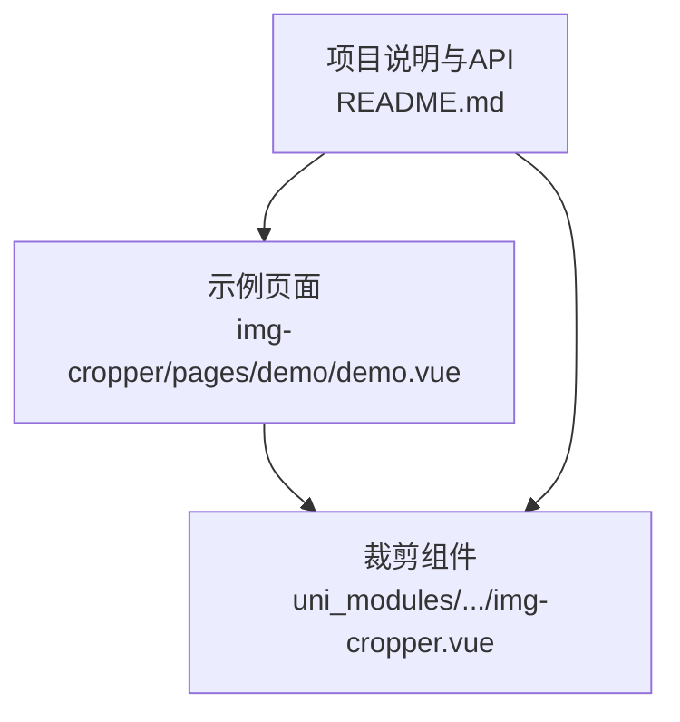
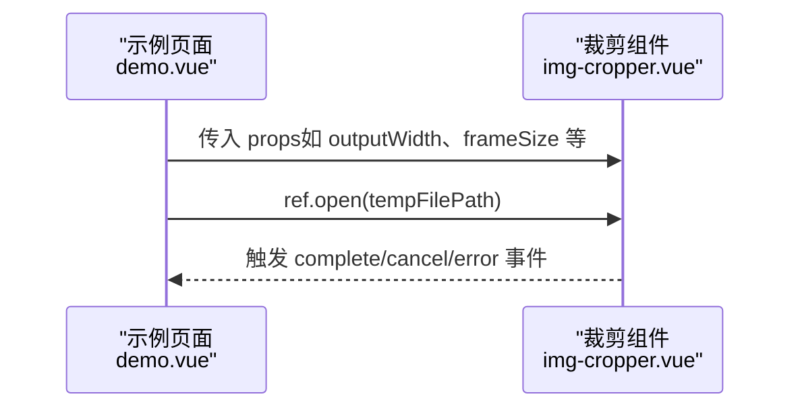
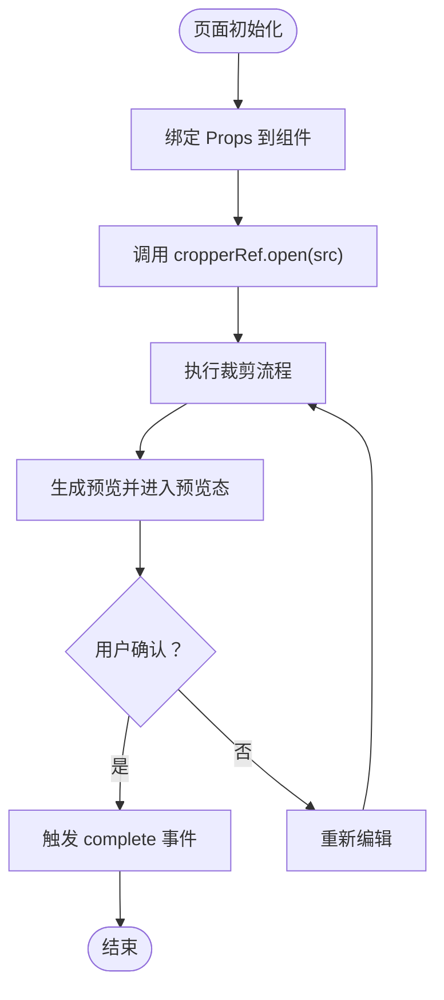

# Props属性配置

<cite>
**本文引用的文件**   
- [img-cropper.vue](file://uni_modules/img-cropper/components/img-cropper/img-cropper.vue)
- [demo.vue](file://img-cropper/pages/demo/demo.vue)
- [README.md](file://README.md)
</cite>

## 目录
1. [简介](#简介)
2. [项目结构](#项目结构)
3. [核心组件与Props总览](#核心组件与props总览)
4. [架构概览](#架构概览)
5. [详细Props说明](#详细props说明)
6. [依赖关系分析](#依赖关系分析)
7. [性能与使用建议](#性能与使用建议)
8. [常见问题排查](#常见问题排查)
9. [结论](#结论)

## 简介
本文件为图片裁剪组件 `img-cropper` 的 Props 属性配置文档，覆盖全部 13 个配置项：outputWidth、outputHeight、frameSize、outputShape、quality、fileType、themeColor、frameColor、title、cancelText、resetText、reEditText、cropText、confirmText。每个属性均提供类型定义、默认值、详细说明与代码使用示例位置，帮助开发者快速调整组件外观与行为。

## 项目结构
该仓库包含插件源码与示例工程：
- uni_modules/img-cropper/components/img-cropper/img-cropper.vue：组件实现与 Props 定义
- img-cropper/pages/demo/demo.vue：示例页面，演示如何引入并调用组件
- README.md：项目说明与 API 文档（含 Props 表格）

图表来源
- [demo.vue:24-35](file://img-cropper/pages/demo/demo.vue#L24-L35)
- [img-cropper.vue:116-143](file://uni_modules/img-cropper/components/img-cropper/img-cropper.vue#L116-L143)
- [README.md:175-194](file://README.md#L175-L194)

章节来源
- [README.md:50-77](file://README.md#L50-L77)

## 核心组件与Props总览
组件对外暴露以下关键能力：
- 通过 open(src) 打开裁剪弹窗
- 通过 close() 关闭弹窗
- 监听 complete/cancel/error 事件获取结果或错误信息

Props 总览（13项）：
- outputWidth：Number，默认 800
- outputHeight：Number，默认 800
- frameSize：Number，默认 560
- outputShape：String，默认 'square'
- quality：Number，默认 0.9
- fileType：String，默认 'jpg'
- themeColor：String，默认 '#07c160'
- frameColor：String，默认 '#ffffff'
- title：String，默认 '裁剪图片'
- cancelText：String，默认 '取消'
- resetText：String，默认 '重置'
- reEditText：String，默认 '重新裁剪'
- cropText：String，默认 '确认'
- confirmText：String，默认 '确认使用'

章节来源
- [img-cropper.vue:116-143](file://uni_modules/img-cropper/components/img-cropper/img-cropper.vue#L116-L143)
- [README.md:175-194](file://README.md#L175-L194)

## 架构概览
下图展示示例页面与裁剪组件之间的交互关系，以及 Props 在模板中的绑定位置。

图表来源
- [demo.vue:24-35](file://img-cropper/pages/demo/demo.vue#L24-L35)
- [img-cropper.vue:116-143](file://uni_modules/img-cropper/components/img-cropper/img-cropper.vue#L116-L143)

## 详细Props说明

### outputWidth
- 类型：Number
- 默认值：800
- 说明：输出图片宽度，单位 px。用于 Canvas 画布尺寸与导出目标尺寸。
- 使用示例位置：[demo.vue:26](file://img-cropper/pages/demo/demo.vue#L26)

章节来源
- [img-cropper.vue:119-120](file://uni_modules/img-cropper/components/img-cropper/img-cropper.vue#L119-L120)
- [demo.vue:26](file://img-cropper/pages/demo/demo.vue#L26)

### outputHeight
- 类型：Number
- 默认值：800
- 说明：输出图片高度，单位 px。用于 Canvas 画布尺寸与导出目标尺寸。
- 使用示例位置：[demo.vue:27](file://img-cropper/pages/demo/demo.vue#L27)

章节来源
- [img-cropper.vue:121-122](file://uni_modules/img-cropper/components/img-cropper/img-cropper.vue#L121-L122)
- [demo.vue:27](file://img-cropper/pages/demo/demo.vue#L27)

### frameSize
- 类型：Number
- 默认值：560
- 说明：裁剪框尺寸，单位 rpx。内部会转换为 px 以控制裁剪区域大小。
- 使用示例位置：[demo.vue:28](file://img-cropper/pages/demo/demo.vue#L28)

章节来源
- [img-cropper.vue:123-124](file://uni_modules/img-cropper/components/img-cropper/img-cropper.vue#L123-L124)
- [demo.vue:28](file://img-cropper/pages/demo/demo.vue#L28)

### outputShape
- 类型：String
- 默认值：'square'
- 说明：预览形状，可选 'square' 或 'circle'。圆形时预览图显示圆角效果。
- 使用示例位置：[demo.vue:29](file://img-cropper/pages/demo/demo.vue#L29)

章节来源
- [img-cropper.vue:125-126](file://uni_modules/img-cropper/components/img-cropper/img-cropper.vue#L125-L126)
- [demo.vue:29](file://img-cropper/pages/demo/demo.vue#L29)

### quality
- 类型：Number
- 默认值：0.9
- 说明：图片输出质量，取值范围 0~1。数值越高画质越好但体积越大。
- 使用示例位置：无直接示例，可在 demo.vue 中按需添加

章节来源
- [img-cropper.vue:127-128](file://uni_modules/img-cropper/components/img-cropper/img-cropper.vue#L127-L128)

### fileType
- 类型：String
- 默认值：'jpg'
- 说明：输出格式，可选 'jpg' 或 'png'。
- 使用示例位置：无直接示例，可在 demo.vue 中按需添加

章节来源
- [img-cropper.vue:129-130](file://uni_modules/img-cropper/components/img-cropper/img-cropper.vue#L129-L130)

### themeColor
- 类型：String
- 默认值：'#07c160'
- 说明：主题色，主要用于确认按钮背景色。
- 使用示例位置：[demo.vue:30](file://img-cropper/pages/demo/demo.vue#L30)

章节来源
- [img-cropper.vue:131-132](file://uni_modules/img-cropper/components/img-cropper/img-cropper.vue#L131-L132)
- [demo.vue:30](file://img-cropper/pages/demo/demo.vue#L30)

### frameColor
- 类型：String
- 默认值：'#ffffff'
- 说明：裁剪框边框颜色。
- 使用示例位置：无直接示例，可在 demo.vue 中按需添加

章节来源
- [img-cropper.vue:133-134](file://uni_modules/img-cropper/components/img-cropper/img-cropper.vue#L133-L134)

### title
- 类型：String
- 默认值：'裁剪图片'
- 说明：弹窗标题文案。
- 使用示例位置：[demo.vue:31](file://img-cropper/pages/demo/demo.vue#L31)

章节来源
- [img-cropper.vue:135-136](file://uni_modules/img-cropper/components/img-cropper/img-cropper.vue#L135-L136)
- [demo.vue:31](file://img-cropper/pages/demo/demo.vue#L31)

### cancelText
- 类型：String
- 默认值：'取消'
- 说明：取消按钮文案。
- 使用示例位置：无直接示例，可在 demo.vue 中按需添加

章节来源
- [img-cropper.vue:137-138](file://uni_modules/img-cropper/components/img-cropper/img-cropper.vue#L137-L138)

### resetText
- 类型：String
- 默认值：'重置'
- 说明：重置按钮文案；点击后重置缩放、位移和旋转。
- 使用示例位置：无直接示例，可在 demo.vue 中按需添加

章节来源
- [img-cropper.vue:139-140](file://uni_modules/img-cropper/components/img-cropper/img-cropper.vue#L139-L140)

### reEditText
- 类型：String
- 默认值：'重新裁剪'
- 说明：预览状态下“重新编辑”按钮文案。
- 使用示例位置：无直接示例，可在 demo.vue 中按需添加

章节来源
- [img-cropper.vue:140-141](file://uni_modules/img-cropper/components/img-cropper/img-cropper.vue#L140-L141)

### cropText
- 类型：String
- 默认值：'确认'
- 说明：初始状态下的确认裁剪按钮文案。
- 使用示例位置：无直接示例，可在 demo.vue 中按需添加

章节来源
- [img-cropper.vue:141-142](file://uni_modules/img-cropper/components/img-cropper/img-cropper.vue#L141-L142)

### confirmText
- 类型：String
- 默认值：'确认使用'
- 说明：预览状态下的确认使用按钮文案。
- 使用示例位置：无直接示例，可在 demo.vue 中按需添加

章节来源
- [img-cropper.vue:142-143](file://uni_modules/img-cropper/components/img-cropper/img-cropper.vue#L142-L143)

## 依赖关系分析
- 示例页面 demo.vue 通过 ref 引用组件实例，调用 open() 打开裁剪弹窗，并监听 complete/cancel/error 事件。
- 组件内部将 props 绑定到模板与逻辑中，影响画布尺寸、裁剪框样式、按钮文案与主题色等。

图表来源
- [demo.vue:24-35](file://img-cropper/pages/demo/demo.vue#L24-L35)
- [img-cropper.vue:116-143](file://uni_modules/img-cropper/components/img-cropper/img-cropper.vue#L116-L143)

章节来源
- [demo.vue:24-35](file://img-cropper/pages/demo/demo.vue#L24-L35)
- [img-cropper.vue:116-143](file://uni_modules/img-cropper/components/img-cropper/img-cropper.vue#L116-L143)

## 性能与使用建议
- 合理设置 outputWidth/outputHeight：过大的输出尺寸会增加内存占用与导出耗时，建议根据头像展示尺寸与上传需求选择合适分辨率。
- quality 与 fileType 权衡：jpg 在相同质量下通常体积更小；png 适合需要透明通道的场景，但体积更大。
- frameSize 与布局：frameSize 决定裁剪框视觉大小，过大可能挤压操作空间，过小则不利于精细裁剪。
- 主题与可访问性：确保 themeColor/frameColor 与整体 UI 风格一致，同时保证对比度满足可读性要求。

## 常见问题排查
- 图片不显示：检查传入的图片路径是否正确，并确保 open() 被正确调用。
- TypeScript 报错：若提示找不到 uni 或 vue 模块的类型声明，不影响运行；如需类型支持可安装对应类型包。
- 裁剪结果与预览不一致：确认输出尺寸与质量设置合理，并检查图片路径与 canvas 导出参数。

章节来源
- [README.md:222-245](file://README.md#L222-L245)

## 结论
通过对 13 个 Props 的系统梳理，开发者可以灵活定制裁剪组件的输出尺寸、形状、质量、格式、主题与文案，从而匹配不同业务场景的视觉与性能需求。建议在示例工程中按需扩展这些属性，并结合事件回调完成完整的裁剪与上传流程。