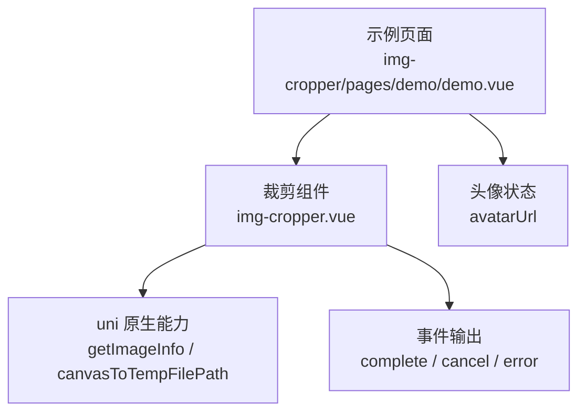
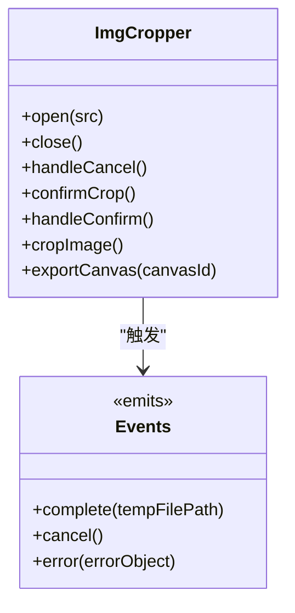
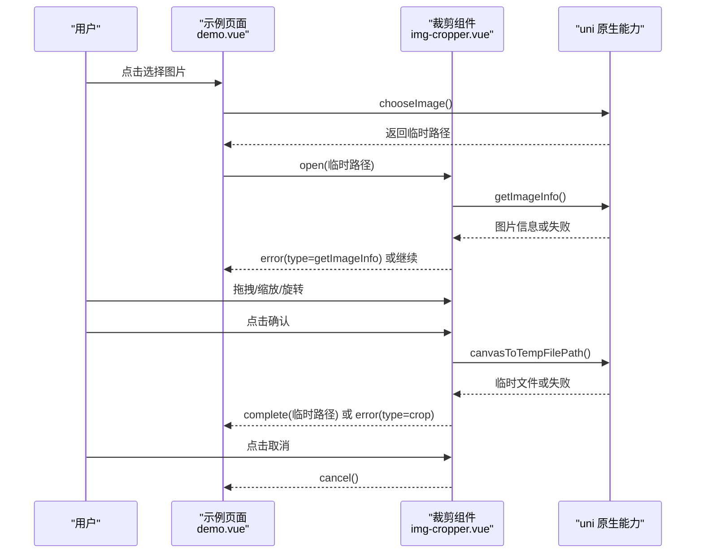
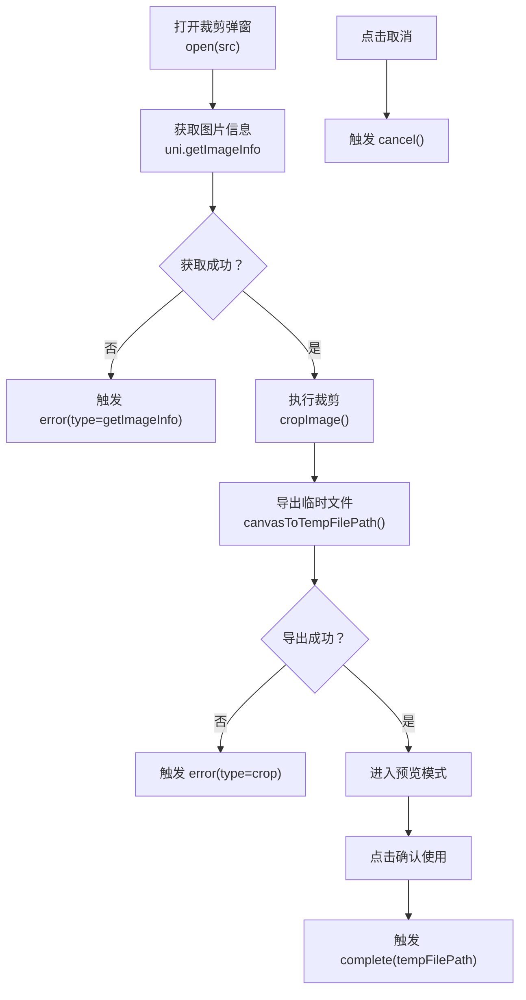
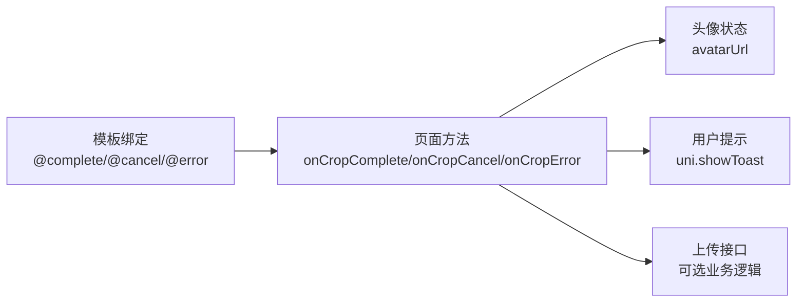

# 事件处理机制

<cite>
**本文引用的文件**   
- [img-cropper.vue（uni_modules 版本）](file://uni_modules\img-cropper\components\img-cropper\img-cropper.vue)
- [img-cropper.vue（插件发布目录版本）](file://img-cropper\components\img-cropper\img-cropper.vue)
- [demo.vue（示例页面）](file://img-cropper\pages\demo\demo.vue)
- [README.md（示例工程说明）](file://README.md)
</cite>

## 目录
1. [引言](#引言)
2. [项目结构与组件定位](#项目结构与组件定位)
3. [核心事件总览](#核心事件总览)
4. [complete 事件：裁剪完成](#complete-事件裁剪完成)
5. [cancel 事件：用户取消操作](#cancel-事件用户取消操作)
6. [error 事件：发生错误](#error-事件发生错误)
7. [完整使用示例与交互流程](#完整使用示例与交互流程)
8. [错误处理最佳实践](#错误处理最佳实践)
9. [架构与数据流图](#架构与数据流图)
10. [常见问题与排查建议](#常见问题与排查建议)
11. [结论](#结论)

## 引言
本文围绕图片裁剪组件暴露的三个核心事件，系统化说明其触发时机、参数格式、返回值类型以及监听处理方式。重点覆盖以下场景：
- 裁剪成功时返回临时文件路径字符串；
- 用户主动取消裁剪；
- 获取图片信息失败、裁剪失败等异常情况；
- 在 Vue 页面中如何正确监听并处理这些事件；
- 结合示例工程中的 demo 页面，给出完整的用户交互流程和错误处理建议。

## 项目结构与组件定位
该仓库是一个基于 uni-app 的头像裁剪示例工程，核心裁剪逻辑由 `img-cropper` 组件实现。组件同时存在于两个位置：
- `uni_modules/img-cropper/components/img-cropper/img-cropper.vue`：通过 easycom 自动注册供示例页面使用；
- `img-cropper/components/img-cropper/img-cropper.vue`：插件发布目录中的组件源码。

示例页面位于 `img-cropper/pages/demo/demo.vue`，演示了如何选择图片、打开裁剪弹窗、监听 `complete`、`cancel`、`error` 三个事件，并在裁剪成功后更新头像预览。

**图表来源**  
- [demo.vue:24-35](file://img-cropper\pages\demo\demo.vue#L24-L35)  
- [img-cropper.vue（uni_modules 版本）:144-145](file://uni_modules\img-cropper\components\img-cropper\img-cropper.vue#L144-L145)

**章节来源**  
- [README.md:50-77](file://README.md#L50-L77)  
- [img-cropper.vue（uni_modules 版本）:116-145](file://uni_modules\img-cropper\components\img-cropper\img-cropper.vue#L116-L145)

## 核心事件总览
组件通过 `emits` 声明了三个事件：
- `complete`：裁剪完成，回调参数为临时文件路径字符串；
- `cancel`：用户取消裁剪，无参数；
- `error`：发生错误，回调参数为包含 `type` 和 `detail` 的错误对象。

这三个事件贯穿组件的生命周期：从打开裁剪弹窗、获取图片信息、执行裁剪、预览结果，到最终确认或取消。

**图表来源**  
- [img-cropper.vue（uni_modules 版本）:144-145](file://uni_modules\img-cropper\components\img-cropper\img-cropper.vue#L144-L145)  
- [img-cropper.vue（uni_modules 版本）:237-240](file://uni_modules\img-cropper\components\img-cropper\img-cropper.vue#L237-L240)  
- [img-cropper.vue（uni_modules 版本）:313-325](file://uni_modules\img-cropper\components\img-cropper\img-cropper.vue#L313-L325)

**章节来源**  
- [img-cropper.vue（uni_modules 版本）:144-145](file://uni_modules\img-cropper\components\img-cropper\img-cropper.vue#L144-L145)

## complete 事件：裁剪完成
### 触发时机
当用户在裁剪界面点击“确认”后，组件会先执行裁剪逻辑，生成临时图片路径，然后进入预览模式；再次点击“确认使用”时，组件会触发 `complete` 事件，并将临时文件路径作为参数传递给父组件。

### 参数格式
- 参数类型：字符串；
- 参数含义：裁剪后的临时文件路径；
- 典型用途：用于头像展示、上传接口调用、本地保存等。

### 返回值类型
组件本身不直接返回 Promise，而是通过事件回调将结果交给父组件处理。父组件可在 `onCropComplete` 中接收该字符串并继续业务逻辑。

### 监听处理代码示例
在示例页面中，`onCropComplete` 接收临时文件路径，并将其赋值给 `avatarUrl`，随后弹出成功提示。注释中还展示了后续可调用上传接口的结构。

**章节来源**  
- [img-cropper.vue（uni_modules 版本）:258-261](file://uni_modules\img-cropper\components\img-cropper\img-cropper.vue#L258-L261)  
- [demo.vue:58-63](file://img-cropper\pages\demo\demo.vue#L58-L63)

## cancel 事件：用户取消操作
### 触发时机
当用户点击顶部标题栏右侧的“取消”按钮时，组件会触发 `cancel` 事件，并关闭裁剪弹窗。

### 参数格式
- 无参数；
- 父组件可根据业务需要记录日志、清理状态或提示用户。

### 返回值类型
组件不返回任何值，仅通知父组件用户已取消操作。

### 监听处理代码示例
示例页面中，`onCropCancel` 打印日志，表示用户取消了裁剪流程。实际项目中可以结合业务状态进行清理或回退。

**章节来源**  
- [img-cropper.vue（uni_modules 版本）:237-240](file://uni_modules\img-cropper\components\img-cropper\img-cropper.vue#L237-L240)  
- [demo.vue:65-67](file://img-cropper\pages\demo\demo.vue#L65-L67)

## error 事件：发生错误
### 触发时机
组件会在两类主要异常场景中触发 `error` 事件：
1. 获取图片信息失败：调用 `uni.getImageInfo` 失败；
2. 裁剪失败：裁剪过程中抛出异常，例如裁剪结果为空、Canvas 导出失败等。

### 参数格式
- 参数类型：对象；
- 字段说明：
  - `type`：错误类型标识，常见值为 `getImageInfo`、`crop`；
  - `detail`：具体错误详情，可能是原生 API 返回的错误对象或自定义错误信息。

### 返回值类型
组件不返回 Promise，而是通过事件向父组件传递结构化错误信息，便于统一错误处理和用户提示。

### 监听处理代码示例
示例页面中，`onCropError` 接收错误对象并打印日志。实际项目中应根据 `type` 分支处理不同错误，例如区分“图片不可读”和“裁剪失败”，并给出更友好的提示。

**章节来源**  
- [img-cropper.vue（uni_modules 版本）:222-225](file://uni_modules\img-cropper\components\img-cropper\img-cropper.vue#L222-L225)  
- [img-cropper.vue（uni_modules 版本）:319-324](file://uni_modules\img-cropper\components\img-cropper\img-cropper.vue#L319-L324)  
- [demo.vue:69-71](file://img-cropper\pages\demo\demo.vue#L69-L71)

## 完整使用示例与交互流程
### 页面集成方式
示例页面通过模板引入 `img-cropper` 组件，并绑定三个事件：
- `@complete="onCropComplete"`；
- `@cancel="onCropCancel"`；
- `@error="onCropError"`。

同时通过 `ref` 获取组件实例，调用 `open(tempFilePath)` 打开裁剪弹窗。

### 用户交互流程
1. 用户点击“选择图片并裁剪”；
2. 调用 `uni.chooseImage` 选择图片；
3. 拿到临时路径后调用 `cropperRef.value.open(tempFilePath)`；
4. 组件内部获取图片信息，初始化裁剪区域；
5. 用户拖拽、缩放、旋转图片；
6. 点击“确认”进入预览；
7. 点击“确认使用”触发 `complete`；
8. 若用户点击“取消”，触发 `cancel`；
9. 若出现异常，触发 `error`。

**图表来源**  
- [demo.vue:45-55](file://img-cropper\pages\demo\demo.vue#L45-L55)  
- [img-cropper.vue（uni_modules 版本）:202-228](file://uni_modules\img-cropper\components\img-cropper\img-cropper.vue#L202-L228)  
- [img-cropper.vue（uni_modules 版本）:313-325](file://uni_modules\img-cropper\components\img-cropper\img-cropper.vue#L313-L325)

**章节来源**  
- [demo.vue:24-35](file://img-cropper\pages\demo\demo.vue#L24-L35)  
- [demo.vue:45-71](file://img-cropper\pages\demo\demo.vue#L45-L71)

## 错误处理最佳实践
### 获取图片信息失败
当 `uni.getImageInfo` 失败时，组件会触发 `error` 事件，`type` 为 `getImageInfo`。建议在父组件中：
- 判断 `error.type === 'getImageInfo'`；
- 读取 `error.detail` 中的错误信息；
- 提示用户图片路径无效、权限不足或平台不支持；
- 避免继续执行裁剪流程。

### 裁剪失败
当裁剪过程中抛出异常，例如裁剪结果为空或 Canvas 导出失败，组件会触发 `error` 事件，`type` 为 `crop`。建议在父组件中：
- 判断 `error.type === 'crop'`；
- 根据 `error.detail` 区分是空结果还是底层 API 失败；
- 提示用户“裁剪失败”，并可引导重新选择图片或调整输出尺寸；
- 避免将空路径写入头像状态。

### 统一错误处理建议
- 在 `onCropError` 中集中处理所有错误；
- 对 `type` 做分支判断，提升错误可读性；
- 对用户可见的错误使用 `uni.showToast` 或弹窗提示；
- 对开发调试错误保留 `console.error` 输出；
- 在上传前校验临时路径是否有效，防止二次失败。

**章节来源**  
- [img-cropper.vue（uni_modules 版本）:222-225](file://uni_modules\img-cropper\components\img-cropper\img-cropper.vue#L222-L225)  
- [img-cropper.vue（uni_modules 版本）:319-324](file://uni_modules\img-cropper\components\img-cropper\img-cropper.vue#L319-L324)  
- [demo.vue:69-71](file://img-cropper\pages\demo\demo.vue#L69-L71)

## 架构与数据流图
### 组件内部事件触发关系

**图表来源**  
- [img-cropper.vue（uni_modules 版本）:202-228](file://uni_modules\img-cropper\components\img-cropper\img-cropper.vue#L202-L228)  
- [img-cropper.vue（uni_modules 版本）:313-325](file://uni_modules\img-cropper\components\img-cropper\img-cropper.vue#L313-L325)  
- [img-cropper.vue（uni_modules 版本）:258-261](file://uni_modules\img-cropper\components\img-cropper\img-cropper.vue#L258-L261)  
- [img-cropper.vue（uni_modules 版本）:237-240](file://uni_modules\img-cropper\components\img-cropper\img-cropper.vue#L237-L240)

### 页面与组件的事件绑定关系

**图表来源**  
- [demo.vue:24-35](file://img-cropper\pages\demo\demo.vue#L24-L35)  
- [demo.vue:58-71](file://img-cropper\pages\demo\demo.vue#L58-L71)

## 常见问题与排查建议
### 图片不显示
如果打开裁剪弹窗后图片不可见，通常与初始布局计算有关。组件已在 `open()` 中设置初始高度，避免 computed 依赖为 0 导致偏移异常。排查时可检查：
- 传入的图片路径是否正确；
- 是否在异步回调后才设置关键布局状态；
- 平台差异导致的像素取整问题。

### TypeScript 报错
如果项目未配置 uni-app 的类型声明，可能出现找不到 `uni` 或 `vue` 模块的提示。这不影响运行，如需类型支持可安装对应类型包。

### 裁剪结果与预览不一致
组件使用帧-图交叉区域算法确保预览与生成图片一致。如遇不一致，请检查：
- 图片路径是否正确；
- 输出尺寸是否合理；
- 是否启用了旋转功能且旋转角度是否正确。

**章节来源**  
- [README.md:222-245](file://README.md#L222-L245)

## 结论
`img-cropper` 组件通过 `complete`、`cancel`、`error` 三个事件，清晰划分了成功、取消、异常三种用户交互结果。父组件只需在模板中绑定对应事件处理器，即可实现完整的头像裁剪流程。推荐在 `onCropError` 中统一处理错误，并根据 `type` 分支区分 `getImageInfo` 与 `crop` 两种错误场景，从而提供更稳定的用户体验。