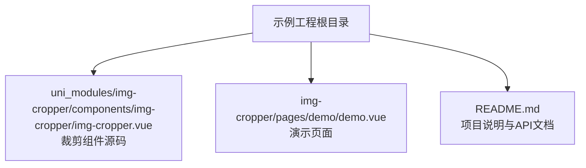
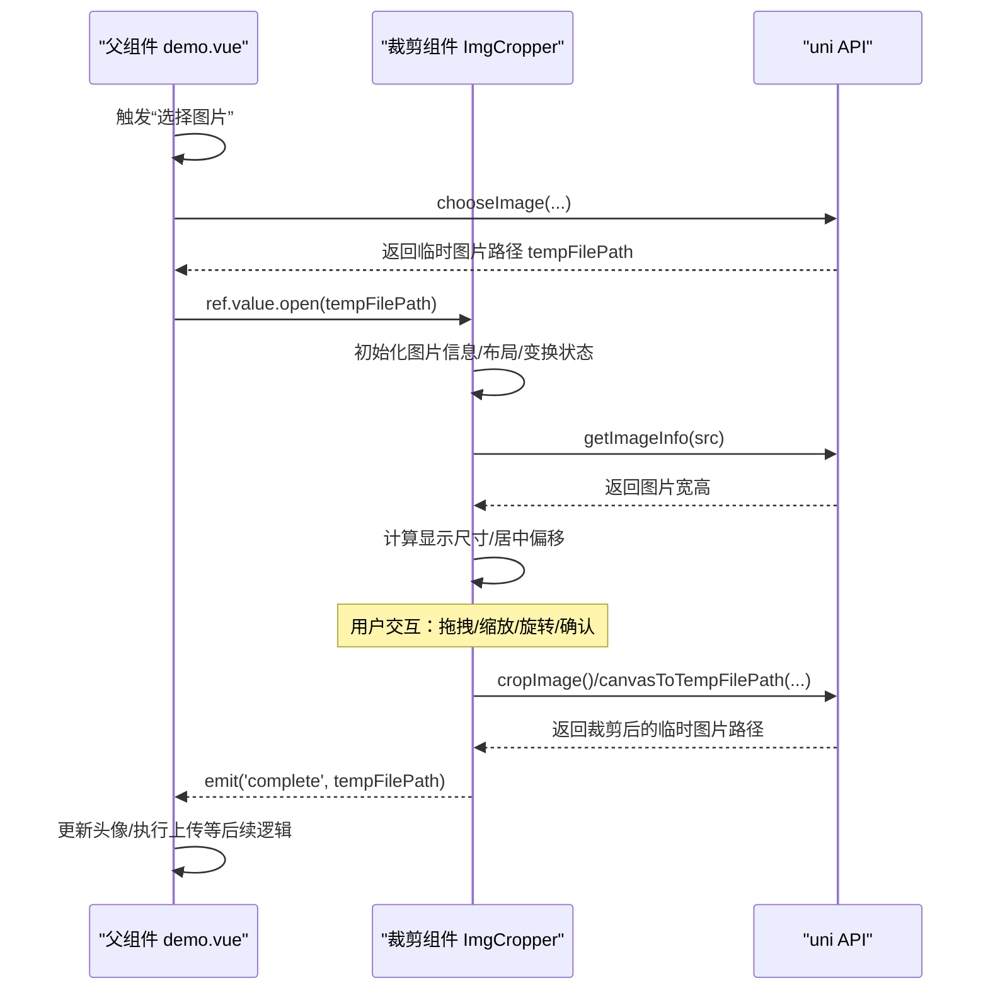

# 方法接口文档

<cite>
**本文引用的文件**   
- [img-cropper.vue](file://uni_modules/img-cropper/components/img-cropper/img-cropper.vue)
- [demo.vue](file://img-cropper/pages/demo/demo.vue)
- [README.md](file://README.md)
</cite>

## 目录
1. [简介](#简介)
2. [项目结构](#项目结构)
3. [核心组件与公共方法总览](#核心组件与公共方法总览)
4. [架构概览](#架构概览)
5. [详细方法说明](#详细方法说明)
6. [依赖关系分析](#依赖关系分析)
7. [性能与兼容性注意事项](#性能与兼容性注意事项)
8. [故障排查指南](#故障排查指南)
9. [结论](#结论)

## 简介
本文档聚焦于图片裁剪组件对外暴露的两个公共方法：open 与 close。内容涵盖参数定义、调用时机、使用场景、内部实现逻辑、事件配合以及完整的集成示例，帮助你在父组件中通过 ref 正确调用这些方法，并与其他功能（如选择图片、上传头像）协同工作。

## 项目结构
该仓库是一个基于 uni-app 的头像裁剪插件示例工程，核心裁剪组件位于 uni_modules 下的 img-cropper 包中，演示页面位于 img-cropper/pages/demo 下。



图表来源
- [README.md:50-77](file://README.md#L50-L77)

章节来源
- [README.md:50-77](file://README.md#L50-L77)

## 核心组件与公共方法总览
- 组件名称：ImgCropper
- 暴露的公共方法：
  - open(src: string)：打开裁剪器，加载指定图片路径并显示裁剪界面
  - close()：关闭裁剪器，隐藏界面并重置预览状态
- 对外事件：
  - complete(tempFilePath: string)：裁剪完成，返回临时图片路径
  - cancel()：用户取消裁剪
  - error({ type: string, detail: any })：发生错误时抛出

章节来源
- [img-cropper.vue:116-144](file://uni_modules/img-cropper/components/img-cropper/img-cropper.vue#L116-L144)
- [img-cropper.vue:440-441](file://uni_modules/img-cropper/components/img-cropper/img-cropper.vue#L440-L441)
- [README.md:175-209](file://README.md#L175-L209)

## 架构概览
下图展示了父组件通过 ref 调用裁剪组件的 open/close 方法，以及组件在裁剪完成后通过事件将结果回传给父组件的整体流程。



图表来源
- [demo.vue:45-55](file://img-cropper/pages/demo/demo.vue#L45-L55)
- [img-cropper.vue:202-229](file://uni_modules/img-cropper/components/img-cropper/img-cropper.vue#L202-L229)
- [img-cropper.vue:313-337](file://uni_modules/img-cropper/components/img-cropper/img-cropper.vue#L313-L337)
- [img-cropper.vue:329-348](file://uni_modules/img-cropper/components/img-cropper/img-cropper.vue#L329-L348)

## 详细方法说明

### open(src: string)
- 作用
  - 打开裁剪弹窗，设置要裁剪的图片源地址，初始化图片信息与布局，重置变换状态，并显示裁剪界面。
- 参数
  - src: string
    - 含义：要加载的图片路径字符串（例如本地临时路径或网络图片地址）
    - 约束：需为可被 image 组件解析的有效路径；若无效会触发 error 事件
- 调用时机
  - 通常在用户选择图片成功后立即调用，用于展示裁剪界面
- 使用场景
  - 头像更换、封面图裁剪、任意需要用户自定义裁剪区域的场景
- 内部实现要点
  - 设置图片源并进入编辑模式
  - 重置预览状态与变换状态（缩放、位移、旋转）
  - 显示弹窗
  - 异步获取图片原始宽高，计算显示尺寸与居中偏移
  - 初始化裁剪区域高度，避免 computed 依赖未就绪导致的布局异常
- 返回值
  - 无直接返回值；裁剪结果通过 complete 事件回调
- 副作用与事件
  - 成功：正常显示裁剪界面
  - 失败：触发 error 事件，type 为 'getImageInfo'，detail 包含具体错误信息
- 参考实现位置
  - [img-cropper.vue:202-229](file://uni_modules/img-cropper/components/img-cropper/img-cropper.vue#L202-L229)

章节来源
- [img-cropper.vue:202-229](file://uni_modules/img-cropper/components/img-cropper/img-cropper.vue#L202-L229)

### close()
- 作用
  - 关闭裁剪弹窗，隐藏界面并清理预览相关状态
- 参数
  - 无
- 调用时机
  - 用户主动取消、或在某些业务分支中需要强制关闭裁剪界面时
- 使用场景
  - 用户点击“取消”按钮后
  - 父组件在特定条件下需要中断裁剪流程并回到上一页
- 内部实现要点
  - 隐藏弹窗
  - 退出预览模式
  - 清空预览图片路径
- 返回值
  - 无直接返回值；取消行为同时会触发 cancel 事件（由 handleCancel 组合调用）
- 副作用与事件
  - 自身仅负责隐藏与状态清理
  - 若通过“取消”按钮触发，会先 emit('cancel') 再调用 close()
- 参考实现位置
  - [img-cropper.vue:231-235](file://uni_modules/img-cropper/components/img-cropper/img-cropper.vue#L231-L235)
  - [img-cropper.vue:237-240](file://uni_modules/img-cropper/components/img-cropper/img-cropper.vue#L237-L240)

章节来源
- [img-cropper.vue:231-240](file://uni_modules/img-cropper/components/img-cropper/img-cropper.vue#L231-L240)

## 依赖关系分析
- 父组件 demo.vue
  - 通过 ref 持有裁剪组件实例
  - 调用 cropperRef.value.open(tempFilePath) 打开裁剪器
  - 监听 complete/cancel/error 事件处理结果
- 裁剪组件 ImgCropper
  - 通过 expose 暴露 open/close 方法
  - 内部依赖 uni.getImageInfo、uni.canvasToTempFilePath 等 API
  - 内部维护可见性、图片信息、变换状态、布局计算等

```mermaid
classDiagram
class DemoVue {
+chooseImage()
+onCropComplete(tempFilePath)
+onCropCancel()
+onCropError(error)
}
class ImgCropper {
+open(src : string)
+close()
+emit("complete", tempFilePath)
+emit("cancel")
+emit("error", {type,detail})
}
DemoVue --> ImgCropper : "ref 调用 open/close"
ImgCropper --> DemoVue : "事件回调 complete/cancel/error"
```

图表来源
- [demo.vue:24-35](file://img-cropper/pages/demo/demo.vue#L24-L35)
- [demo.vue:45-71](file://img-cropper/pages/demo/demo.vue#L45-L71)
- [img-cropper.vue:144-145](file://uni_modules/img-cropper/components/img-cropper/img-cropper.vue#L144-L145)
- [img-cropper.vue:440-441](file://uni_modules/img-cropper/components/img-cropper/img-cropper.vue#L440-L441)

章节来源
- [demo.vue:24-71](file://img-cropper/pages/demo/demo.vue#L24-L71)
- [img-cropper.vue:144-145](file://uni_modules/img-cropper/components/img-cropper/img-cropper.vue#L144-L145)
- [img-cropper.vue:440-441](file://uni_modules/img-cropper/components/img-cropper/img-cropper.vue#L440-L441)

## 性能与兼容性注意事项
- 布局与像素取整
  - 组件对关键尺寸统一使用 Math.floor 取整，避免 APP 端浮点像素取整方向不一致导致偏移
- 缩放策略
  - 不使用 transform:scale，而是直接设置 CSS 宽高为缩放后的像素值，确保 APP 端布局盒等于视觉尺寸
- 裁剪算法
  - 采用帧-图交叉区域算法，确保预览与生成图片一致
- Canvas 输出
  - 导出前延时 200ms，确保绘制完成后再导出临时图片路径
- 平台兼容
  - 支持 H5 与 APP（含 Android 10），小程序端待验证

章节来源
- [img-cropper.vue:97-113](file://uni_modules/img-cropper/components/img-cropper/img-cropper.vue#L97-L113)
- [img-cropper.vue:329-348](file://uni_modules/img-cropper/components/img-cropper/img-cropper.vue#L329-L348)
- [README.md:211-220](file://README.md#L211-L220)

## 故障排查指南
- 图片不显示
  - 现象：打开裁剪弹窗后图片不可见
  - 原因：cropAreaHeight 在异步回调中赋值，可能导致 computed 计算出负数偏移
  - 解决：已在 open() 中立即设置初始值，避免布局异常
- TypeScript 报错
  - 现象：提示找不到 uni 或 vue 模块
  - 原因：项目未配置类型声明
  - 解决：不影响运行，可忽略；如需类型支持，安装 @dcloudio/types
- 裁剪结果与预览不一致
  - 组件已保证一致；如遇问题，检查图片路径是否正确、输出尺寸是否合理

章节来源
- [README.md:222-245](file://README.md#L222-L245)

## 结论
- open(src) 是打开裁剪器的入口方法，负责初始化图片信息、计算布局、重置变换状态并显示界面
- close() 负责关闭裁剪器并清理预览状态
- 父组件通过 ref 调用这两个方法，并结合 complete/cancel/error 事件完成完整业务流程
- 组件在布局、缩放、裁剪算法等方面做了平台兼容与一致性保障，适合头像、封面图等常见裁剪场景