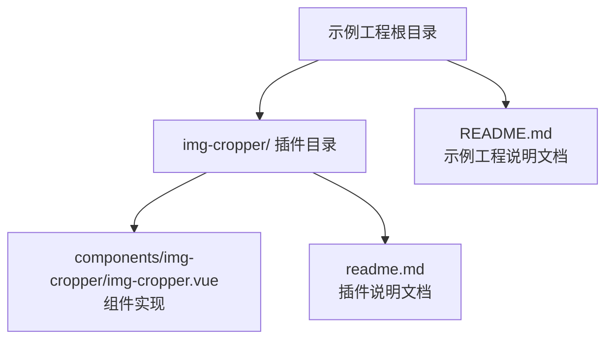
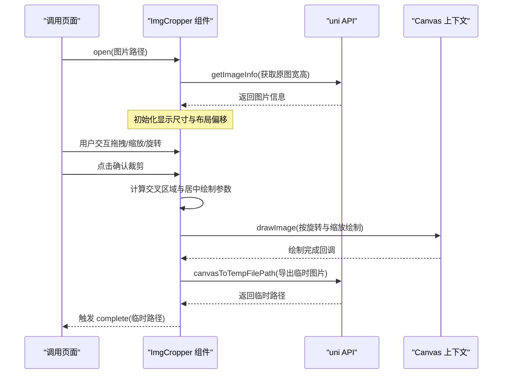
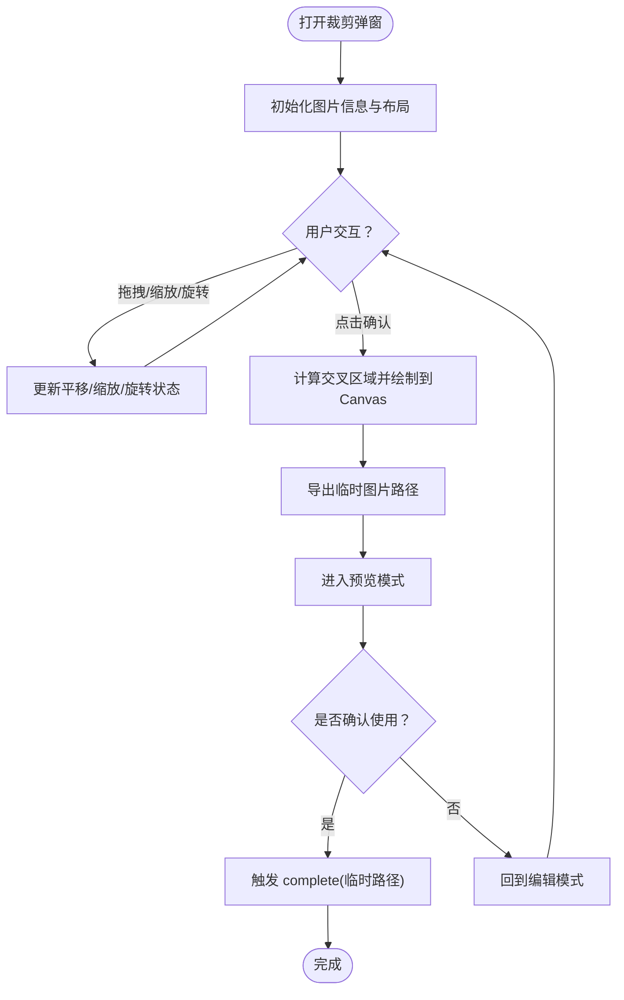
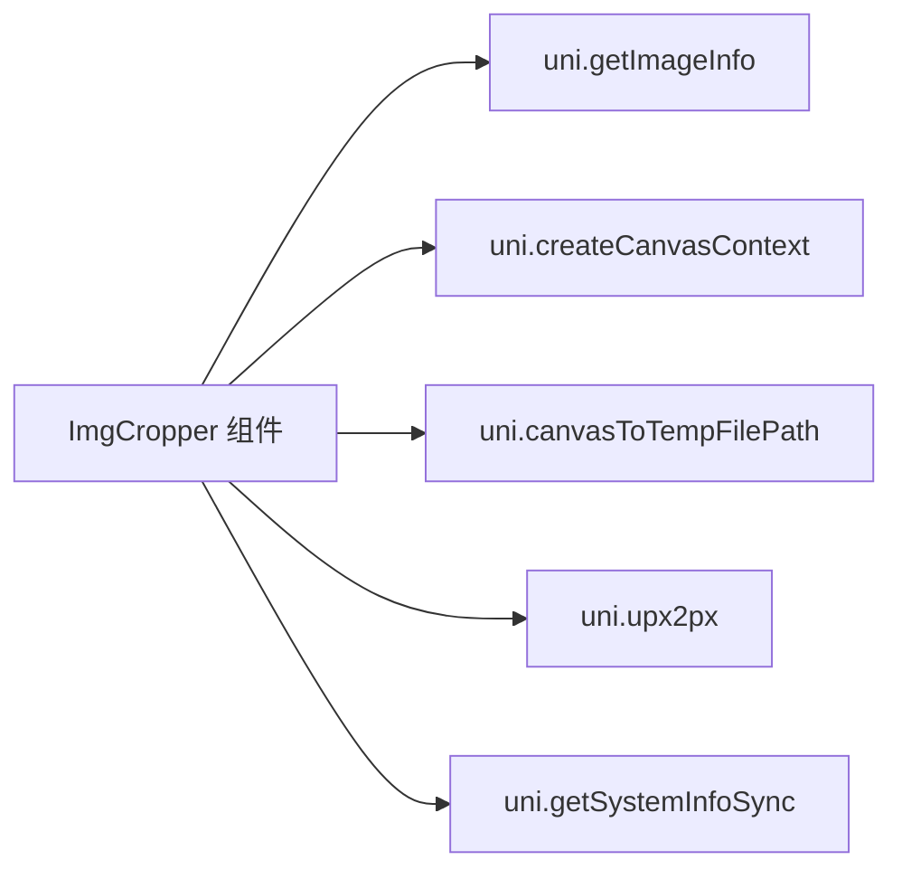

# 组件API参考

<cite>
**本文引用的文件**   
- [img-cropper.vue](file://uni_modules/img-cropper/components/img-cropper/img-cropper.vue)
- [img-cropper.vue（示例工程副本）](file://img-cropper/components/img-cropper/img-cropper.vue)
- [插件说明文档](file://img-cropper/readme.md)
- [示例工程说明文档](file://README.md)
</cite>

## 目录
1. [简介](#简介)
2. [项目结构](#项目结构)
3. [核心组件概览](#核心组件概览)
4. [架构总览](#架构总览)
5. [详细组件分析](#详细组件分析)
6. [依赖关系分析](#依赖关系分析)
7. [性能与兼容性注意事项](#性能与兼容性注意事项)
8. [故障排查指南](#故障排查指南)
9. [结论](#结论)
10. [附录：完整API速查表](#附录完整api速查表)

## 简介
本组件是一个面向 uni-app 的图片裁剪弹窗组件，支持 H5 与 APP（含 Android 10），具备单指拖拽、双指缩放、图片旋转、方形/圆形预览、可配置主题色与文案等能力。组件通过“帧-图交叉区域算法”保证预览与最终导出图片内容一致，并通过 Canvas 输出指定尺寸、格式与质量的图片临时路径。

## 项目结构
该仓库包含两个关键位置：
- 插件发布目录：`img-cropper/`，内含组件源码与插件说明文档。
- 示例工程根目录：提供页面集成示例与使用说明。

图表来源
- [img-cropper.vue](file://uni_modules/img-cropper/components/img-cropper/img-cropper.vue)
- [img-cropper.vue（示例工程副本）](file://img-cropper/components/img-cropper/img-cropper.vue)
- [插件说明文档](file://img-cropper/readme.md)
- [示例工程说明文档](file://README.md)

章节来源
- [示例工程说明文档:50-77](file://README.md#L50-L77)
- [插件说明文档:15-30](file://img-cropper/readme.md#L15-L30)

## 核心组件概览
- 组件名称：ImgCropper
- 暴露方法：open(src)、close()
- 事件：complete(tempFilePath)、cancel、error({ type, detail })
- 主要能力：打开裁剪弹窗、拖拽移动、双指缩放、旋转、预览、Canvas 导出临时图片路径

章节来源
- [img-cropper.vue:116-144](file://uni_modules/img-cropper/components/img-cropper/img-cropper.vue#L116-L144)
- [img-cropper.vue:201-235](file://uni_modules/img-cropper/components/img-cropper/img-cropper.vue#L201-L235)
- [img-cropper.vue:440-451](file://uni_modules/img-cropper/components/img-cropper/img-cropper.vue#L440-L451)

## 架构总览
组件内部由模板层、交互逻辑层、裁剪计算层与导出层组成：
- 模板层：渲染遮罩弹窗、裁剪区、预览区、工具栏与按钮。
- 交互逻辑层：处理触摸开始/移动/结束，控制平移、缩放与旋转状态。
- 裁剪计算层：基于屏幕坐标计算裁剪框与图片的交叉区域，映射到原图坐标并居中绘制到 Canvas。
- 导出层：将 Canvas 内容导出为临时图片路径，触发 complete 或 error 事件。

图表来源
- [img-cropper.vue:201-235](file://uni_modules/img-cropper/components/img-cropper/img-cropper.vue#L201-L235)
- [img-cropper.vue:311-348](file://uni_modules/img-cropper/components/img-cropper/img-cropper.vue#L311-L348)
- [img-cropper.vue:361-436](file://uni_modules/img-cropper/components/img-cropper/img-cropper.vue#L361-L436)

## 详细组件分析

### Props 属性文档
以下为组件对外暴露的 13 个 Props，包含类型、默认值、详细说明与使用建议。

| 属性名 | 类型 | 默认值 | 说明 | 使用建议 |
|---|---:|---:|---|---|
| outputWidth | Number | 800 | 输出图片宽度，单位 px | 根据上传接口要求设置，头像常用 800×800 |
| outputHeight | Number | 800 | 输出图片高度，单位 px | 与 width 保持一致可获得正方形输出 |
| frameSize | Number | 560 | 裁剪框尺寸，单位 rpx | 影响视觉裁剪框大小，需与预览尺寸匹配 |
| outputShape | String | 'square' | 裁剪框形状：square 或 circle | 头像场景推荐 circle |
| quality | Number | 0.9 | 图片输出质量，范围 0~1 | 平衡清晰度与体积，jpg 下更明显 |
| fileType | String | 'jpg' | 输出格式：jpg 或 png | 需要透明背景时选 png |
| themeColor | String | '#07c160' | 确认按钮主题色 | 与产品主色调保持一致 |
| frameColor | String | '#ffffff' | 裁剪框边框颜色 | 深色背景建议使用浅色边框 |
| title | String | '裁剪图片' | 弹窗标题文案 | 根据业务场景自定义 |
| cancelText | String | '取消' | 取消按钮文案 | 保持简洁明确 |
| resetText | String | '重置' | 重置按钮文案 | 会同时重置缩放、位移和旋转 |
| reEditText | String | '重新裁剪' | 预览态重新裁剪按钮文案 | 提示用户可再次调整 |
| cropText | String | '确认' | 确认裁剪按钮文案 | 引导用户完成裁剪 |
| confirmText | String | '确认使用' | 预览态确认使用按钮文案 | 提示用户确认结果 |

使用示例（以代码片段路径代替具体代码）：
- 在页面中引入组件并传入上述属性，参考：[示例工程说明文档:103-114](file://README.md#L103-L114)

最佳实践：
- 头像场景：outputWidth=outputHeight=800，outputShape='circle'，quality=0.9，fileType='jpg'。
- 若需要透明背景（如 PNG 水印叠加），设置 fileType='png'，quality 可适当提高。
- 主题色与文案应与整体 UI 风格统一，提升一致性体验。

章节来源
- [img-cropper.vue:118-143](file://uni_modules/img-cropper/components/img-cropper/img-cropper.vue#L118-L143)
- [插件说明文档:75-92](file://img-cropper/readme.md#L75-L92)
- [示例工程说明文档:179-194](file://README.md#L179-L194)

### Events 事件文档
组件通过事件向父组件传递操作结果与错误信息。

- complete(tempFilePath: string)
  - 触发时机：裁剪成功并进入预览后，点击“确认使用”时触发。
  - 参数：临时图片路径字符串。
  - 处理方式：接收路径后可直接用于上传或展示。
  - 参考：[img-cropper.vue:256-262](file://uni_modules/img-cropper/components/img-cropper/img-cropper.vue#L256-L262)

- cancel
  - 触发时机：用户点击“取消”按钮时触发。
  - 参数：无。
  - 处理方式：关闭弹窗或执行取消流程。
  - 参考：[img-cropper.vue:237-240](file://uni_modules/img-cropper/components/img-cropper/img-cropper.vue#L237-L240)

- error(detail: { type: string; detail: any })
  - 触发时机：获取图片信息失败或裁剪过程中出错。
  - 参数对象字段：
    - type：错误类型，可能值为 'getImageInfo' 或 'crop'。
    - detail：具体错误对象或异常信息。
  - 处理方式：记录日志、提示用户或降级处理。
  - 参考：[img-cropper.vue:222-225](file://uni_modules/img-cropper/components/img-cropper/img-cropper.vue#L222-L225)，[img-cropper.vue:319-324](file://uni_modules/img-cropper/components/img-cropper/img-cropper.vue#L319-L324)

使用示例（以代码片段路径代替具体代码）：
- 监听 complete/cancel/error 事件，参考：[示例工程说明文档:111-114](file://README.md#L111-L114)

最佳实践：
- 对 error 事件进行统一捕获与提示，避免静默失败。
- 在 complete 回调中先校验 tempFilePath 再发起上传，防止空路径导致请求失败。

章节来源
- [img-cropper.vue:144-144](file://uni_modules/img-cropper/components/img-cropper/img-cropper.vue#L144-L144)
- [img-cropper.vue:222-225](file://uni_modules/img-cropper/components/img-cropper/img-cropper.vue#L222-L225)
- [img-cropper.vue:256-262](file://uni_modules/img-cropper/components/img-cropper/img-cropper.vue#L256-L262)
- [img-cropper.vue:319-324](file://uni_modules/img-cropper/components/img-cropper/img-cropper.vue#L319-L324)
- [插件说明文档:94-100](file://img-cropper/readme.md#L94-L100)
- [示例工程说明文档:196-202](file://README.md#L196-L202)

### Methods 方法文档
组件通过 ref 暴露以下公共方法：

- open(src: string)
  - 调用方式：ref.value.open(图片路径)
  - 参数：src 为本地或临时图片路径。
  - 行为：
    - 设置图片源并重置裁剪状态。
    - 异步获取图片信息，初始化显示尺寸与布局偏移。
    - 显示弹窗。
  - 使用场景：选择图片后打开裁剪弹窗。
  - 参考：[img-cropper.vue:201-229](file://uni_modules/img-cropper/components/img-cropper/img-cropper.vue#L201-L229)

- close()
  - 调用方式：ref.value.close()
  - 参数：无。
  - 行为：隐藏弹窗并清理预览状态。
  - 使用场景：主动关闭弹窗或取消流程。
  - 参考：[img-cropper.vue:231-235](file://uni_modules/img-cropper/components/img-cropper/img-cropper.vue#L231-L235)

使用示例（以代码片段路径代替具体代码）：
- 打开裁剪弹窗：[示例工程说明文档:124-133](file://README.md#L124-L133)
- 暴露方法与事件绑定：[插件说明文档:39-43](file://img-cropper/readme.md#L39-L43)

最佳实践：
- 在 open 前确保 src 有效且可访问。
- 在 close 后如需复用组件，应等待下一次 open 调用，避免状态残留。

章节来源
- [img-cropper.vue:201-235](file://uni_modules/img-cropper/components/img-cropper/img-cropper.vue#L201-L235)
- [img-cropper.vue:440-451](file://uni_modules/img-cropper/components/img-cropper/img-cropper.vue#L440-L451)
- [插件说明文档:102-107](file://img-cropper/readme.md#L102-L107)
- [示例工程说明文档:204-209](file://README.md#L204-L209)

### 交互与裁剪流程图

图表来源
- [img-cropper.vue:264-310](file://uni_modules/img-cropper/components/img-cropper/img-cropper.vue#L264-L310)
- [img-cropper.vue:311-348](file://uni_modules/img-cropper/components/img-cropper/img-cropper.vue#L311-L348)
- [img-cropper.vue:361-436](file://uni_modules/img-cropper/components/img-cropper/img-cropper.vue#L361-L436)

## 依赖关系分析
组件依赖 uni-app 提供的系统 API 与 Canvas 能力：
- uni.getImageInfo：获取图片原始宽高，用于计算显示比例与居中偏移。
- uni.canvasToTempFilePath：将 Canvas 内容导出为临时图片路径。
- uni.createCanvasContext：创建 Canvas 上下文进行绘制。
- uni.upx2px / uni.getSystemInfoSync：rpx 转 px 与获取系统窗口尺寸。

图表来源
- [img-cropper.vue:212-227](file://uni_modules/img-cropper/components/img-cropper/img-cropper.vue#L212-L227)
- [img-cropper.vue:329-348](file://uni_modules/img-cropper/components/img-cropper/img-cropper.vue#L329-L348)
- [img-cropper.vue:380-381](file://uni_modules/img-cropper/components/img-cropper/img-cropper.vue#L380-L381)
- [img-cropper.vue:173-178](file://uni_modules/img-cropper/components/img-cropper/img-cropper.vue#L173-L178)

章节来源
- [img-cropper.vue:173-178](file://uni_modules/img-cropper/components/img-cropper/img-cropper.vue#L173-L178)
- [img-cropper.vue:212-227](file://uni_modules/img-cropper/components/img-cropper/img-cropper.vue#L212-L227)
- [img-cropper.vue:329-348](file://uni_modules/img-cropper/components/img-cropper/img-cropper.vue#L329-L348)
- [img-cropper.vue:380-381](file://uni_modules/img-cropper/components/img-cropper/img-cropper.vue#L380-L381)

## 性能与兼容性注意事项
- 输出尺寸与质量：
  - 较大的 outputWidth/outputHeight 与较高的 quality 会增加导出耗时与内存占用。
  - 建议在满足上传接口要求的前提下尽量降低不必要的尺寸与质量。
- 旋转与缩放：
  - 旋转与缩放会影响 Canvas 绘制复杂度，频繁操作时应避免重复导出。
- APP 端兼容：
  - 组件已针对 Android 10 WebView 进行适配，避免 transform:scale、inset、margin:auto 等不可靠样式。
  - 所有尺寸计算使用 Math.floor 取整，减少浮点像素不一致导致的偏移。
- 多实例隔离：
  - 每个实例生成唯一 canvasId，避免多实例冲突。

章节来源
- [img-cropper.vue:96-113](file://uni_modules/img-cropper/components/img-cropper/img-cropper.vue#L96-L113)
- [img-cropper.vue:147-147](file://uni_modules/img-cropper/components/img-cropper/img-cropper.vue#L147-L147)
- [img-cropper.vue:173-189](file://uni_modules/img-cropper/components/img-cropper/img-cropper.vue#L173-L189)
- [插件说明文档:142-150](file://img-cropper/readme.md#L142-L150)

## 故障排查指南
- 图片不显示：
  - 现象：打开弹窗后图片不可见。
  - 原因：初始 cropAreaHeight 未就绪导致布局计算异常。
  - 解决：组件已在 open 中立即设置初始值；检查图片路径是否有效。
  - 参考：[插件说明文档:154-158](file://img-cropper/readme.md#L154-L158)

- TypeScript 报错：
  - 现象：提示找不到 uni 或 vue 模块。
  - 原因：未安装类型声明。
  - 解决：不影响运行，可忽略；如需类型支持，安装 @dcloudio/types。
  - 参考：[插件说明文档:160-164](file://img-cropper/readme.md#L160-L164)

- 裁剪结果与预览不一致：
  - 现象：导出的图片与预览不同。
  - 原因：图片路径错误或输出尺寸不合理。
  - 解决：校验图片路径与输出尺寸；确认旋转角度与缩放状态正确。
  - 参考：[插件说明文档:166-171](file://img-cropper/readme.md#L166-L171)

- 事件未触发：
  - 现象：complete/cancel/error 未触发。
  - 原因：未在父组件正确绑定事件或未调用 open/close。
  - 解决：检查事件绑定与方法调用；查看控制台错误日志。
  - 参考：[示例工程说明文档:111-114](file://README.md#L111-L114)

章节来源
- [插件说明文档:154-171](file://img-cropper/readme.md#L154-L171)
- [示例工程说明文档:111-114](file://README.md#L111-L114)

## 结论
ImgCropper 组件提供了完整的图片裁剪能力，涵盖 Props 配置、事件通知与公共方法调用。通过帧-图交叉区域算法与 Canvas 旋转变换，确保预览与导出一致性。开发者可按需配置输出尺寸、质量、格式与主题，结合事件与方法构建流畅的头像裁剪流程。

## 附录：完整API速查表

### Props
- outputWidth：Number，默认 800，输出图片宽度（px）
- outputHeight：Number，默认 800，输出图片高度（px）
- frameSize：Number，默认 560，裁剪框尺寸（rpx）
- outputShape：String，默认 'square'，裁剪框形状 square/circle
- quality：Number，默认 0.9，图片输出质量 0~1
- fileType：String，默认 'jpg'，输出格式 jpg/png
- themeColor：String，默认 '#07c160'，确认按钮主题色
- frameColor：String，默认 '#ffffff'，裁剪框边框颜色
- title：String，默认 '裁剪图片'，弹窗标题
- cancelText：String，默认 '取消'，取消按钮文案
- resetText：String，默认 '重置'，重置按钮文案
- reEditText：String，默认 '重新裁剪'，重新裁剪按钮文案
- cropText：String，默认 '确认'，确认裁剪按钮文案
- confirmText：String，默认 '确认使用'，确认使用按钮文案

章节来源
- [img-cropper.vue:118-143](file://uni_modules/img-cropper/components/img-cropper/img-cropper.vue#L118-L143)
- [插件说明文档:75-92](file://img-cropper/readme.md#L75-L92)
- [示例工程说明文档:179-194](file://README.md#L179-L194)

### Events
- complete(tempFilePath: string)：裁剪完成，返回临时图片路径
- cancel：用户取消裁剪
- error({ type: string, detail: any })：裁剪出错，type 可为 'getImageInfo' 或 'crop'

章节来源
- [img-cropper.vue:144-144](file://uni_modules/img-cropper/components/img-cropper/img-cropper.vue#L144-L144)
- [img-cropper.vue:222-225](file://uni_modules/img-cropper/components/img-cropper/img-cropper.vue#L222-L225)
- [img-cropper.vue:256-262](file://uni_modules/img-cropper/components/img-cropper/img-cropper.vue#L256-L262)
- [img-cropper.vue:319-324](file://uni_modules/img-cropper/components/img-cropper/img-cropper.vue#L319-L324)
- [插件说明文档:94-100](file://img-cropper/readme.md#L94-L100)
- [示例工程说明文档:196-202](file://README.md#L196-L202)

### Methods
- open(src: string)：打开裁剪弹窗，传入图片路径
- close()：关闭裁剪弹窗

章节来源
- [img-cropper.vue:201-235](file://uni_modules/img-cropper/components/img-cropper/img-cropper.vue#L201-L235)
- [img-cropper.vue:440-451](file://uni_modules/img-cropper/components/img-cropper/img-cropper.vue#L440-L451)
- [插件说明文档:102-107](file://img-cropper/readme.md#L102-L107)
- [示例工程说明文档:204-209](file://README.md#L204-L209)