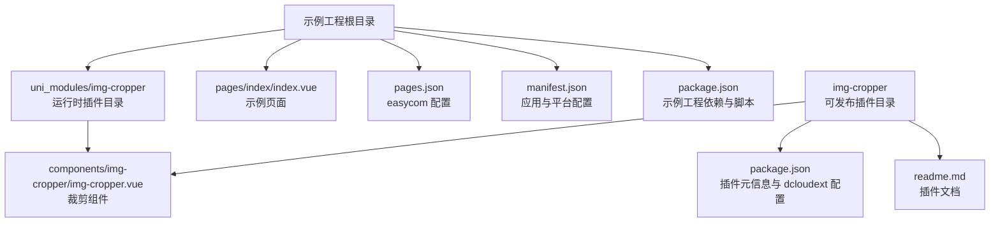
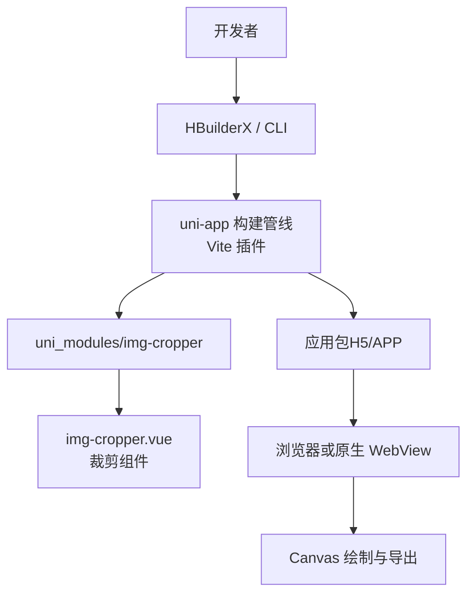
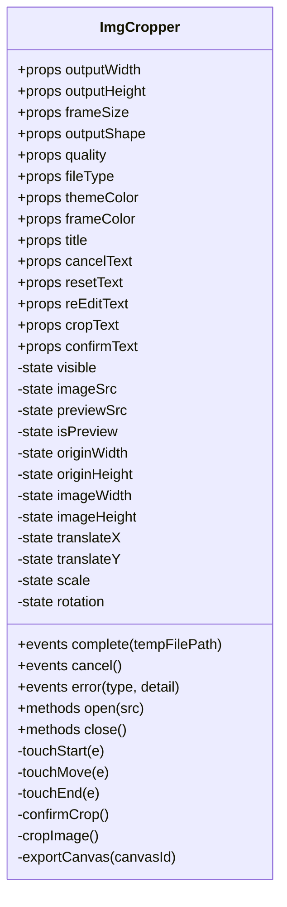
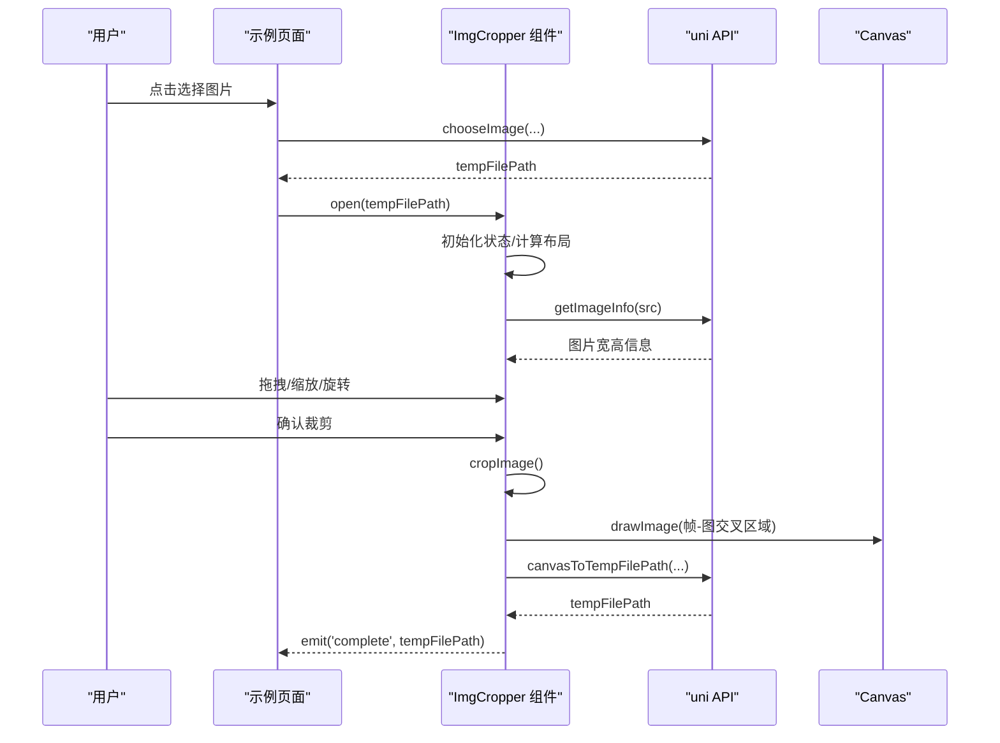
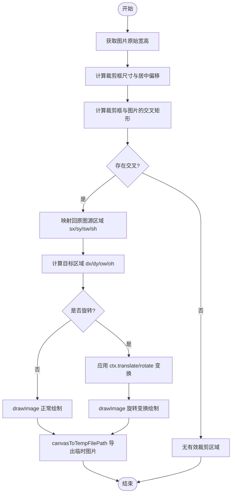
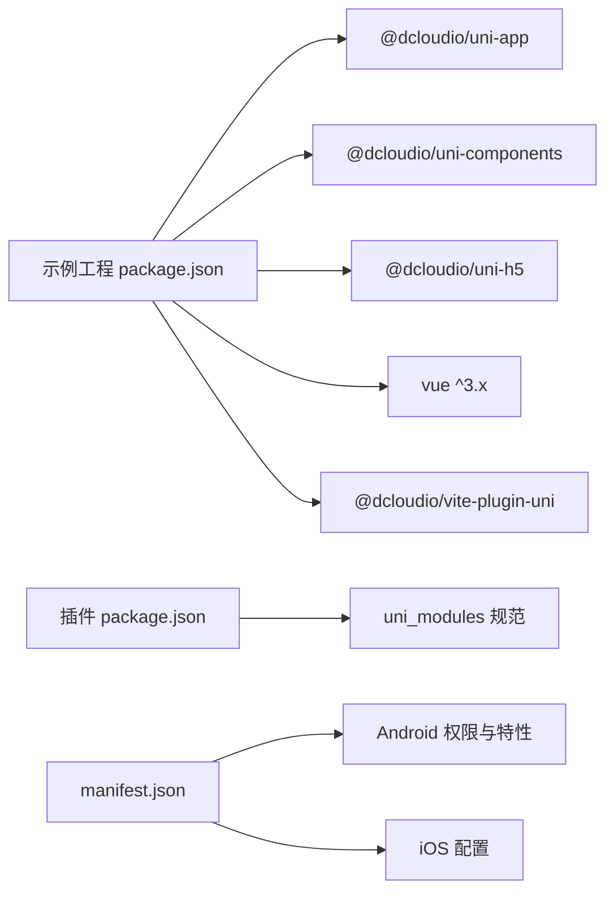
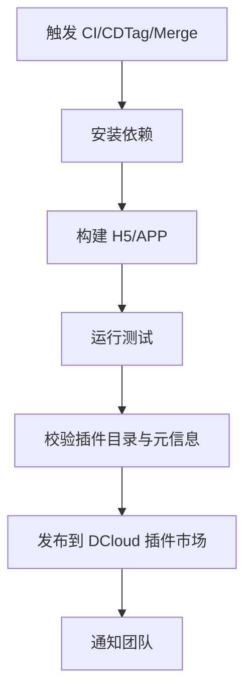

# 部署与发布指南

<cite>
**本文引用的文件**   
- [README.md](file://README.md)
- [package.json](file://package.json)
- [manifest.json](file://manifest.json)
- [pages.json](file://pages.json)
- [img-cropper.vue](file://uni_modules/img-cropper/components/img-cropper/img-cropper.vue)
- [插件 package.json](file://img-cropper/package.json)
- [插件 readme.md](file://img-cropper/readme.md)
</cite>

## 目录
1. [引言](#引言)
2. [项目结构](#项目结构)
3. [核心组件](#核心组件)
4. [架构总览](#架构总览)
5. [详细组件分析](#详细组件分析)
6. [依赖分析](#依赖分析)
7. [性能考虑](#性能考虑)
8. [故障排查指南](#故障排查指南)
9. [结论](#结论)
10. [附录：DCloud 插件市场发布流程与 CI/CD 自动化](#附录dcloud-插件市场发布流程与-cicd-自动化)

## 引言
本指南面向使用 uni-app 开发头像裁剪插件的团队，目标是建立标准化的部署与发布流程。内容覆盖：
- uni_modules 规范与 easycom 自动注册配置
- DCloud 插件市场的发布准备、打包与版本管理
- H5、Android APP、iOS APP 的差异化配置与注意事项
- 插件兼容性要求与升级策略
- CI/CD 自动化发布的参考方案

本项目包含一个示例工程与可独立发布的插件目录，既可用于本地演示，也可作为 DCloud 插件市场发布的产物。

## 项目结构
仓库采用“示例工程 + 插件目录”的双层组织方式：
- 根目录为示例应用，用于演示 img-cropper 的使用方式，并启用 easycom 自动注册
- uni_modules/img-cropper 为运行时使用的插件目录（与示例工程保持一致）
- img-cropper 为可独立发布的插件目录，包含插件元信息、文档和组件源码

图表来源
- [README.md:50-77](file://README.md#L50-L77)
- [pages.json:17-20](file://pages.json#L17-L20)
- [manifest.json:1-73](file://manifest.json#L1-L73)
- [package.json:1-22](file://package.json#L1-L22)
- [插件 package.json:1-68](file://img-cropper/package.json#L1-L68)
- [插件 readme.md:15-30](file://img-cropper/readme.md#L15-L30)

章节来源
- [README.md:50-77](file://README.md#L50-L77)
- [pages.json:1-22](file://pages.json#L1-L22)
- [manifest.json:1-73](file://manifest.json#L1-L73)
- [package.json:1-22](file://package.json#L1-L22)
- [插件 package.json:1-68](file://img-cropper/package.json#L1-L68)
- [插件 readme.md:15-30](file://img-cropper/readme.md#L15-L30)

## 核心组件
- 头像裁剪组件：提供图片选择、拖拽移动、双指缩放、旋转、预览与导出等功能，基于 Canvas 实现帧-图交叉区域算法，确保预览与输出一致
- 示例页面：演示如何调用组件 API，包括打开裁剪弹窗、监听完成/取消/错误事件
- 插件元数据：定义插件名称、ID、版本、分类、关键词、作者、许可证、仓库地址、引擎要求、DCloud 扩展字段与 uni_modules 依赖与平台支持声明

章节来源
- [img-cropper.vue:96-453](file://uni_modules/img-cropper/components/img-cropper/img-cropper.vue#L96-L453)
- [插件 package.json:1-68](file://img-cropper/package.json#L1-L68)

## 架构总览
下图展示示例工程与插件在构建与运行时的关系：示例工程通过 uni_modules 引入组件，并在 pages.json 中启用 easycom；构建时由 uni-app/Vite 插件处理；运行时根据目标平台（H5/APP）执行不同逻辑。

图表来源
- [package.json:1-22](file://package.json#L1-L22)
- [pages.json:17-20](file://pages.json#L17-L20)
- [img-cropper.vue:312-438](file://uni_modules/img-cropper/components/img-cropper/img-cropper.vue#L312-L438)

## 详细组件分析

### 组件类结构与职责
- 组件实例：负责状态管理、手势交互、Canvas 绘制与导出
- 暴露方法：open/close，供父组件控制弹窗显示与关闭
- 事件：complete/cancel/error，向父组件传递结果与异常信息

图表来源
- [img-cropper.vue:116-143](file://uni_modules/img-cropper/components/img-cropper/img-cropper.vue#L116-L143)
- [img-cropper.vue:145-453](file://uni_modules/img-cropper/components/img-cropper/img-cropper.vue#L145-L453)

章节来源
- [img-cropper.vue:96-453](file://uni_modules/img-cropper/components/img-cropper/img-cropper.vue#L96-L453)

### 裁剪流程时序
该时序展示了从用户触发到最终导出临时图片的关键步骤。

图表来源
- [img-cropper.vue:202-229](file://uni_modules/img-cropper/components/img-cropper/img-cropper.vue#L202-L229)
- [img-cropper.vue:312-438](file://uni_modules/img-cropper/components/img-cropper/img-cropper.vue#L312-L438)
- [img-cropper.vue:328-350](file://uni_modules/img-cropper/components/img-cropper/img-cropper.vue#L328-L350)

章节来源
- [img-cropper.vue:202-438](file://uni_modules/img-cropper/components/img-cropper/img-cropper.vue#L202-L438)

### 裁剪算法流程图
帧-图交叉区域算法决定源图像区域与目标画布位置，确保预览与输出一致。

图表来源
- [img-cropper.vue:352-438](file://uni_modules/img-cropper/components/img-cropper/img-cropper.vue#L352-L438)

章节来源
- [img-cropper.vue:352-438](file://uni_modules/img-cropper/components/img-cropper/img-cropper.vue#L352-L438)

## 依赖分析
- 示例工程依赖 uni-app 生态与 Vue 3，构建工具链基于 Vite 与 @dcloudio/vite-plugin-uni
- 插件本身零外部依赖，仅依赖 uni-app 提供的 Canvas 与系统 API
- manifest.json 定义了 Android/iOS 权限与模块配置，以及多端小程序开关

图表来源
- [package.json:1-22](file://package.json#L1-L22)
- [插件 package.json:1-68](file://img-cropper/package.json#L1-L68)
- [manifest.json:1-73](file://manifest.json#L1-L73)

章节来源
- [package.json:1-22](file://package.json#L1-L22)
- [插件 package.json:1-68](file://img-cropper/package.json#L1-L68)
- [manifest.json:1-73](file://manifest.json#L1-L73)

## 性能考虑
- 避免使用 transform:scale() 进行缩放，改用 CSS 宽高直接设置像素值，保证 APP 端布局盒与视觉尺寸一致
- 所有尺寸统一 Math.floor 取整，减少浮点像素取整方向不一致导致的偏移
- 使用帧-图交叉区域算法与 Canvas 变换，确保预览与导出一致性，避免重复计算
- 导出前延迟调用 canvasToTempFilePath，降低并发绘制风险

章节来源
- [img-cropper.vue:96-113](file://uni_modules/img-cropper/components/img-cropper/img-cropper.vue#L96-L113)
- [img-cropper.vue:328-350](file://uni_modules/img-cropper/components/img-cropper/img-cropper.vue#L328-L350)

## 故障排查指南
- 图片不显示：检查 cropAreaHeight 初始值是否在 open 中立即设置，避免 computed 负数偏移
- TypeScript 报错：不影响运行，如需类型支持安装 @dcloudio/types
- 裁剪结果与预览不一致：核对图片路径与输出尺寸，确认帧-图交叉区域算法参数正确

章节来源
- [README.md:222-248](file://README.md#L222-L248)
- [插件 readme.md:152-171](file://img-cropper/readme.md#L152-L171)

## 结论
本项目以 uni_modules 规范组织插件代码，并通过 easycom 实现自动注册；示例工程演示了组件用法，插件目录满足 DCloud 插件市场发布要求。建议在团队内统一版本管理与发布流程，结合 CI/CD 自动化构建与发布，提升交付效率与质量。

## 附录：DCloud 插件市场发布流程与 CI/CD 自动化

### uni_modules 规范与 easycom 自动注册
- 目录结构要求
  - 组件必须位于 uni_modules/<plugin-name>/components/<component-name>/<component-name>.vue
  - 示例工程中已按此结构放置 img-cropper 组件
- easycom 配置
  - 在 pages.json 中开启 autoscan，custom 为空对象即可启用自动扫描
  - 无需手动 import 组件，直接使用标签名引用

章节来源
- [README.md:153-173](file://README.md#L153-L173)
- [pages.json:17-20](file://pages.json#L17-L20)
- [插件 readme.md:15-30](file://img-cropper/readme.md#L15-L30)

### 插件打包与版本管理
- 插件目录
  - img-cropper 目录即为可发布插件，包含 components、pages/demo、package.json、readme.md
- 版本管理
  - 插件 package.json 中的 version 字段需与更新日志保持一致
  - 示例工程与插件建议同步版本号，便于追踪
- 依赖声明
  - 插件 package.json 的 uni_modules.dependencies 为空数组，表示零外部依赖
  - 若未来引入第三方库，需在 dependencies 中声明并维护兼容范围

章节来源
- [插件 package.json:1-68](file://img-cropper/package.json#L1-L68)
- [插件 readme.md:15-30](file://img-cropper/readme.md#L15-L30)

### DCloud 插件市场发布流程（步骤说明）
- 准备工作
  - 完善插件 package.json：name、id、version、description、displayName、main、keywords、author、license、repository、engines、dcloudext、uni_modules
  - 完善插件 readme.md：安装说明、API、支持平台、常见问题、更新日志
- 打包与校验
  - 在 HBuilderX 中打开插件目录，执行“发行 → 插件市场”
  - 校验插件目录结构是否符合 uni_modules 规范
  - 检查 dcloudext 分类、售价、源代码价格等字段
- 提交与审核
  - 填写插件标题、简介、截图、演示视频（可选）
  - 提交后等待平台审核，根据反馈修改
- 发布与维护
  - 审核通过后发布新版本
  - 保持更新日志与版本号同步，记录破坏性变更与兼容性说明

章节来源
- [插件 package.json:1-68](file://img-cropper/package.json#L1-L68)
- [插件 readme.md:1-191](file://img-cropper/readme.md#L1-L191)

### 不同平台的部署注意事项

#### H5 端
- 构建命令
  - 示例工程 scripts 中提供 dev:h5 与 build:h5
- 注意事项
  - 确保 vite.config.js 与 @dcloudio/vite-plugin-uni 配置正确
  - 注意跨域与静态资源路径问题

章节来源
- [package.json:5-8](file://package.json#L5-L8)

#### Android APP
- 权限与特性
  - manifest.json 中 app-plus.android.permissions 已声明相机、网络、存储等权限
  - 包含 camera 硬件特性与 autofocus 支持
- 注意事项
  - 确保 Android 10+ 的 WebView 行为与 Canvas 兼容性
  - 如需要相册访问，确保权限申请与用户授权流程完整

章节来源
- [manifest.json:24-41](file://manifest.json#L24-L41)
- [img-cropper.vue:96-113](file://uni_modules/img-cropper/components/img-cropper/img-cropper.vue#L96-L113)

#### iOS APP
- 配置
  - manifest.json 中 app-plus.ios 为空对象，可按需添加权限与配置
- 注意事项
  - 相册与相机权限需在 Info.plist 中声明
  - 注意 iOS WebView 的 Canvas 与图片处理差异

章节来源
- [manifest.json:43-46](file://manifest.json#L43-L46)

### 插件的版本兼容性要求与升级策略
- 兼容性
  - 插件 package.json 的 engines.HBuilderX 要求 ^3.0.0
  - uni_modules.platforms.client.App.app-vue 标记为 y，app-nvue 标记为 n
  - H5 pc/mobile 均支持；小程序端标记为 u（待验证）
- 升级策略
  - 遵循语义化版本：主版本（破坏性变更）、次版本（新增功能）、修订版本（修复问题）
  - 在更新日志中明确标注破坏性变更与迁移指引
  - 对旧版本用户提供渐进式升级路径，必要时保留兼容层

章节来源
- [插件 package.json:25-65](file://img-cropper/package.json#L25-L65)
- [插件 readme.md:176-191](file://img-cropper/readme.md#L176-L191)

### CI/CD 自动化发布配置示例（概念性流程）
以下流程为概念性说明，帮助团队建立标准化发布流水线：
- 触发条件
  - 推送 tag（如 v1.1.0）或合并至 main 分支
- 构建阶段
  - 安装依赖（npm ci）
  - 构建 H5 与 APP 产物（npm run build:h5）
  - 校验插件目录结构与 package.json 字段
- 测试阶段
  - 运行单元测试与 E2E 测试（如有）
  - 生成覆盖率报告
- 发布阶段
  - 登录 DCloud 插件市场 CLI（需提前配置 token）
  - 上传插件包并发布指定版本
  - 通知团队（邮件/钉钉/企业微信）

[本图为概念性流程，不直接对应具体源码文件]