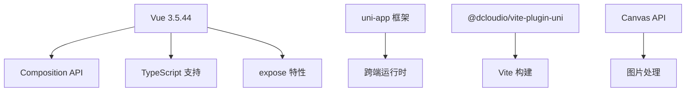
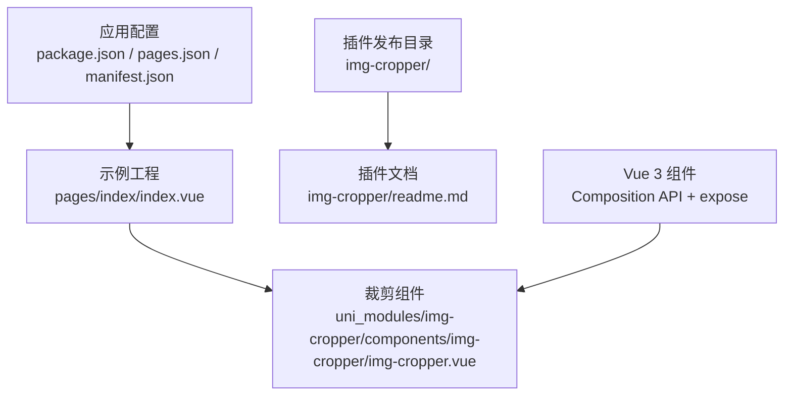
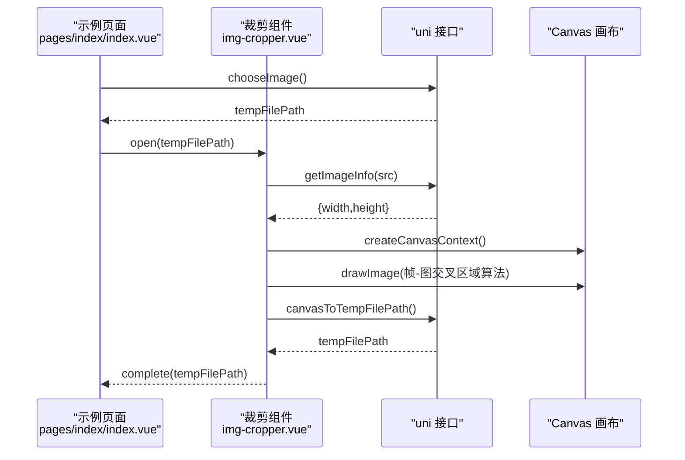
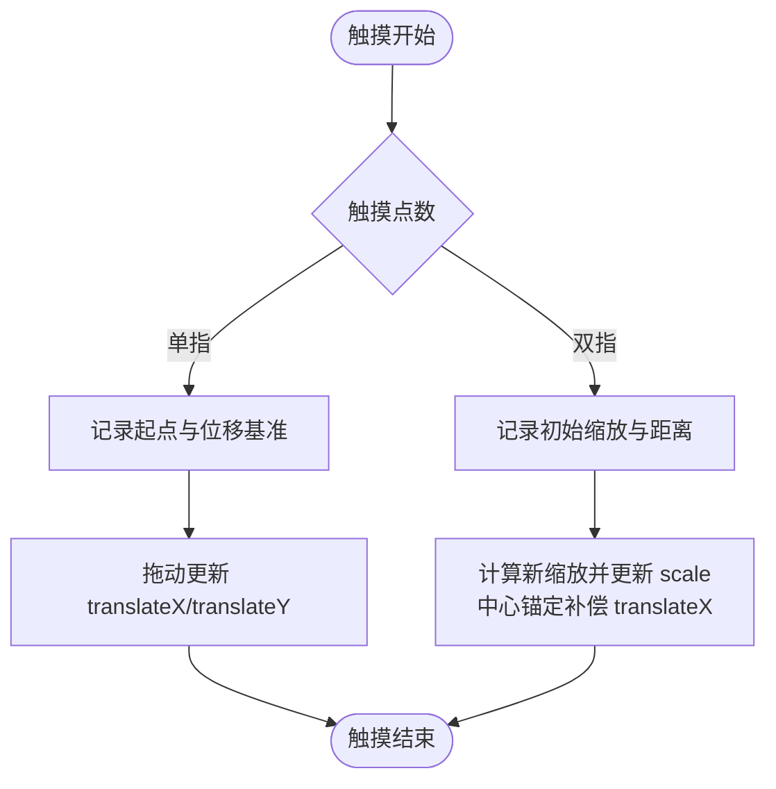
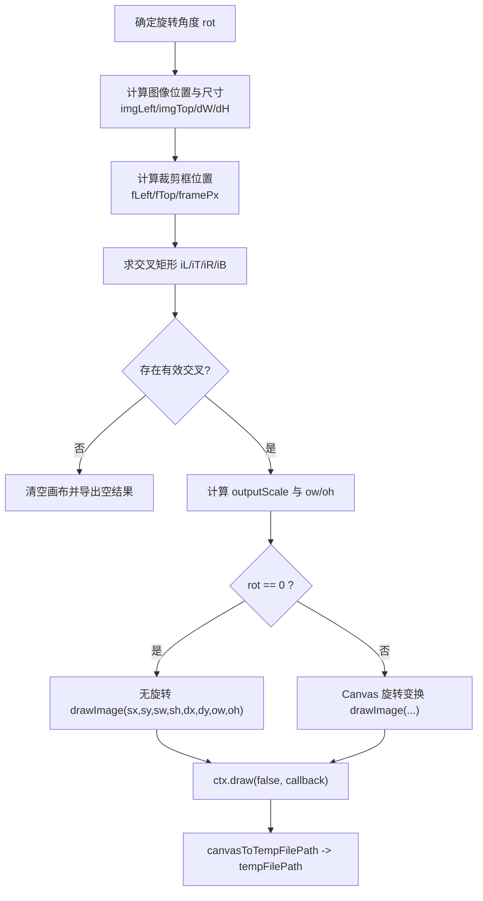
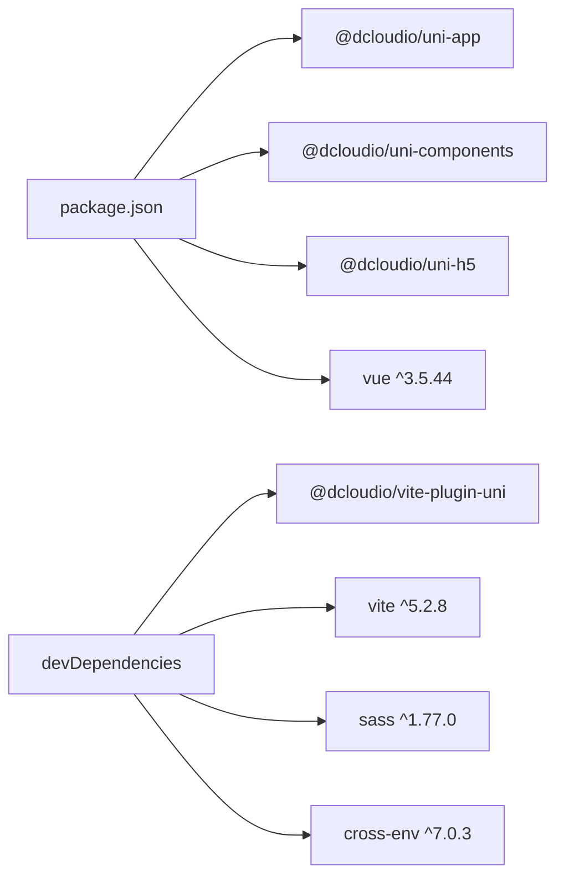

# 项目概述

<cite>
**本文引用的文件**   
- [README.md](file://README.md)
- [img-cropper/readme.md](file://img-cropper/readme.md)
- [uni_modules/img-cropper/components/img-cropper/img-cropper.vue](file://uni_modules/img-cropper/components/img-cropper/img-cropper.vue)
- [pages/index/index.vue](file://pages/index/index.vue)
- [package.json](file://package.json)
</cite>

## 更新摘要
**所做更改**   
- 更新了技术栈说明，明确强调这是纯 Vue 3 实现
- 添加了关于 Composition API 和 expose 特性的详细说明
- 增加了 Vue 2 兼容性警告和迁移指南
- 更新了架构说明以反映现代 Vue 3 开发模式

## 目录
1. [简介](#简介)
2. [技术架构与版本要求](#技术架构与版本要求)
3. [项目结构](#项目结构)
4. [核心组件与能力](#核心组件与能力)
5. [架构总览](#架构总览)
6. [详细组件分析](#详细组件分析)
7. [依赖关系分析](#依赖关系分析)
8. [性能与兼容性要点](#性能与兼容性要点)
9. [常见问题与排错](#常见问题与排错)
10. [结论](#结论)

## 简介
本项目是基于 uni-app（Vue 3）的头像裁剪插件示例工程，演示如何快速集成和使用 img-cropper 图片裁剪组件。**重要提示：这是一个纯 Vue 3 实现，使用 Composition API 和 expose 特性，不兼容 Vue 2 项目。**

该组件面向需要"头像裁剪"能力的业务场景，提供圆形/方形裁剪、单指拖拽、双指缩放、图片旋转、裁剪预览等能力，并支持 H5 与 APP（含 Android 10）。

核心价值：
- **纯 Vue 3 现代化实现**：采用 Composition API 和 setup 函数，提供更好的类型支持和逻辑复用
- **零依赖、开箱即用**：自带弹窗与交互，无需引入第三方 UI 库
- **精准裁剪**：采用帧-图交叉区域算法，确保预览与生成图片完全一致
- **跨端兼容**：H5 + APP（Android/iOS）均已验证，适配常见平台差异
- **可配置化**：裁剪框尺寸、输出尺寸、主题色、输出形状、按钮文案等均可自定义

目标用户群体：
- 使用 uni-app Vue 3 开发多端应用的开发者
- 需要在 H5 或 APP 中实现头像上传与裁剪的业务方
- 希望以轻量、可控的方式集成图片裁剪能力的团队

与其他图片处理库的区别：
- 更聚焦于"头像裁剪"这一高频场景，内置弹窗与交互流程，减少二次封装成本
- 针对 APP 端 WebView 的差异做了大量兼容处理（如禁用 transform:scale、统一 Math.floor 取整、显式定位替代 inset 等），降低踩坑概率
- 通过 Canvas 变换保证旋转后导出图片与预览一致，避免常见的"预览与结果不一致"问题

主要特性列表：
- 头像裁剪（圆形/方形）
- 单指拖拽移动图片
- 双指缩放调整大小
- 图片旋转（每次顺时针旋转 90°）
- 裁剪预览
- 零依赖开箱即用
- 支持 H5 和 APP（含 Android 10）

技术栈选择与优势：
- **uni-app + Vue 3**：一套代码多端运行，结合 easycom 自动注册组件，简化集成；同时借助 uni 提供的 getImageInfo、canvasToTempFilePath 等 API，在 H5/APP 上获得一致的图像处理体验
- **Composition API**：提供更好的逻辑组织、类型推导和复用能力
- **expose 特性**：精确控制组件暴露的方法，提高安全性和可维护性
- 构建工具链：基于 Vite 与 @dcloudio/vite-plugin-uni，提升开发与构建效率

**⚠️ 重要版本要求**
- **必须使用 Vue 3.5.44+**
- **不支持 Vue 2 项目**
- 如需在 Vue 2 项目中使用，请参考下方的迁移指南

章节来源
- [README.md:9-23](file://README.md#L9-L23)
- [package.json:9-19](file://package.json#L9-L19)

## 技术架构与版本要求

### 核心技术栈
本项目采用现代化的 Vue 3 技术栈，具有以下特点：



**图表来源**
- [package.json:9-19](file://package.json#L9-L19)
- [uni_modules/img-cropper/components/img-cropper/img-cropper.vue:114-145](file://uni_modules/img-cropper/components/img-cropper/img-cropper.vue#L114-L145)

### Vue 3 专属特性使用

#### Composition API 模式
组件完全采用 Composition API 编写，使用 `setup()` 函数组织逻辑：

```javascript
// 组件入口
setup(props, { emit, expose }) {
  // 响应式状态
  const visible = ref(false);
  const imageSrc = ref('');
  
  // 计算属性
  const framePx = computed(() => Math.floor(uni.upx2px(props.frameSize)));
  
  // 方法定义
  const open = (src) => { /* ... */ };
  const close = () => { /* ... */ };
  
  // 暴露方法
  expose({ open, close });
  
  return {};
}
```

#### expose 特性
组件使用 `expose()` 精确控制对外暴露的方法，只暴露必要的 `open` 和 `close` 方法，隐藏内部实现细节。

#### 模板语法
组件模板使用 Vue 3 的标准语法，包括：
- `v-if` / `v-show` 条件渲染
- `@click` / `@touchstart` 事件处理
- `:style` 动态样式绑定
- `:class` 动态类名绑定

**章节来源**
- [uni_modules/img-cropper/components/img-cropper/img-cropper.vue:145-452](file://uni_modules/img-cropper/components/img-cropper/img-cropper.vue#L145-L452)

### Vue 2 兼容性说明

**❌ 不兼容 Vue 2 项目**

由于以下原因，本组件无法在 Vue 2 项目中直接使用：

1. **Composition API 依赖**：组件完全基于 Vue 3 的 Composition API 编写
2. **expose 特性**：使用了 Vue 3 新增的 `expose` API
3. **ref/computed 导入方式**：直接从 'vue' 包导入响应式 API
4. **defineComponent 用法**：使用 Vue 3 的组件定义方式

**迁移指南**

如果您的项目仍在使用 Vue 2，有以下解决方案：

1. **升级到 Vue 3**（推荐）
   - 升级 uni-app 到支持 Vue 3 的版本
   - 重构现有组件为 Composition API 模式
   - 利用 Vue 3 的性能优势和更好的 TypeScript 支持

2. **寻找 Vue 2 兼容版本**
   - 检查是否有历史版本的 Vue 2 兼容实现
   - 考虑使用其他 Vue 2 兼容的图片裁剪库

3. **自行适配**
   - 将组件重写为 Options API 模式
   - 移除对 `expose` 特性的依赖
   - 适配 Vue 2 的响应式系统

**章节来源**
- [uni_modules/img-cropper/components/img-cropper/img-cropper.vue:114-145](file://uni_modules/img-cropper/components/img-cropper/img-cropper.vue#L114-L145)

## 项目结构
项目采用"示例工程 + 插件目录"的双层组织方式：
- 根目录为示例工程，包含页面入口、应用配置与示例页
- img-cropper 目录为插件发布目录，可独立发布到 DCloud 插件市场
- uni_modules 下放置 img-cropper 组件，配合 easycom 自动注册，便于在任意页面直接使用



**图表来源**
- [pages/index/index.vue:24-35](file://pages/index/index.vue#L24-L35)
- [uni_modules/img-cropper/components/img-cropper/img-cropper.vue:1-94](file://uni_modules/img-cropper/components/img-cropper/img-cropper.vue#L1-L94)
- [img-cropper/readme.md:15-30](file://img-cropper/readme.md#L15-L30)

**章节来源**
- [README.md:50-77](file://README.md#L50-L77)

## 核心组件与能力
- **组件名称**：img-cropper
- **组件职责**：提供全屏遮罩弹窗，承载图片展示、裁剪框、工具栏、预览区与 Canvas 隐藏画布，完成从选择图片到裁剪预览的全流程
- **关键能力**：
  - **手势交互**：单指拖拽、双指缩放，中心锚定缩放，最小宽度等于裁剪框宽度
  - **图片旋转**：CSS 预览旋转 + Canvas 旋转变换导出，保证预览与导出一致
  - **精准裁剪**：帧-图交叉区域算法，计算源矩形与目标矩形，居中绘制
  - **预览模式**：裁剪完成后进入预览，支持重新编辑与确认使用
  - **可配置项**：输出宽高、裁剪框尺寸、输出形状、质量、格式、主题色、边框颜色、标题与按钮文案等

**章节来源**
- [uni_modules/img-cropper/components/img-cropper/img-cropper.vue:96-144](file://uni_modules/img-cropper/components/img-cropper/img-cropper.vue#L96-L144)
- [img-cropper/readme.md:5-13](file://img-cropper/readme.md#L5-L13)

## 架构总览
整体由"示例页面"调用"裁剪组件"，组件内部通过 uni.getImageInfo 获取图片信息，使用 uni.createCanvasContext 进行绘制，并通过 uni.canvasToTempFilePath 导出临时图片路径。



**图表来源**
- [pages/index/index.vue:45-54](file://pages/index/index.vue#L45-L54)
- [uni_modules/img-cropper/components/img-cropper/img-cropper.vue:202-229](file://uni_modules/img-cropper/components/img-cropper/img-cropper.vue#L202-L229)
- [uni_modules/img-cropper/components/img-cropper/img-cropper.vue:363-437](file://uni_modules/img-cropper/components/img-cropper/img-cropper.vue#L363-L437)
- [uni_modules/img-cropper/components/img-cropper/img-cropper.vue:328-350](file://uni_modules/img-cropper/components/img-cropper/img-cropper.vue#L328-L350)

## 详细组件分析

### 组件结构与状态
- **模板结构**：
  - 遮罩层与弹窗容器
  - 标题栏（标题 + 取消）
  - 裁剪区域（图片 + 遮罩 + 裁剪框）
  - 预览区域（显示裁剪结果）
  - 工具栏（旋转按钮）
  - 底部操作区（重置/重新裁剪、确认）
  - 隐藏 Canvas（用于导出）
- **核心状态**：
  - visible、imageSrc、previewSrc、isPreview
  - originWidth、originHeight、imageWidth、imageHeight
  - translateX、translateY、scale、rotation
  - 触摸状态：touchStartX/Y、touchStartTranslateX/Y、touchStartScale、touchStartDistance、isMultiTouch
  - 布局计算：framePx、cropAreaWidth、centerOffsetX、cropAreaHeight、frameTopPx、displayedH、centerOffsetY、maskStyle

**章节来源**
- [uni_modules/img-cropper/components/img-cropper/img-cropper.vue:1-94](file://uni_modules/img-cropper/components/img-cropper/img-cropper.vue#L1-L94)
- [uni_modules/img-cropper/components/img-cropper/img-cropper.vue:145-200](file://uni_modules/img-cropper/components/img-cropper/img-cropper.vue#L145-L200)

### 交互与手势处理
- **单指拖拽**：记录起始坐标与位移基准，实时更新 translateX/translateY
- **双指缩放**：计算两指距离变化，按中心锚定更新 scale，并对 translateX 做半宽补偿以保持视觉中心不变
- **抬起手指优化**：双指缩放后先抬起一根手指时，重设单指拖拽基准，避免跳变



**图表来源**
- [uni_modules/img-cropper/components/img-cropper/img-cropper.vue:264-310](file://uni_modules/img-cropper/components/img-cropper/img-cropper.vue#L264-L310)

**章节来源**
- [uni_modules/img-cropper/components/img-cropper/img-cropper.vue:264-310](file://uni_modules/img-cropper/components/img-cropper/img-cropper.vue#L264-L310)

### 裁剪算法与导出流程
- **帧-图交叉区域算法**：
  - 计算裁剪框与图片在屏幕坐标系下的交叉矩形
  - 源矩形：将交叉区域映射回原图坐标（sx/sy/sw/sh）
  - 目标矩形：将交叉区域在输出画布中居中放置（dx/dy）
- **旋转处理**：
  - 预览：CSS transform: rotate() 实时旋转显示
  - 导出：Canvas ctx.rotate()/ctx.translate() 变换，确保 90°/180°/270° 旋转后导出图片与预览一致
- **导出**：
  - 使用 uni.canvasToTempFilePath 将 Canvas 内容导出为临时图片路径



**图表来源**
- [uni_modules/img-cropper/components/img-cropper/img-cropper.vue:363-437](file://uni_modules/img-cropper/components/img-cropper/img-cropper.vue#L363-L437)
- [img-cropper/readme.md:122-140](file://img-cropper/readme.md#L122-L140)

**章节来源**
- [uni_modules/img-cropper/components/img-cropper/img-cropper.vue:312-437](file://uni_modules/img-cropper/components/img-cropper/img-cropper.vue#L312-L437)
- [img-cropper/readme.md:122-140](file://img-cropper/readme.md#L122-L140)

### 示例页面集成
- 页面通过 uni.chooseImage 选择图片，调用 cropperRef.open 打开裁剪弹窗
- 监听 complete/cancel/error 事件，完成头像展示与错误处理
- 使用 Vue 3 Composition API 管理组件引用和状态

**章节来源**
- [pages/index/index.vue:45-70](file://pages/index/index.vue#L45-L70)

## 依赖关系分析
- **运行时依赖**：
  - @dcloudio/uni-app、@dcloudio/uni-components、@dcloudio/uni-h5：提供 uni-app 框架与组件生态
  - vue ^3.5.44：**Vue 3 框架，必需版本**
- **开发依赖**：
  - @dcloudio/vite-plugin-uni：Vite 插件，支持 uni-app 开发构建
  - vite、sass、cross-env：构建与样式预处理工具



**图表来源**
- [package.json:9-20](file://package.json#L9-L20)

**章节来源**
- [package.json:1-22](file://package.json#L1-L22)

## 性能与兼容性要点
- **性能优化**：
  - 所有尺寸统一使用 Math.floor 取整，避免浮点像素取整方向不一致导致的偏移
  - 不使用 transform:scale 控制缩放，而是直接设置 CSS 宽高为缩放后的像素值，确保 APP 端布局盒与视觉尺寸一致
  - 使用帧-图交叉区域算法，减少不必要的绘制区域，提高导出效率
- **兼容性处理（APP 端）**：
  - 禁用 transform:scale（Android 10 WebView 不可靠）
  - 禁用 CSS inset:0，改用显式 top/right/bottom/left
  - 禁用 margin:auto 居中，改为 JS 计算居中偏移
  - setup 阶段捕获 instance，避免事件处理器中 getCurrentInstance() 返回 null

**章节来源**
- [uni_modules/img-cropper/components/img-cropper/img-cropper.vue:96-113](file://uni_modules/img-cropper/components/img-cropper/img-cropper.vue#L96-L113)
- [img-cropper/readme.md:142-151](file://img-cropper/readme.md#L142-L151)

## 常见问题与排错
- **图片不显示**：
  - 原因：cropAreaHeight 在异步回调中赋值，导致 computed 计算出负数偏移
  - 解决：已在 open() 中立即设置初始值
- **TypeScript 报错**：
  - 提示找不到 uni 或 vue 模块，不影响运行，可忽略；如需类型支持，安装 @dcloudio/types
- **裁剪结果与预览不一致**：
  - 组件已采用帧-图交叉区域算法确保一致；若仍出现不一致，检查图片路径与输出尺寸是否合理
- **Vue 2 项目无法使用**：
  - 原因：组件使用 Vue 3 的 Composition API 和 expose 特性
  - 解决：升级到 Vue 3 或使用 Vue 2 兼容的替代方案

**章节来源**
- [README.md:222-245](file://README.md#L222-L245)
- [img-cropper/readme.md:152-170](file://img-cropper/readme.md#L152-L170)

## 结论
img-cropper 是一个面向 uni-app Vue 3 项目的现代化头像裁剪组件，具备纯 Vue 3 实现、Composition API 支持、expose 特性、零依赖、跨端兼容、精准裁剪与可配置化等优势。其核心在于对 APP 端差异的细致兼容与帧-图交叉区域算法的稳定实现，使预览与导出保持一致，降低集成与调试成本。

**重要提醒**：该组件仅支持 Vue 3 项目，对于仍在使用 Vue 2 的团队，建议升级到 Vue 3 以获得更好的性能和开发体验，或者寻找 Vue 2 兼容的替代方案。对于需要在 H5 与 APP 端快速落地头像裁剪能力的团队而言，该组件提供了现代化、高性能的开箱即用的解决方案，并与 uni-app 生态无缝衔接。